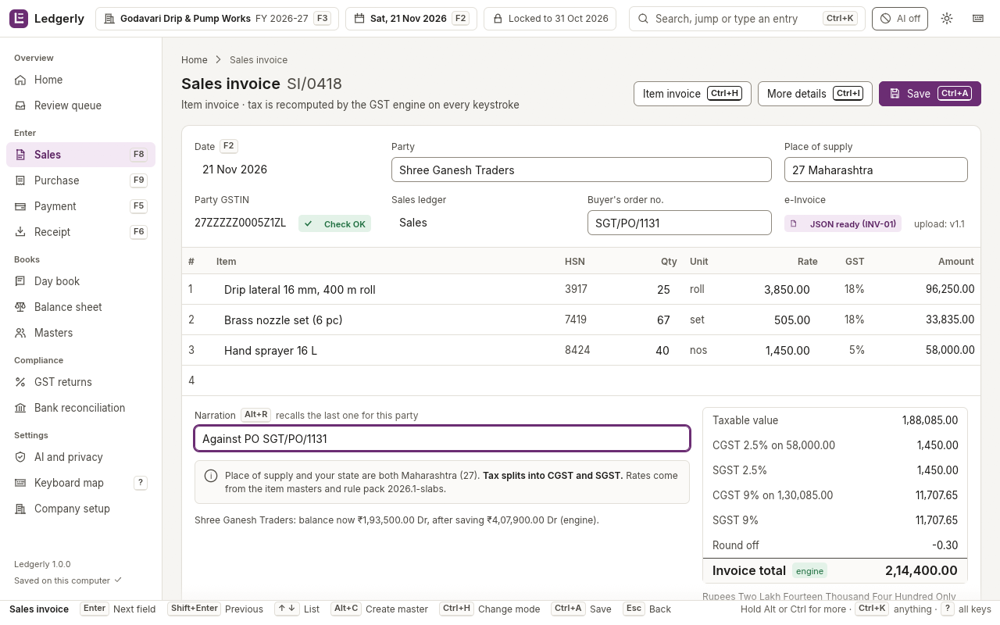

# Ledgerly

**A local-first, keyboard-driven desktop accounting app for Indian small businesses. Your books stay in one company file on your own computer.**

[](https://github.com/DevanshChoubey/tally-oss/actions/workflows/ci.yml)
[](https://github.com/DevanshChoubey/tally-oss/releases/latest)
[](LICENSING.md)

Ledgerly covers books, GST returns, bank reconciliation, basic inventory and printing. It is written
in Rust with [egui](https://github.com/emilk/egui).



## Contents

- [Key features](#key-features)
- [Install](#install)
- [Quick start](#quick-start)
- [Command line](#command-line)
- [AI assistant and MCP server](#ai-assistant-and-mcp-server)
- [Data and privacy](#data-and-privacy)
- [Correctness](#correctness)
- [Project status and known gaps](#project-status-and-known-gaps)
- [Repository layout](#repository-layout)
- [Contributing](#contributing)
- [Security](#security)
- [Licence](#licence)
- [Independence and trademarks](#independence-and-trademarks)

## Key features

- **Books.** Ledgers, groups and cost centres; sales, purchase, payment, receipt, journal, contra,
  credit note and debit note vouchers; voucher numbering; period locks; backups.
- **Audit trail.** Every change is an event in an append-only log. Each event is hash-chained to the
  one before it, and `ledgerly verify` checks the chain.
- **Reports.** Balance sheet, profit and loss, trial balance, day book, ledger vouchers and
  outstanding bills, with drill-down to the voucher. Reports can be exported to CSV and XLSX.
- **GST.** Place of supply and tax on vouchers; GSTR-1, GSTR-1A and GSTR-3B working with JSON export;
  IMS actions; e-invoice and e-way bill JSON. Ledgerly does not call any GST portal API.
- **Bank.** Import statements in CSV, XLSX and MT940; match entries and reconcile; record cheques.
- **Stock.** Stock items, units and godowns; invoices for items; stock valuation.
- **Import from Tally.** Read a Tally XML file that you exported, or pull the company from a running
  Tally over its HTTP XML port, with a reconciliation report. Ledgerly does not export Tally XML.
- **Printing.** Sales invoices, credit notes, debit notes and five reports print to PDF through the
  print action (Ctrl+P), then open in your PDF viewer.
- **Keyboard first.** Function keys and a command palette (Ctrl+K). Two keymaps are included:
  `keymap-standard.toml` and `keymap-classic.toml`.
- **Themes and access.** Light, dark and high-contrast themes; screen-reader names and Tab order;
  Ctrl+= / Ctrl+- / Ctrl+0 zoom.

## Install

Download a release from the [releases page](https://github.com/DevanshChoubey/tally-oss/releases).
Each release has a `SHA256SUMS.txt` file with the SHA-256 of every artifact.

| Platform | Artifacts |
| --- | --- |
| Linux (x86_64) | `ledgerly-<version>-linux-x86_64.tar.gz`, `ledgerly_<version>_amd64.deb` |
| Windows (x86_64) | `ledgerly-<version>-windows-x86_64.zip`, `ledgerly-<version>-windows-x86_64-setup.exe` |
| macOS (arm64, Apple silicon) | `ledgerly-<version>-macos-arm64.dmg` |

The Windows and macOS packages are built by CI. They were not tried by hand before the 1.0.0
release (see [known gaps](#project-status-and-known-gaps)).

The packages are not signed with an Apple or Microsoft developer certificate, so the first launch
shows a warning:

- **macOS:** open Ledgerly once, then allow it in System Settings > Privacy & Security > Open
  Anyway. If macOS says the app is "damaged" (the 1.0.0 package had no bundle signature), run
  `xattr -dr com.apple.quarantine /Applications/Ledgerly.app` and open it again.
- **Windows:** SmartScreen may say it protected your PC; choose More info > Run anyway.

Check a download against `SHA256SUMS.txt` from the same release before you run it.

### Build from source

The Rust toolchain is pinned in `rust-toolchain.toml` (channel `1.100`). With
[rustup](https://rustup.rs) installed, it is selected automatically.

```bash
git clone https://github.com/DevanshChoubey/tally-oss
cd tally-oss
cargo build --release --locked -p ledgerly-app -p ledgerly-cli
```

This produces:

- `target/release/ledgerly-app`, the desktop app;
- `target/release/ledgerly`, the command line tool.

To run the app straight from the source tree, use `cargo run --release -p ledgerly-app`.

## Quick start

1. Start `ledgerly-app`. The first-run screens cover the company, the features you want, backups and
   the keyboard.
2. Create the company. Ledgerly stores it as a single file on your computer.
3. Enter vouchers from the sidebar or with the function keys shown in the status bar. Press Ctrl+K
   to find any screen or master by name.
4. Open **Balance sheet**, **Day book** or **GST returns** to see the engine's figures.
5. Keep regular backups of the company file. The setup screens include a backup step.

## Command line

The `ledgerly` binary has these subcommands. Run `ledgerly --help` or `ledgerly <command> --help` for
all options.

| Command | What it does |
| --- | --- |
| `ledgerly verify <file>` | Checks the audit chain and checkpoints of a company file. |
| `ledgerly rebuild-check <file>` | Replays the event log and compares the result with the stored projection tables. |
| `ledgerly export gstr1 <file> --gstin <GSTIN> --from <YYYY-MM-DD> --to <YYYY-MM-DD> [--out <file>]` | Writes GSTR-1 for one period as JSON, to standard output or to `--out`. |
| `ledgerly import-tally <file> --company "<name>" [--host <host>] [--port <port>]` | Imports a company from a running Tally's HTTP XML port (default `127.0.0.1:9000`) into a company file. |
| `ledgerly conformance [--cases <dir>] [--pass-list <file>]` | Runs the golden conformance cases and checks the pass-list ratchet. |
| `ledgerly mcp --company <file>` | Serves the MCP server over stdio. See the next section. |

Exit codes:

- `0`: the command ran and its check passed.
- `1`: a check failed, for example a broken audit chain or projections that differ from the rebuild.
- `2`: the command could not run, for example bad arguments, a missing file, or input this build does
  not compute yet.

`verify`, `rebuild-check` and `export` need an existing company file. None of them creates one.

## AI assistant and MCP server

Ledgerly has an optional AI assistant. It is off by default. The assistant never produces a figure
that you see. It can only propose drafts, and the engine computes every number.

**The MCP server works in this release.** `ledgerly mcp --company <file>` runs a Model Context Protocol
server over stdio for an AI client. It exposes three tools:

- `search` finds ledgers, groups, stock items and vouchers by name, alias, GSTIN, voucher number,
  party or amount. Read only.
- `report` runs a report through the engine and returns the engine's result. Read only.
- `propose_voucher` checks a voucher draft against the books and reports what would be written. It
  posts nothing. The server has no tool that posts a voucher.

**The in-app assistant does not run yet.** The screens for "Ask your books", plain-words entry and bill
photos are present, but in this release they show why they cannot work. There is no local model
client and no OCR engine, and the cloud (bring-your-own-key) tier is refused because no keychain
store is wired in. The company file never holds a provider key.

## Data and privacy

- **Local by default.** The company is one file on your computer. Ledgerly does not upload books,
  party data or bank data.
- **Network use only when you ask for it.** Ledgerly makes a network connection in one case: when you
  import from a running Tally, it connects to the HTTP XML port you give it (default `127.0.0.1:9000`).
  The in-app cloud AI tier is not available in this release.
- **Backups.** The store can write a backup of the company file to a folder you choose, and restore
  from one.

## Correctness

Ledgerly's main promise is that it never shows a wrong number. Every computation returns one of three
things:

- a **value**, computed by the engine;
- an **`Unsupported`** result with a reason, when the case is not built yet;
- an **error**.

There are no silent defaults and no "best effort" figures. The screens and the MCP server show the
engine's result as it is, or the reason it is not available.

The books can also check themselves:

- Every change is a hash-chained event. `ledgerly verify <file>` recomputes the chain and reports a
  break. A broken chain exits with code `1`.
- `ledgerly rebuild-check <file>` replays the event log and compares it with the stored tables.
- The golden conformance cases carry provenance, either a recorded observation or a derivation written
  out by hand. `ledgerly conformance` runs them and fails if a listed case stops passing.

The engineering rules that enforce this are in [docs/engineering-rules.md](docs/engineering-rules.md).

## Project status and known gaps

The latest release is Ledgerly 1.0.1 (2026-11-24; 1.0.0 the same day). The full list of what is in the release and what is not
is in [RELEASE-NOTES.md](RELEASE-NOTES.md). The changes are in [CHANGELOG.md](CHANGELOG.md).

The main gaps in 1.0.0:

- English only. Hindi is planned for 1.1.
- No Tally XML export, and no Excel import of masters or vouchers.
- Printing is save-to-PDF only. There is no print preview and no UPI QR code on invoices. Only
  invoices, notes and five reports print.
- The in-app AI assistant is not functional (see above).
- Payment bill-wise allocation, the overdraft warning and the GSTR-2B reconciliation reader are not
  built.
- The Windows and macOS packages have not been tried by hand before release, and the Windows
  installer has no icon.

Smaller differences from the design are tracked in [design/PARITY-GAPS.md](design/PARITY-GAPS.md).
The design spec is [docs/specs/2026-11-20-ledgerly-design.md](docs/specs/2026-11-20-ledgerly-design.md).

## Repository layout

| Crate | Licence | Purpose |
| --- | --- | --- |
| `ledgerly-core` | MIT OR Apache-2.0 | Shared types: paise, quantities, rates, dates, financial years, GSTIN, PAN, state codes, `Outcome` and `Unsupported`. |
| `ledgerly-model` | AGPL-3.0-or-later | Masters, vouchers and the books read model, with invariant checks. |
| `ledgerly-store` | AGPL-3.0-or-later | SQLite event store: the hash-chained log, projections, verification and backup. |
| `ledgerly-engine` | AGPL-3.0-or-later | Command handlers that validate a command against the books and produce events. |
| `ledgerly-gst` | AGPL-3.0-or-later | GST rule packs, place of supply, voucher tax, return builders and reconciliation. |
| `ledgerly-gst-formats` | MIT OR Apache-2.0 | GST return data shapes and their JSON formats. |
| `ledgerly-stock` | AGPL-3.0-or-later | Units, stock positions and inventory valuation. |
| `ledgerly-reports` | AGPL-3.0-or-later | Report parameters, report builders, and CSV and XLSX export. |
| `ledgerly-bank` | AGPL-3.0-or-later | Bank statements, matching, bank reconciliation, cheques and UPI payload building. |
| `ledgerly-bankfmt` | MIT OR Apache-2.0 | Bank statement format registry and the CSV, XLSX and MT940 parsers. |
| `ledgerly-tally-xml` | MIT OR Apache-2.0 | Tally XML types, parsers and request builders. No network. |
| `ledgerly-tally-bridge` | AGPL-3.0-or-later | Import from a running Tally or from exported XML files, with mapping and reconciliation. |
| `ledgerly-assist` | AGPL-3.0-or-later | The assistant's typed proposals, OCR and model seams, and the validator that recomputes through the engine. |
| `ledgerly-print` | AGPL-3.0-or-later | Print templates and PDF rendering for invoices and vouchers. |
| `ledgerly-api` | AGPL-3.0-or-later | The command and query facade used by the app, the CLI and the MCP server. |
| `ledgerly-mcp` | AGPL-3.0-or-later | The MCP server (JSON-RPC over stdio) with read tools and a propose tool. No posting tool. |
| `ledgerly-conformance` | AGPL-3.0-or-later | Golden cases with provenance, fixtures, the pass-list ratchet and benchmarks. |
| `ledgerly-cli` | AGPL-3.0-or-later | The `ledgerly` command line. |
| `ledgerly-app` | AGPL-3.0-or-later | The desktop app (egui). |

The headless crates do not depend on any UI crate. CI checks this.

## Contributing

Read [CONTRIBUTING.md](CONTRIBUTING.md) and [docs/engineering-rules.md](docs/engineering-rules.md)
before you open a pull request. The main rule is that a wrong number is a bug. Tests come first, and
expected values need provenance. Ledgerly is a clean-room project, so contributions must not use code,
artwork or screens from any other product.

Before you open a pull request, run the same checks as CI:

```bash
cargo fmt --all --check
cargo clippy --workspace --all-targets --all-features -- -D warnings
cargo nextest run --workspace
RUSTDOCFLAGS="-D warnings" cargo doc --workspace --no-deps
cargo deny check
```

Sign off each commit with `git commit -s` (Developer Certificate of Origin). Do not attach real company
files, bank statements or GST data to issues or pull requests. Make a small example with made-up names
and amounts instead.

## Security

Please do not report security problems in a public issue. Use GitHub's private vulnerability reporting
(the **Security** tab, then **Report a vulnerability**). [SECURITY.md](SECURITY.md) describes what
counts as a security issue and what to expect.

## Licence

- The app and most crates are licensed under the GNU Affero General Public License v3.0 or later
  ([LICENSE-AGPL](LICENSE-AGPL)).
- `ledgerly-core`, `ledgerly-tally-xml`, `ledgerly-gst-formats` and `ledgerly-bankfmt` are dual-licensed
  under MIT OR Apache-2.0 ([LICENSE-MIT](LICENSE-MIT), [LICENSE-APACHE](LICENSE-APACHE)), so other
  projects can reuse the format code.
- The bundled fonts are under the SIL Open Font License 1.1. See [NOTICE](NOTICE) and
  [LICENSING.md](LICENSING.md).

## Independence and trademarks

Ledgerly is an independent project. It is not affiliated with, endorsed by or supported by Tally
Solutions Pvt. Ltd. "Tally" and "TallyPrime" are trademarks of their owner. Ledgerly uses those names
only to say which file formats and ports it reads for import.
