# App against mock

174 app captures are paired with a mock capture of the same theme and state id. SSIM is 1 for identical images; lower is a bigger difference, and the list runs worst first.

| Theme | State | SSIM |
| --- | --- | --- |
| hc | home.default | 0.4551 |
| hc | day-book.month | 0.4769 |
| hc | palette.entry | 0.4853 |
| hc | palette.ask | 0.4880 |
| hc | sales-invoice.validation-error | 0.4934 |
| hc | palette.voucher | 0.4968 |
| hc | sales-invoice.period-locked | 0.5084 |
| hc | palette.no-results | 0.5094 |
| hc | bank.default | 0.5105 |
| hc | sales-invoice.save-confirm | 0.5144 |
| hc | ai-settings.cloud | 0.5232 |
| hc | balance-sheet.provisional | 0.5314 |
| hc | sales-invoice.item-list | 0.5319 |
| hc | palette.search | 0.5422 |
| hc | home.ai-off | 0.5450 |
| hc | ai-settings.local | 0.5507 |
| dark | home.default | 0.5545 |
| hc | sales-invoice.default | 0.5602 |
| hc | sales-invoice.gst-inter-state | 0.5611 |
| light | home.default | 0.5675 |
| hc | palette.default | 0.5708 |
| hc | masters.ledgers | 0.5717 |
| hc | gst.gstr1 | 0.5774 |
| light | day-book.month | 0.5832 |
| hc | balance-sheet.detailed | 0.5962 |
| hc | keys.standard | 0.5964 |
| hc | sales-invoice.b2c | 0.5965 |
| dark | day-book.month | 0.5971 |
| light | masters.ledgers | 0.5991 |
| hc | purchase-bill.offline-ai | 0.6009 |
| hc | palette.commands | 0.6025 |
| hc | masters.items | 0.6028 |
| hc | keys.classic | 0.6030 |
| light | ai-settings.cloud | 0.6083 |
| hc | review.default | 0.6092 |
| dark | bank.default | 0.6095 |
| hc | sales-invoice.saved | 0.6123 |
| dark | sales-invoice.item-list | 0.6132 |
| dark | sales-invoice.period-locked | 0.6137 |
| light | palette.entry | 0.6150 |
| light | sales-invoice.item-list | 0.6156 |
| light | sales-invoice.period-locked | 0.6159 |
| light | palette.ask | 0.6183 |
| hc | bank.brs | 0.6190 |
| dark | ai-settings.cloud | 0.6192 |
| hc | gst.gstr1-correction | 0.6205 |
| dark | sales-invoice.validation-error | 0.6217 |
| light | palette.no-results | 0.6218 |
| light | sales-invoice.validation-error | 0.6247 |
| light | sales-invoice.default | 0.6263 |
| light | sales-invoice.save-confirm | 0.6267 |
| light | palette.voucher | 0.6270 |
| dark | sales-invoice.default | 0.6271 |
| dark | palette.entry | 0.6277 |
| light | bank.default | 0.6283 |
| hc | balance-sheet.default | 0.6297 |
| dark | masters.ledgers | 0.6299 |
| dark | palette.ask | 0.6305 |
| dark | palette.no-results | 0.6309 |
| dark | sales-invoice.save-confirm | 0.6313 |
| light | sales-invoice.gst-inter-state | 0.6337 |
| dark | home.ai-off | 0.6340 |
| hc | ai-settings.off | 0.6341 |
| light | gst.gstr1 | 0.6347 |
| dark | gst.gstr1 | 0.6356 |
| dark | sales-invoice.gst-inter-state | 0.6370 |
| light | palette.search | 0.6383 |
| dark | palette.voucher | 0.6397 |
| hc | balance-sheet.ledger | 0.6465 |
| dark | palette.search | 0.6488 |
| light | home.ai-off | 0.6493 |
| light | keys.standard | 0.6514 |
| light | balance-sheet.detailed | 0.6516 |
| dark | purchase-bill.offline-ai | 0.6522 |
| dark | keys.standard | 0.6525 |
| light | ai-settings.local | 0.6590 |
| light | palette.default | 0.6595 |
| light | balance-sheet.provisional | 0.6597 |
| light | keys.classic | 0.6615 |
| dark | review.default | 0.6619 |
| dark | keys.classic | 0.6620 |
| light | sales-invoice.b2c | 0.6625 |
| light | sales-invoice.saved | 0.6635 |
| dark | ai-settings.local | 0.6647 |
| hc | gst.gstr3b | 0.6657 |
| dark | palette.default | 0.6664 |
| light | review.default | 0.6666 |
| light | balance-sheet.default | 0.6669 |
| dark | balance-sheet.provisional | 0.6675 |
| dark | sales-invoice.b2c | 0.6723 |
| dark | sales-invoice.saved | 0.6755 |
| light | palette.commands | 0.6782 |
| hc | receipt.default | 0.6806 |
| light | ai-settings.off | 0.6850 |
| dark | gst.gstr1-correction | 0.6863 |
| dark | palette.commands | 0.6867 |
| light | gst.gstr1-correction | 0.6879 |
| dark | ai-settings.off | 0.6896 |
| dark | balance-sheet.default | 0.6903 |
| dark | balance-sheet.detailed | 0.6908 |
| hc | day-book.default | 0.6932 |
| hc | payment.default | 0.6945 |
| light | bank.brs | 0.6964 |
| light | gst.gstr3b | 0.7013 |
| hc | balance-sheet.voucher | 0.7015 |
| dark | gst.gstr3b | 0.7021 |
| dark | bank.brs | 0.7023 |
| hc | setup.features | 0.7061 |
| hc | masters.gstin-error | 0.7076 |
| dark | masters.items | 0.7140 |
| light | masters.items | 0.7163 |
| hc | masters.ledger-detail | 0.7196 |
| dark | balance-sheet.ledger | 0.7296 |
| light | balance-sheet.ledger | 0.7342 |
| light | receipt.default | 0.7369 |
| light | day-book.default | 0.7374 |
| dark | masters.gstin-error | 0.7380 |
| dark | receipt.default | 0.7403 |
| hc | balance-sheet.group | 0.7413 |
| light | purchase-bill.offline-ai | 0.7422 |
| light | balance-sheet.group | 0.7430 |
| dark | day-book.default | 0.7456 |
| light | masters.gstin-error | 0.7473 |
| hc | masters.create-ledger | 0.7514 |
| dark | masters.ledger-detail | 0.7514 |
| dark | balance-sheet.group | 0.7514 |
| light | payment.default | 0.7527 |
| dark | payment.default | 0.7553 |
| light | balance-sheet.voucher | 0.7558 |
| light | setup.features | 0.7571 |
| dark | balance-sheet.voucher | 0.7573 |
| light | masters.ledger-detail | 0.7584 |
| hc | ask.offline-ai | 0.7614 |
| hc | setup.done | 0.7622 |
| hc | home.empty | 0.7654 |
| dark | setup.features | 0.7661 |
| hc | setup.company | 0.7842 |
| hc | bank.empty | 0.7872 |
| dark | masters.create-ledger | 0.7894 |
| light | masters.create-ledger | 0.7900 |
| hc | setup.gstin-error | 0.7927 |
| dark | setup.company | 0.7980 |
| light | setup.company | 0.7997 |
| dark | home.empty | 0.8019 |
| hc | setup.backup | 0.8025 |
| hc | setup.ai | 0.8025 |
| hc | day-book.empty | 0.8047 |
| light | ask.offline-ai | 0.8055 |
| hc | gst.recon-empty | 0.8060 |
| light | home.empty | 0.8084 |
| dark | setup.gstin-error | 0.8091 |
| dark | setup.done | 0.8097 |
| hc | review.empty | 0.8099 |
| light | setup.gstin-error | 0.8101 |
| dark | ask.offline-ai | 0.8112 |
| hc | setup.welcome | 0.8121 |
| light | bank.empty | 0.8153 |
| dark | bank.empty | 0.8153 |
| hc | setup.keyboard | 0.8180 |
| dark | review.empty | 0.8226 |
| dark | gst.recon-empty | 0.8267 |
| light | review.empty | 0.8272 |
| light | gst.recon-empty | 0.8308 |
| light | setup.backup | 0.8328 |
| light | day-book.empty | 0.8345 |
| dark | day-book.empty | 0.8353 |
| dark | setup.backup | 0.8354 |
| light | setup.welcome | 0.8395 |
| light | setup.keyboard | 0.8418 |
| dark | setup.keyboard | 0.8423 |
| dark | setup.welcome | 0.8452 |
| light | setup.ai | 0.8461 |
| dark | setup.ai | 0.8492 |
| light | setup.done | 0.8904 |

## hc / home.default

SSIM 0.4551

<table>
<tr><th>Mock</th><th>App</th></tr>
<tr>
<td></td>
<td></td>
</tr>
</table>

## hc / day-book.month

SSIM 0.4769

<table>
<tr><th>Mock</th><th>App</th></tr>
<tr>
<td></td>
<td></td>
</tr>
</table>

## hc / palette.entry

SSIM 0.4853

<table>
<tr><th>Mock</th><th>App</th></tr>
<tr>
<td></td>
<td></td>
</tr>
</table>

## hc / palette.ask

SSIM 0.4880

<table>
<tr><th>Mock</th><th>App</th></tr>
<tr>
<td></td>
<td></td>
</tr>
</table>

## hc / sales-invoice.validation-error

SSIM 0.4934

<table>
<tr><th>Mock</th><th>App</th></tr>
<tr>
<td></td>
<td>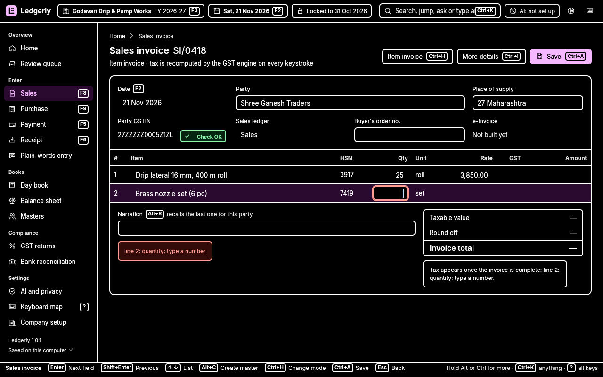</td>
</tr>
</table>

## hc / palette.voucher

SSIM 0.4968

<table>
<tr><th>Mock</th><th>App</th></tr>
<tr>
<td></td>
<td></td>
</tr>
</table>

## hc / sales-invoice.period-locked

SSIM 0.5084

<table>
<tr><th>Mock</th><th>App</th></tr>
<tr>
<td>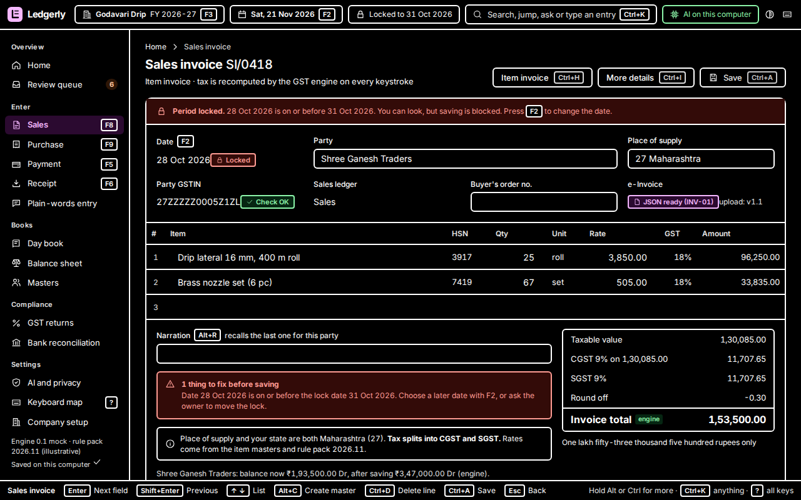</td>
<td></td>
</tr>
</table>

## hc / palette.no-results

SSIM 0.5094

<table>
<tr><th>Mock</th><th>App</th></tr>
<tr>
<td></td>
<td></td>
</tr>
</table>

## hc / bank.default

SSIM 0.5105

<table>
<tr><th>Mock</th><th>App</th></tr>
<tr>
<td></td>
<td></td>
</tr>
</table>

## hc / sales-invoice.save-confirm

SSIM 0.5144

<table>
<tr><th>Mock</th><th>App</th></tr>
<tr>
<td></td>
<td></td>
</tr>
</table>

## hc / ai-settings.cloud

SSIM 0.5232

<table>
<tr><th>Mock</th><th>App</th></tr>
<tr>
<td></td>
<td></td>
</tr>
</table>

## hc / balance-sheet.provisional

SSIM 0.5314

<table>
<tr><th>Mock</th><th>App</th></tr>
<tr>
<td></td>
<td></td>
</tr>
</table>

## hc / sales-invoice.item-list

SSIM 0.5319

<table>
<tr><th>Mock</th><th>App</th></tr>
<tr>
<td></td>
<td></td>
</tr>
</table>

## hc / palette.search

SSIM 0.5422

<table>
<tr><th>Mock</th><th>App</th></tr>
<tr>
<td></td>
<td></td>
</tr>
</table>

## hc / home.ai-off

SSIM 0.5450

<table>
<tr><th>Mock</th><th>App</th></tr>
<tr>
<td></td>
<td>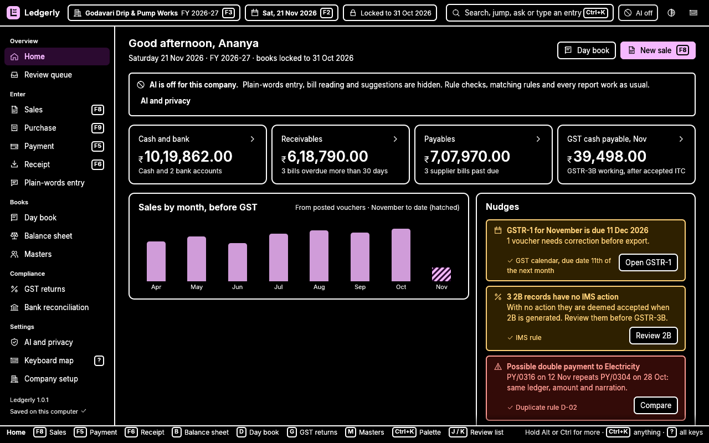</td>
</tr>
</table>

## hc / ai-settings.local

SSIM 0.5507

<table>
<tr><th>Mock</th><th>App</th></tr>
<tr>
<td></td>
<td>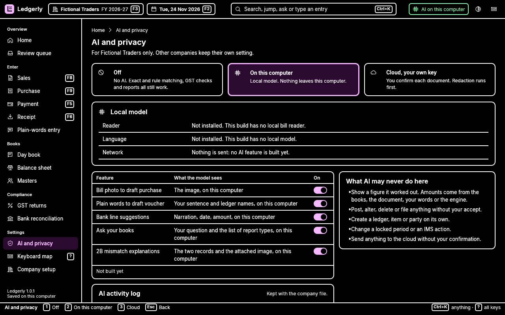</td>
</tr>
</table>

## dark / home.default

SSIM 0.5545

<table>
<tr><th>Mock</th><th>App</th></tr>
<tr>
<td></td>
<td></td>
</tr>
</table>

## hc / sales-invoice.default

SSIM 0.5602

<table>
<tr><th>Mock</th><th>App</th></tr>
<tr>
<td></td>
<td>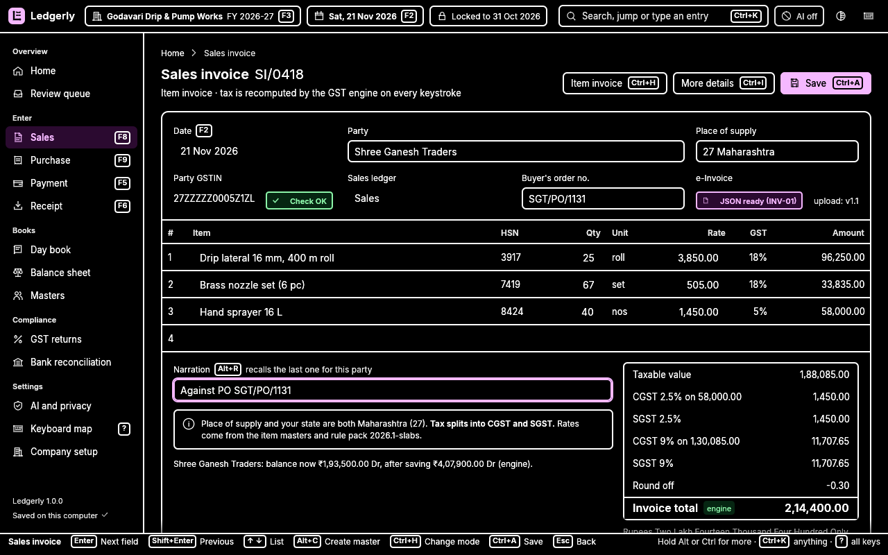</td>
</tr>
</table>

## hc / sales-invoice.gst-inter-state

SSIM 0.5611

<table>
<tr><th>Mock</th><th>App</th></tr>
<tr>
<td></td>
<td></td>
</tr>
</table>

## light / home.default

SSIM 0.5675

<table>
<tr><th>Mock</th><th>App</th></tr>
<tr>
<td></td>
<td></td>
</tr>
</table>

## hc / palette.default

SSIM 0.5708

<table>
<tr><th>Mock</th><th>App</th></tr>
<tr>
<td></td>
<td></td>
</tr>
</table>

## hc / masters.ledgers

SSIM 0.5717

<table>
<tr><th>Mock</th><th>App</th></tr>
<tr>
<td></td>
<td></td>
</tr>
</table>

## hc / gst.gstr1

SSIM 0.5774

<table>
<tr><th>Mock</th><th>App</th></tr>
<tr>
<td></td>
<td></td>
</tr>
</table>

## light / day-book.month

SSIM 0.5832

<table>
<tr><th>Mock</th><th>App</th></tr>
<tr>
<td></td>
<td></td>
</tr>
</table>

## hc / balance-sheet.detailed

SSIM 0.5962

<table>
<tr><th>Mock</th><th>App</th></tr>
<tr>
<td></td>
<td></td>
</tr>
</table>

## hc / keys.standard

SSIM 0.5964

<table>
<tr><th>Mock</th><th>App</th></tr>
<tr>
<td></td>
<td></td>
</tr>
</table>

## hc / sales-invoice.b2c

SSIM 0.5965

<table>
<tr><th>Mock</th><th>App</th></tr>
<tr>
<td></td>
<td>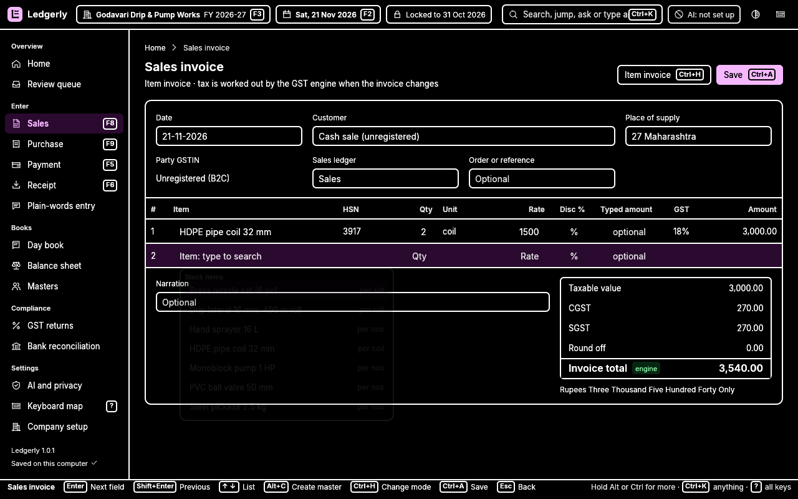</td>
</tr>
</table>

## dark / day-book.month

SSIM 0.5971

<table>
<tr><th>Mock</th><th>App</th></tr>
<tr>
<td>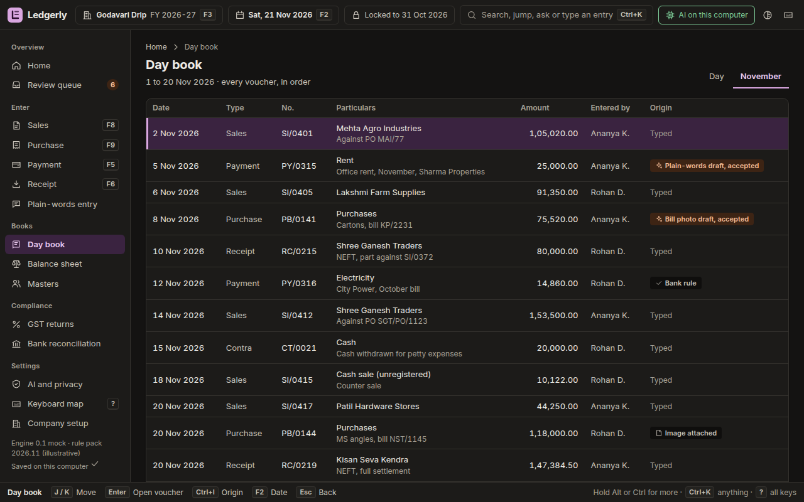</td>
<td></td>
</tr>
</table>

## light / masters.ledgers

SSIM 0.5991

<table>
<tr><th>Mock</th><th>App</th></tr>
<tr>
<td></td>
<td></td>
</tr>
</table>

## hc / purchase-bill.offline-ai

SSIM 0.6009

<table>
<tr><th>Mock</th><th>App</th></tr>
<tr>
<td></td>
<td>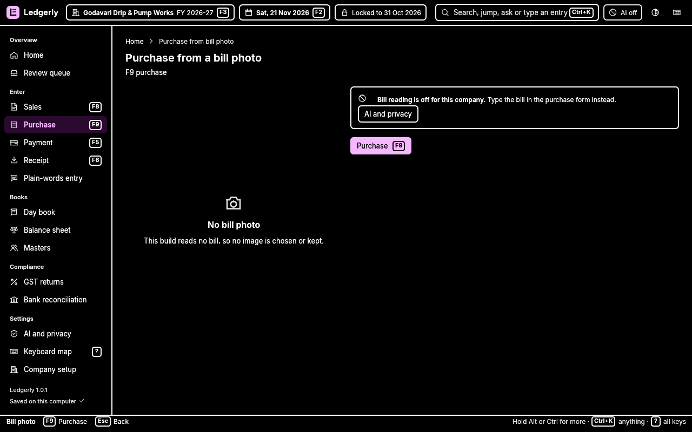</td>
</tr>
</table>

## hc / palette.commands

SSIM 0.6025

<table>
<tr><th>Mock</th><th>App</th></tr>
<tr>
<td></td>
<td></td>
</tr>
</table>

## hc / masters.items

SSIM 0.6028

<table>
<tr><th>Mock</th><th>App</th></tr>
<tr>
<td></td>
<td></td>
</tr>
</table>

## hc / keys.classic

SSIM 0.6030

<table>
<tr><th>Mock</th><th>App</th></tr>
<tr>
<td></td>
<td></td>
</tr>
</table>

## light / ai-settings.cloud

SSIM 0.6083

<table>
<tr><th>Mock</th><th>App</th></tr>
<tr>
<td></td>
<td></td>
</tr>
</table>

## hc / review.default

SSIM 0.6092

<table>
<tr><th>Mock</th><th>App</th></tr>
<tr>
<td></td>
<td></td>
</tr>
</table>

## dark / bank.default

SSIM 0.6095

<table>
<tr><th>Mock</th><th>App</th></tr>
<tr>
<td></td>
<td>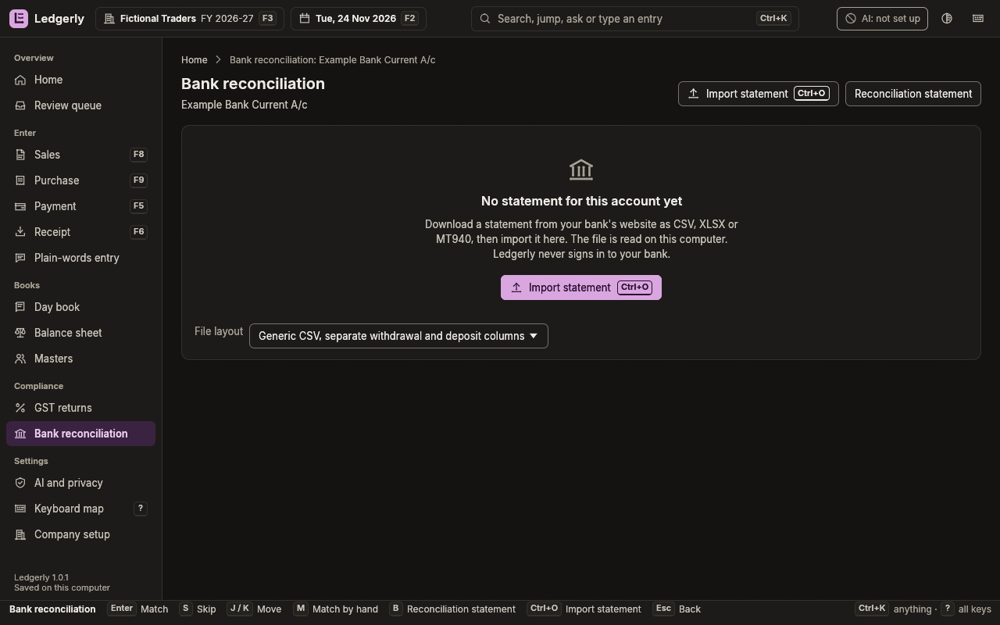</td>
</tr>
</table>

## hc / sales-invoice.saved

SSIM 0.6123

<table>
<tr><th>Mock</th><th>App</th></tr>
<tr>
<td></td>
<td></td>
</tr>
</table>

## dark / sales-invoice.item-list

SSIM 0.6132

<table>
<tr><th>Mock</th><th>App</th></tr>
<tr>
<td></td>
<td></td>
</tr>
</table>

## dark / sales-invoice.period-locked

SSIM 0.6137

<table>
<tr><th>Mock</th><th>App</th></tr>
<tr>
<td>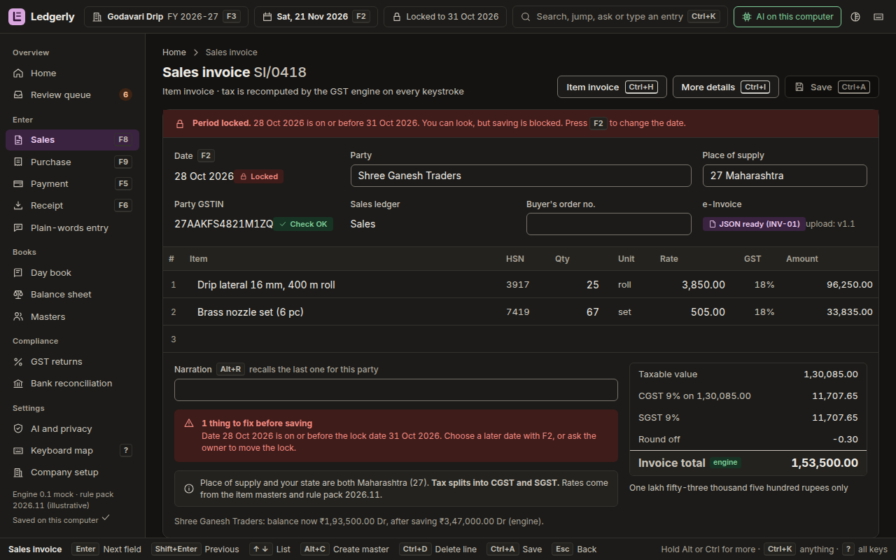</td>
<td></td>
</tr>
</table>

## light / palette.entry

SSIM 0.6150

<table>
<tr><th>Mock</th><th>App</th></tr>
<tr>
<td></td>
<td></td>
</tr>
</table>

## light / sales-invoice.item-list

SSIM 0.6156

<table>
<tr><th>Mock</th><th>App</th></tr>
<tr>
<td></td>
<td></td>
</tr>
</table>

## light / sales-invoice.period-locked

SSIM 0.6159

<table>
<tr><th>Mock</th><th>App</th></tr>
<tr>
<td></td>
<td>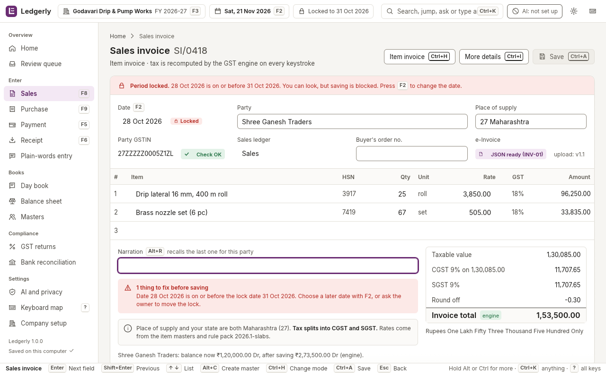</td>
</tr>
</table>

## light / palette.ask

SSIM 0.6183

<table>
<tr><th>Mock</th><th>App</th></tr>
<tr>
<td></td>
<td></td>
</tr>
</table>

## hc / bank.brs

SSIM 0.6190

<table>
<tr><th>Mock</th><th>App</th></tr>
<tr>
<td></td>
<td></td>
</tr>
</table>

## dark / ai-settings.cloud

SSIM 0.6192

<table>
<tr><th>Mock</th><th>App</th></tr>
<tr>
<td>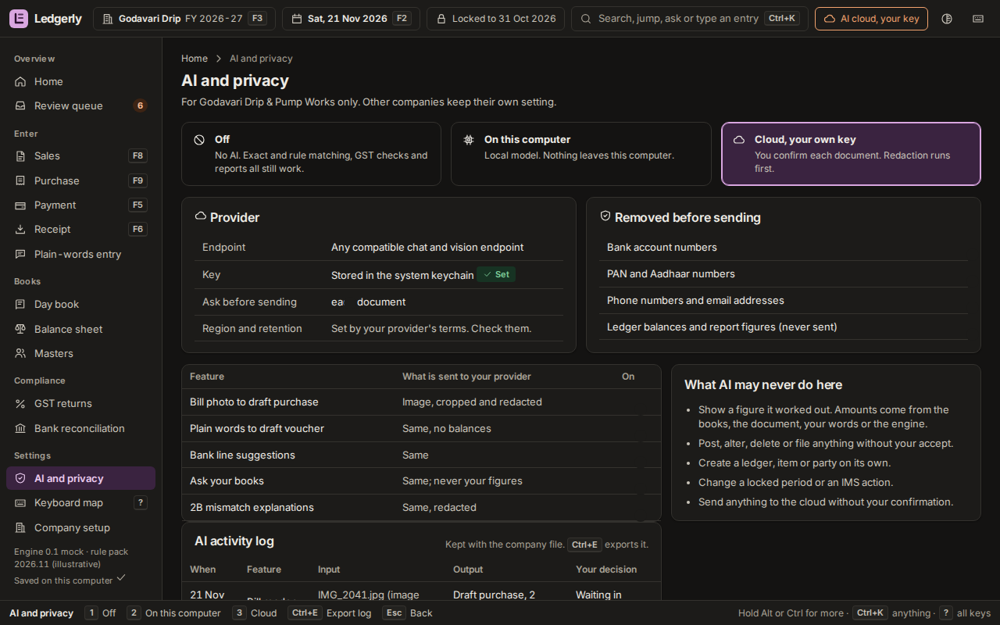</td>
<td></td>
</tr>
</table>

## hc / gst.gstr1-correction

SSIM 0.6205

<table>
<tr><th>Mock</th><th>App</th></tr>
<tr>
<td></td>
<td></td>
</tr>
</table>

## dark / sales-invoice.validation-error

SSIM 0.6217

<table>
<tr><th>Mock</th><th>App</th></tr>
<tr>
<td>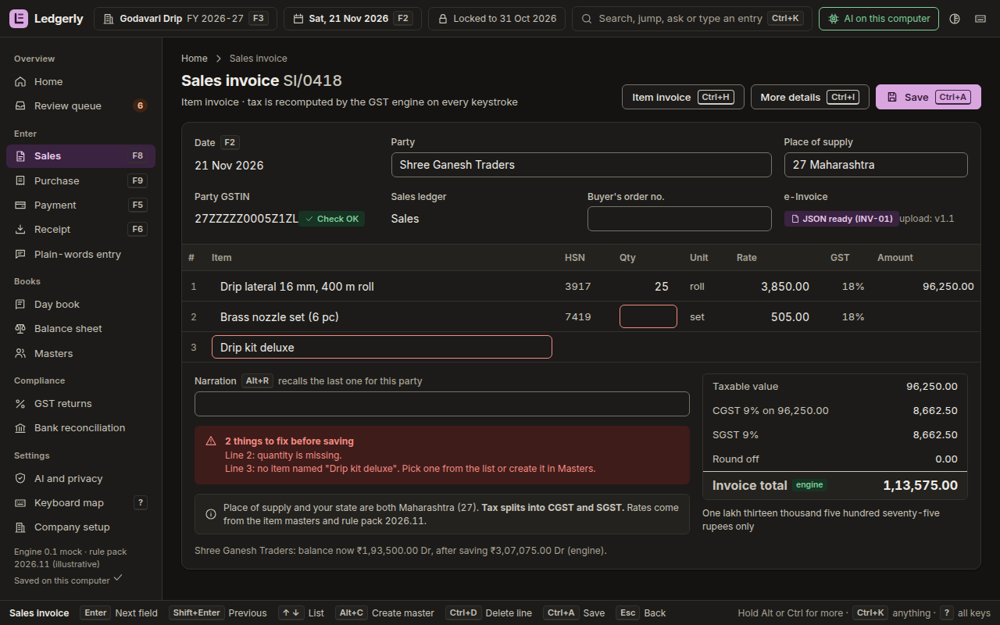</td>
<td></td>
</tr>
</table>

## light / palette.no-results

SSIM 0.6218

<table>
<tr><th>Mock</th><th>App</th></tr>
<tr>
<td></td>
<td></td>
</tr>
</table>

## light / sales-invoice.validation-error

SSIM 0.6247

<table>
<tr><th>Mock</th><th>App</th></tr>
<tr>
<td></td>
<td></td>
</tr>
</table>

## light / sales-invoice.default

SSIM 0.6263

<table>
<tr><th>Mock</th><th>App</th></tr>
<tr>
<td></td>
<td></td>
</tr>
</table>

## light / sales-invoice.save-confirm

SSIM 0.6267

<table>
<tr><th>Mock</th><th>App</th></tr>
<tr>
<td>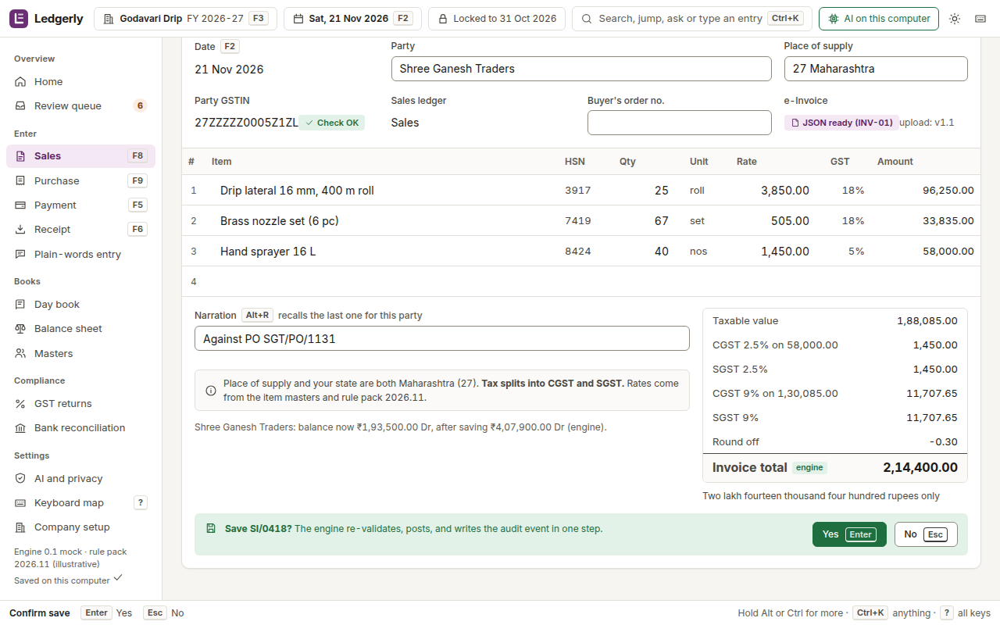</td>
<td></td>
</tr>
</table>

## light / palette.voucher

SSIM 0.6270

<table>
<tr><th>Mock</th><th>App</th></tr>
<tr>
<td></td>
<td></td>
</tr>
</table>

## dark / sales-invoice.default

SSIM 0.6271

<table>
<tr><th>Mock</th><th>App</th></tr>
<tr>
<td></td>
<td></td>
</tr>
</table>

## dark / palette.entry

SSIM 0.6277

<table>
<tr><th>Mock</th><th>App</th></tr>
<tr>
<td></td>
<td></td>
</tr>
</table>

## light / bank.default

SSIM 0.6283

<table>
<tr><th>Mock</th><th>App</th></tr>
<tr>
<td></td>
<td>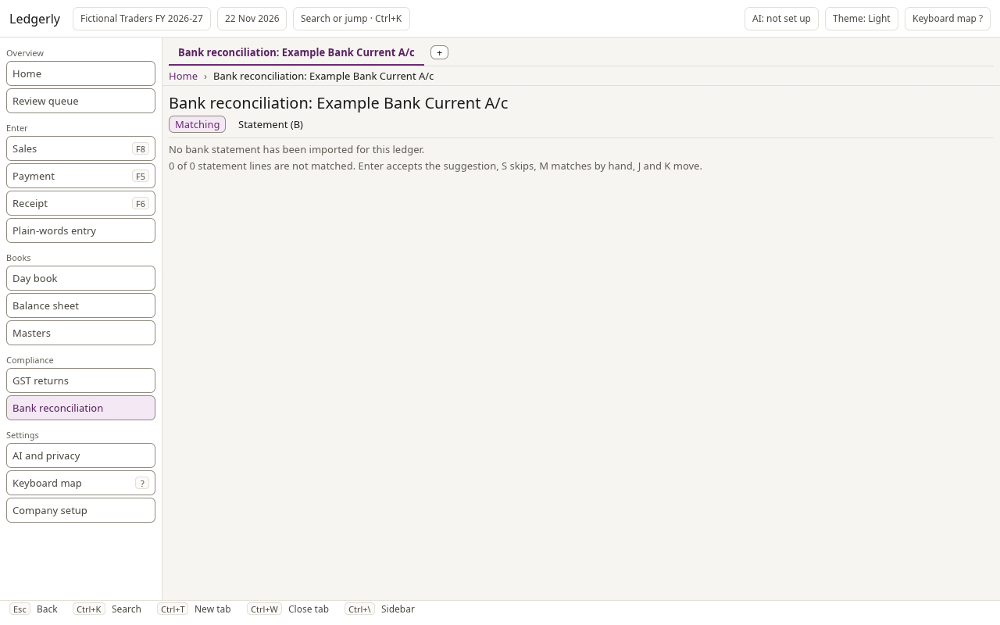</td>
</tr>
</table>

## hc / balance-sheet.default

SSIM 0.6297

<table>
<tr><th>Mock</th><th>App</th></tr>
<tr>
<td></td>
<td></td>
</tr>
</table>

## dark / masters.ledgers

SSIM 0.6299

<table>
<tr><th>Mock</th><th>App</th></tr>
<tr>
<td></td>
<td></td>
</tr>
</table>

## dark / palette.ask

SSIM 0.6305

<table>
<tr><th>Mock</th><th>App</th></tr>
<tr>
<td></td>
<td></td>
</tr>
</table>

## dark / palette.no-results

SSIM 0.6309

<table>
<tr><th>Mock</th><th>App</th></tr>
<tr>
<td></td>
<td></td>
</tr>
</table>

## dark / sales-invoice.save-confirm

SSIM 0.6313

<table>
<tr><th>Mock</th><th>App</th></tr>
<tr>
<td></td>
<td></td>
</tr>
</table>

## light / sales-invoice.gst-inter-state

SSIM 0.6337

<table>
<tr><th>Mock</th><th>App</th></tr>
<tr>
<td></td>
<td>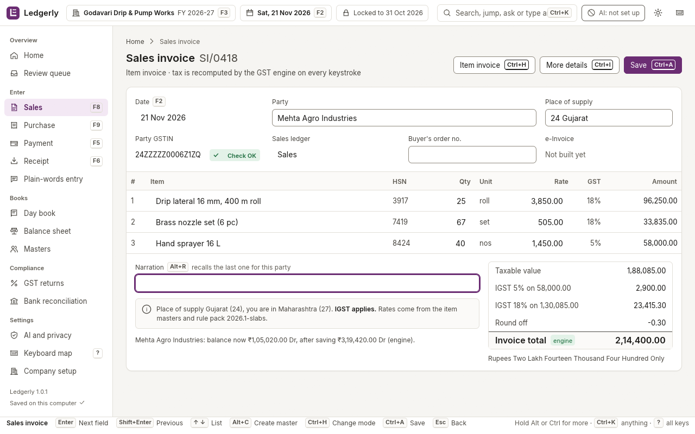</td>
</tr>
</table>

## dark / home.ai-off

SSIM 0.6340

<table>
<tr><th>Mock</th><th>App</th></tr>
<tr>
<td></td>
<td></td>
</tr>
</table>

## hc / ai-settings.off

SSIM 0.6341

<table>
<tr><th>Mock</th><th>App</th></tr>
<tr>
<td></td>
<td></td>
</tr>
</table>

## light / gst.gstr1

SSIM 0.6347

<table>
<tr><th>Mock</th><th>App</th></tr>
<tr>
<td></td>
<td></td>
</tr>
</table>

## dark / gst.gstr1

SSIM 0.6356

<table>
<tr><th>Mock</th><th>App</th></tr>
<tr>
<td></td>
<td></td>
</tr>
</table>

## dark / sales-invoice.gst-inter-state

SSIM 0.6370

<table>
<tr><th>Mock</th><th>App</th></tr>
<tr>
<td></td>
<td></td>
</tr>
</table>

## light / palette.search

SSIM 0.6383

<table>
<tr><th>Mock</th><th>App</th></tr>
<tr>
<td></td>
<td></td>
</tr>
</table>

## dark / palette.voucher

SSIM 0.6397

<table>
<tr><th>Mock</th><th>App</th></tr>
<tr>
<td></td>
<td></td>
</tr>
</table>

## hc / balance-sheet.ledger

SSIM 0.6465

<table>
<tr><th>Mock</th><th>App</th></tr>
<tr>
<td></td>
<td></td>
</tr>
</table>

## dark / palette.search

SSIM 0.6488

<table>
<tr><th>Mock</th><th>App</th></tr>
<tr>
<td></td>
<td></td>
</tr>
</table>

## light / home.ai-off

SSIM 0.6493

<table>
<tr><th>Mock</th><th>App</th></tr>
<tr>
<td>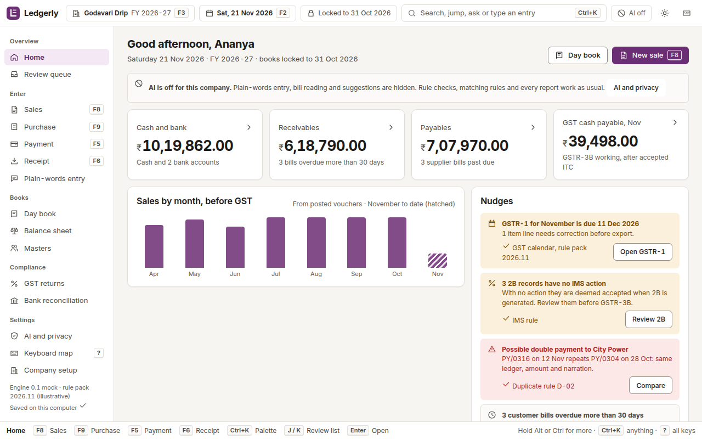</td>
<td></td>
</tr>
</table>

## light / keys.standard

SSIM 0.6514

<table>
<tr><th>Mock</th><th>App</th></tr>
<tr>
<td></td>
<td></td>
</tr>
</table>

## light / balance-sheet.detailed

SSIM 0.6516

<table>
<tr><th>Mock</th><th>App</th></tr>
<tr>
<td></td>
<td></td>
</tr>
</table>

## dark / purchase-bill.offline-ai

SSIM 0.6522

<table>
<tr><th>Mock</th><th>App</th></tr>
<tr>
<td>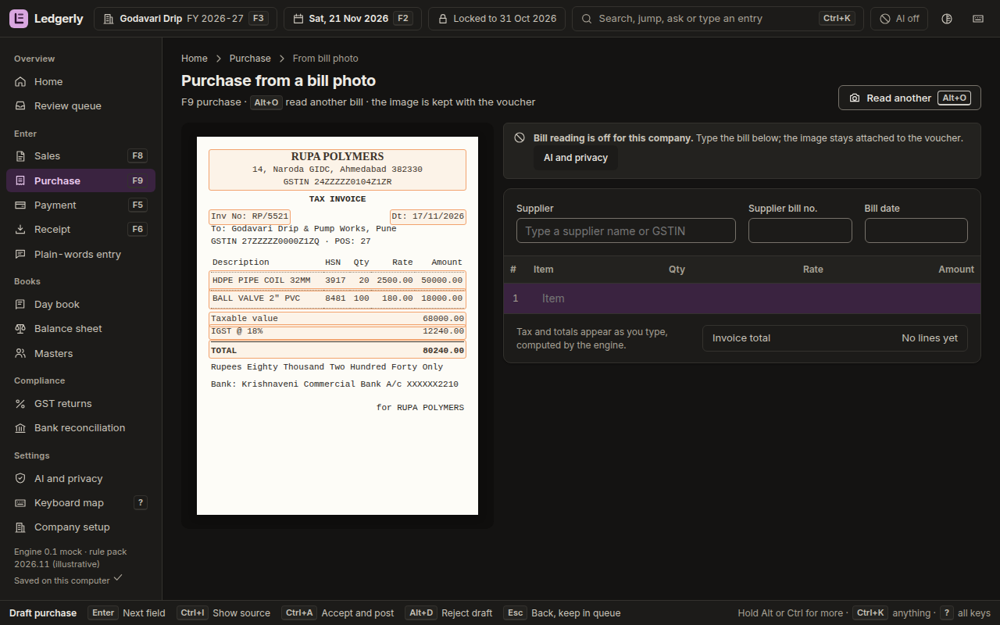</td>
<td></td>
</tr>
</table>

## dark / keys.standard

SSIM 0.6525

<table>
<tr><th>Mock</th><th>App</th></tr>
<tr>
<td></td>
<td>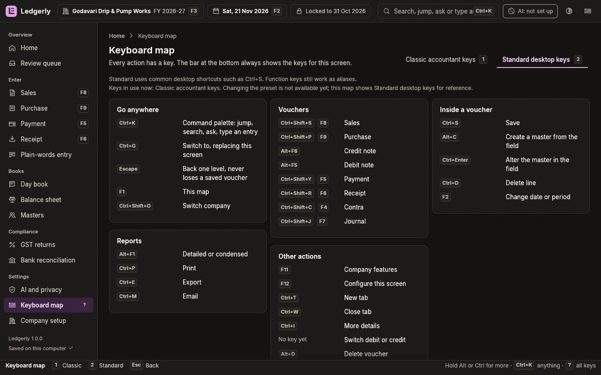</td>
</tr>
</table>

## light / ai-settings.local

SSIM 0.6590

<table>
<tr><th>Mock</th><th>App</th></tr>
<tr>
<td></td>
<td></td>
</tr>
</table>

## light / palette.default

SSIM 0.6595

<table>
<tr><th>Mock</th><th>App</th></tr>
<tr>
<td></td>
<td></td>
</tr>
</table>

## light / balance-sheet.provisional

SSIM 0.6597

<table>
<tr><th>Mock</th><th>App</th></tr>
<tr>
<td></td>
<td>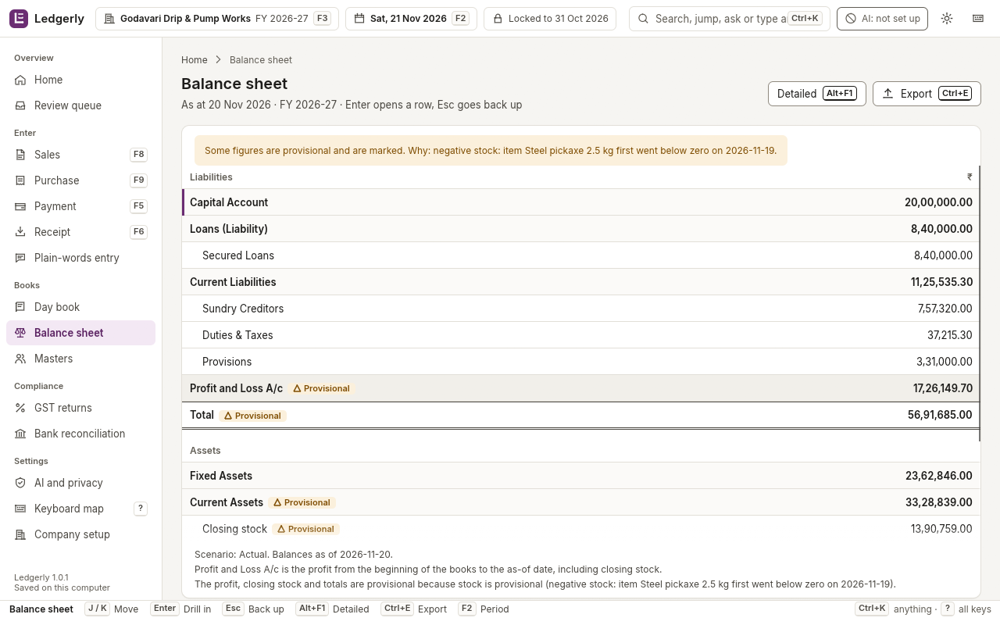</td>
</tr>
</table>

## light / keys.classic

SSIM 0.6615

<table>
<tr><th>Mock</th><th>App</th></tr>
<tr>
<td>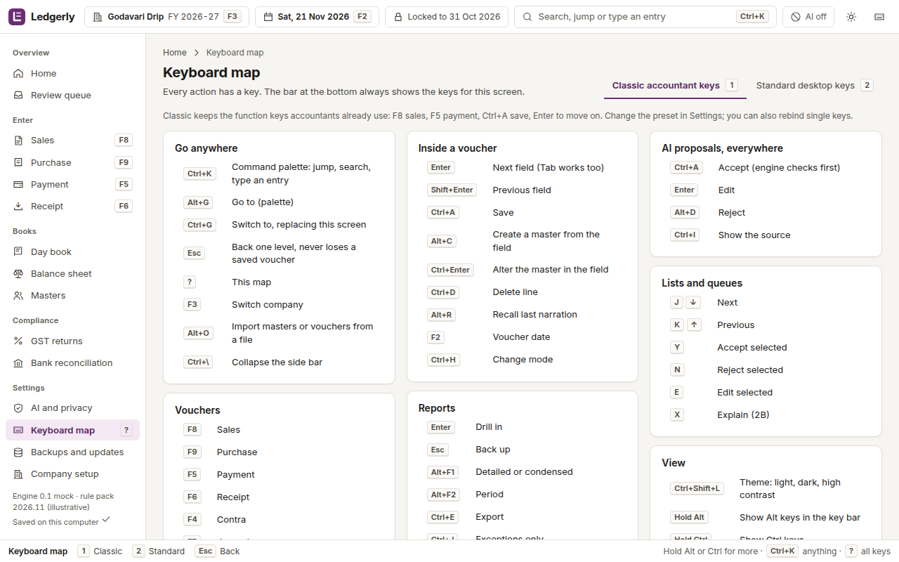</td>
<td></td>
</tr>
</table>

## dark / review.default

SSIM 0.6619

<table>
<tr><th>Mock</th><th>App</th></tr>
<tr>
<td></td>
<td></td>
</tr>
</table>

## dark / keys.classic

SSIM 0.6620

<table>
<tr><th>Mock</th><th>App</th></tr>
<tr>
<td></td>
<td></td>
</tr>
</table>

## light / sales-invoice.b2c

SSIM 0.6625

<table>
<tr><th>Mock</th><th>App</th></tr>
<tr>
<td></td>
<td></td>
</tr>
</table>

## light / sales-invoice.saved

SSIM 0.6635

<table>
<tr><th>Mock</th><th>App</th></tr>
<tr>
<td>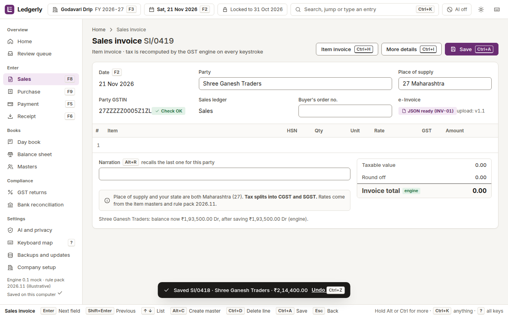</td>
<td></td>
</tr>
</table>

## dark / ai-settings.local

SSIM 0.6647

<table>
<tr><th>Mock</th><th>App</th></tr>
<tr>
<td></td>
<td></td>
</tr>
</table>

## hc / gst.gstr3b

SSIM 0.6657

<table>
<tr><th>Mock</th><th>App</th></tr>
<tr>
<td></td>
<td></td>
</tr>
</table>

## dark / palette.default

SSIM 0.6664

<table>
<tr><th>Mock</th><th>App</th></tr>
<tr>
<td></td>
<td></td>
</tr>
</table>

## light / review.default

SSIM 0.6666

<table>
<tr><th>Mock</th><th>App</th></tr>
<tr>
<td></td>
<td></td>
</tr>
</table>

## light / balance-sheet.default

SSIM 0.6669

<table>
<tr><th>Mock</th><th>App</th></tr>
<tr>
<td></td>
<td></td>
</tr>
</table>

## dark / balance-sheet.provisional

SSIM 0.6675

<table>
<tr><th>Mock</th><th>App</th></tr>
<tr>
<td></td>
<td></td>
</tr>
</table>

## dark / sales-invoice.b2c

SSIM 0.6723

<table>
<tr><th>Mock</th><th>App</th></tr>
<tr>
<td>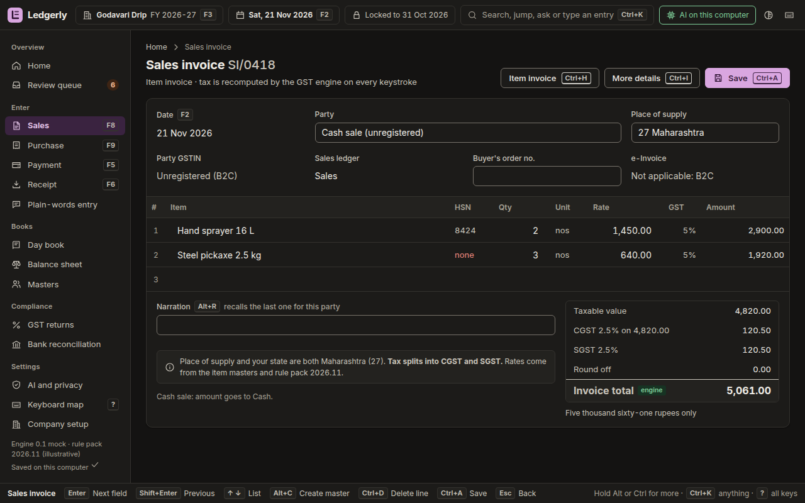</td>
<td></td>
</tr>
</table>

## dark / sales-invoice.saved

SSIM 0.6755

<table>
<tr><th>Mock</th><th>App</th></tr>
<tr>
<td></td>
<td></td>
</tr>
</table>

## light / palette.commands

SSIM 0.6782

<table>
<tr><th>Mock</th><th>App</th></tr>
<tr>
<td></td>
<td></td>
</tr>
</table>

## hc / receipt.default

SSIM 0.6806

<table>
<tr><th>Mock</th><th>App</th></tr>
<tr>
<td></td>
<td></td>
</tr>
</table>

## light / ai-settings.off

SSIM 0.6850

<table>
<tr><th>Mock</th><th>App</th></tr>
<tr>
<td></td>
<td></td>
</tr>
</table>

## dark / gst.gstr1-correction

SSIM 0.6863

<table>
<tr><th>Mock</th><th>App</th></tr>
<tr>
<td></td>
<td></td>
</tr>
</table>

## dark / palette.commands

SSIM 0.6867

<table>
<tr><th>Mock</th><th>App</th></tr>
<tr>
<td></td>
<td></td>
</tr>
</table>

## light / gst.gstr1-correction

SSIM 0.6879

<table>
<tr><th>Mock</th><th>App</th></tr>
<tr>
<td></td>
<td></td>
</tr>
</table>

## dark / ai-settings.off

SSIM 0.6896

<table>
<tr><th>Mock</th><th>App</th></tr>
<tr>
<td></td>
<td></td>
</tr>
</table>

## dark / balance-sheet.default

SSIM 0.6903

<table>
<tr><th>Mock</th><th>App</th></tr>
<tr>
<td></td>
<td></td>
</tr>
</table>

## dark / balance-sheet.detailed

SSIM 0.6908

<table>
<tr><th>Mock</th><th>App</th></tr>
<tr>
<td></td>
<td></td>
</tr>
</table>

## hc / day-book.default

SSIM 0.6932

<table>
<tr><th>Mock</th><th>App</th></tr>
<tr>
<td></td>
<td></td>
</tr>
</table>

## hc / payment.default

SSIM 0.6945

<table>
<tr><th>Mock</th><th>App</th></tr>
<tr>
<td></td>
<td></td>
</tr>
</table>

## light / bank.brs

SSIM 0.6964

<table>
<tr><th>Mock</th><th>App</th></tr>
<tr>
<td></td>
<td></td>
</tr>
</table>

## light / gst.gstr3b

SSIM 0.7013

<table>
<tr><th>Mock</th><th>App</th></tr>
<tr>
<td></td>
<td></td>
</tr>
</table>

## hc / balance-sheet.voucher

SSIM 0.7015

<table>
<tr><th>Mock</th><th>App</th></tr>
<tr>
<td></td>
<td>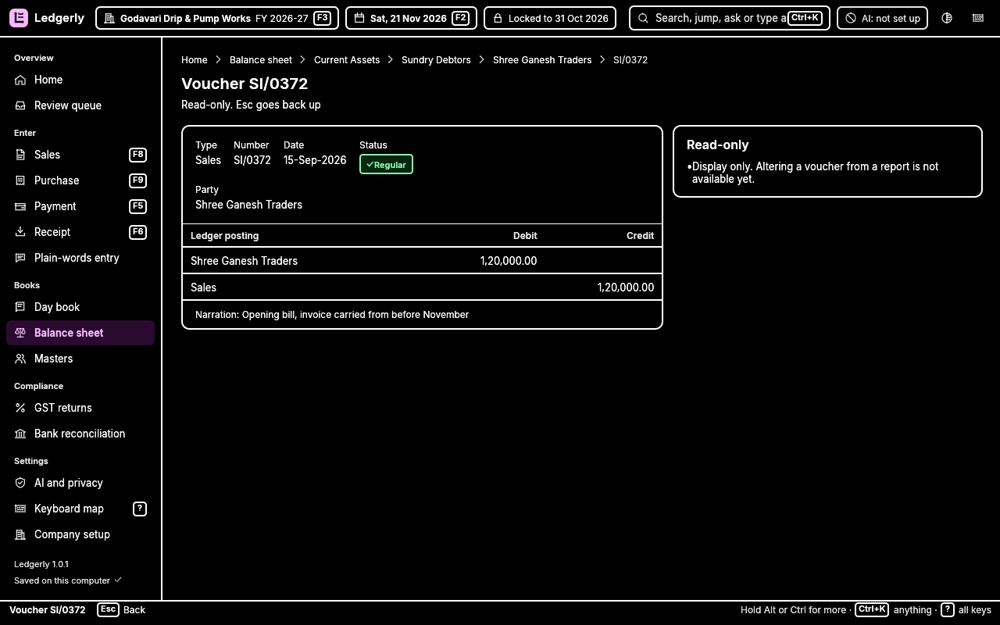</td>
</tr>
</table>

## dark / gst.gstr3b

SSIM 0.7021

<table>
<tr><th>Mock</th><th>App</th></tr>
<tr>
<td></td>
<td></td>
</tr>
</table>

## dark / bank.brs

SSIM 0.7023

<table>
<tr><th>Mock</th><th>App</th></tr>
<tr>
<td></td>
<td></td>
</tr>
</table>

## hc / setup.features

SSIM 0.7061

<table>
<tr><th>Mock</th><th>App</th></tr>
<tr>
<td></td>
<td></td>
</tr>
</table>

## hc / masters.gstin-error

SSIM 0.7076

<table>
<tr><th>Mock</th><th>App</th></tr>
<tr>
<td>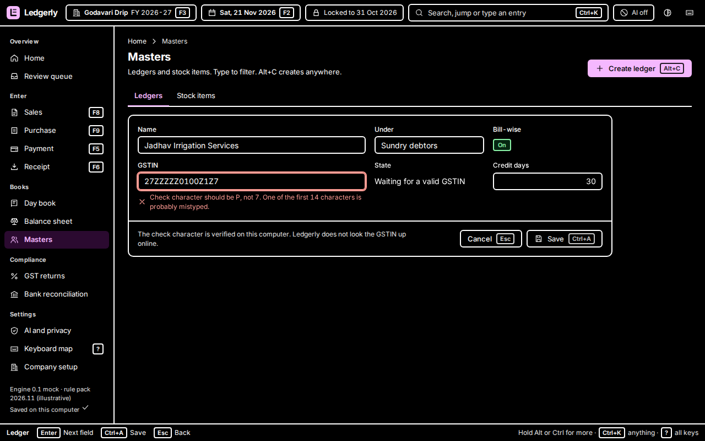</td>
<td></td>
</tr>
</table>

## dark / masters.items

SSIM 0.7140

<table>
<tr><th>Mock</th><th>App</th></tr>
<tr>
<td></td>
<td></td>
</tr>
</table>

## light / masters.items

SSIM 0.7163

<table>
<tr><th>Mock</th><th>App</th></tr>
<tr>
<td>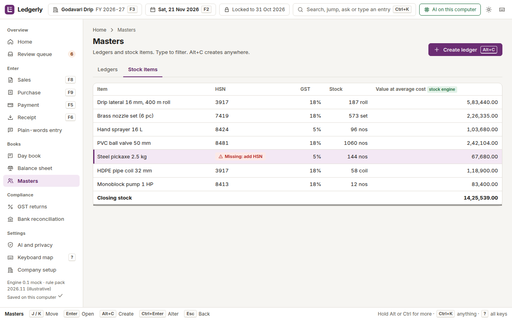</td>
<td></td>
</tr>
</table>

## hc / masters.ledger-detail

SSIM 0.7196

<table>
<tr><th>Mock</th><th>App</th></tr>
<tr>
<td></td>
<td></td>
</tr>
</table>

## dark / balance-sheet.ledger

SSIM 0.7296

<table>
<tr><th>Mock</th><th>App</th></tr>
<tr>
<td></td>
<td></td>
</tr>
</table>

## light / balance-sheet.ledger

SSIM 0.7342

<table>
<tr><th>Mock</th><th>App</th></tr>
<tr>
<td></td>
<td></td>
</tr>
</table>

## light / receipt.default

SSIM 0.7369

<table>
<tr><th>Mock</th><th>App</th></tr>
<tr>
<td></td>
<td></td>
</tr>
</table>

## light / day-book.default

SSIM 0.7374

<table>
<tr><th>Mock</th><th>App</th></tr>
<tr>
<td>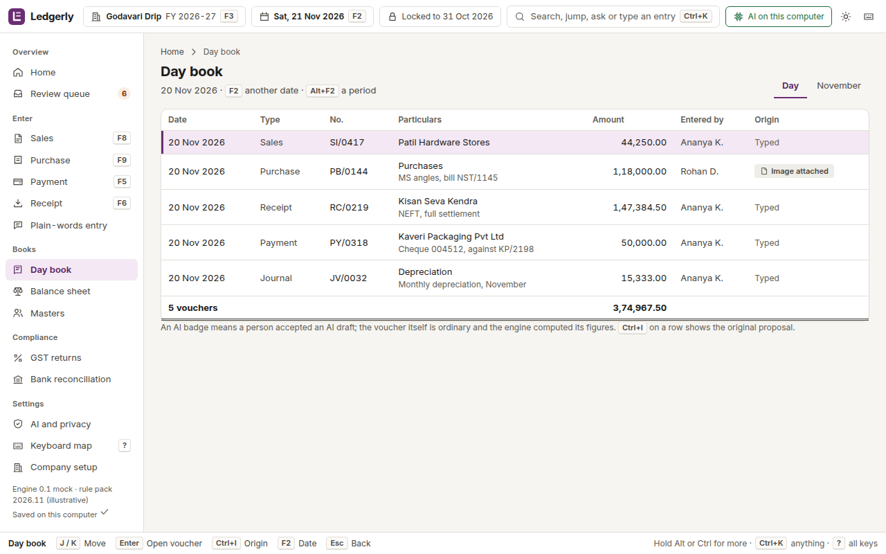</td>
<td></td>
</tr>
</table>

## dark / masters.gstin-error

SSIM 0.7380

<table>
<tr><th>Mock</th><th>App</th></tr>
<tr>
<td></td>
<td></td>
</tr>
</table>

## dark / receipt.default

SSIM 0.7403

<table>
<tr><th>Mock</th><th>App</th></tr>
<tr>
<td></td>
<td></td>
</tr>
</table>

## hc / balance-sheet.group

SSIM 0.7413

<table>
<tr><th>Mock</th><th>App</th></tr>
<tr>
<td></td>
<td></td>
</tr>
</table>

## light / purchase-bill.offline-ai

SSIM 0.7422

<table>
<tr><th>Mock</th><th>App</th></tr>
<tr>
<td></td>
<td></td>
</tr>
</table>

## light / balance-sheet.group

SSIM 0.7430

<table>
<tr><th>Mock</th><th>App</th></tr>
<tr>
<td></td>
<td></td>
</tr>
</table>

## dark / day-book.default

SSIM 0.7456

<table>
<tr><th>Mock</th><th>App</th></tr>
<tr>
<td></td>
<td></td>
</tr>
</table>

## light / masters.gstin-error

SSIM 0.7473

<table>
<tr><th>Mock</th><th>App</th></tr>
<tr>
<td></td>
<td></td>
</tr>
</table>

## hc / masters.create-ledger

SSIM 0.7514

<table>
<tr><th>Mock</th><th>App</th></tr>
<tr>
<td></td>
<td></td>
</tr>
</table>

## dark / masters.ledger-detail

SSIM 0.7514

<table>
<tr><th>Mock</th><th>App</th></tr>
<tr>
<td></td>
<td></td>
</tr>
</table>

## dark / balance-sheet.group

SSIM 0.7514

<table>
<tr><th>Mock</th><th>App</th></tr>
<tr>
<td></td>
<td></td>
</tr>
</table>

## light / payment.default

SSIM 0.7527

<table>
<tr><th>Mock</th><th>App</th></tr>
<tr>
<td></td>
<td></td>
</tr>
</table>

## dark / payment.default

SSIM 0.7553

<table>
<tr><th>Mock</th><th>App</th></tr>
<tr>
<td></td>
<td></td>
</tr>
</table>

## light / balance-sheet.voucher

SSIM 0.7558

<table>
<tr><th>Mock</th><th>App</th></tr>
<tr>
<td></td>
<td></td>
</tr>
</table>

## light / setup.features

SSIM 0.7571

<table>
<tr><th>Mock</th><th>App</th></tr>
<tr>
<td></td>
<td></td>
</tr>
</table>

## dark / balance-sheet.voucher

SSIM 0.7573

<table>
<tr><th>Mock</th><th>App</th></tr>
<tr>
<td></td>
<td></td>
</tr>
</table>

## light / masters.ledger-detail

SSIM 0.7584

<table>
<tr><th>Mock</th><th>App</th></tr>
<tr>
<td></td>
<td>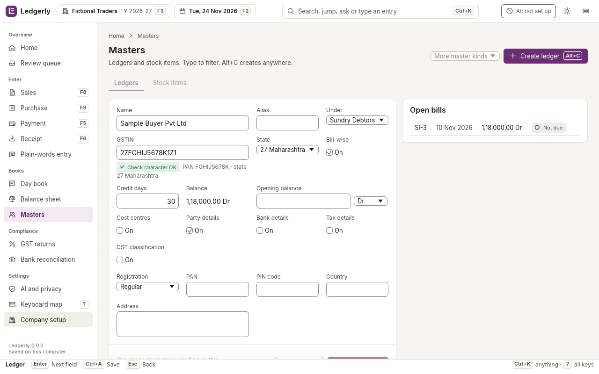</td>
</tr>
</table>

## hc / ask.offline-ai

SSIM 0.7614

<table>
<tr><th>Mock</th><th>App</th></tr>
<tr>
<td></td>
<td></td>
</tr>
</table>

## hc / setup.done

SSIM 0.7622

<table>
<tr><th>Mock</th><th>App</th></tr>
<tr>
<td></td>
<td></td>
</tr>
</table>

## hc / home.empty

SSIM 0.7654

<table>
<tr><th>Mock</th><th>App</th></tr>
<tr>
<td></td>
<td>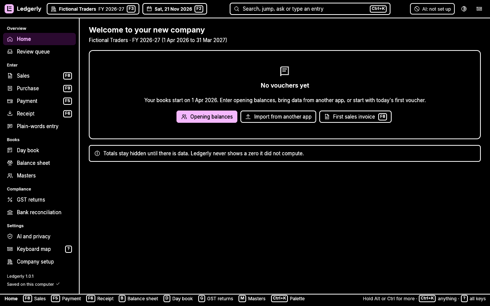</td>
</tr>
</table>

## dark / setup.features

SSIM 0.7661

<table>
<tr><th>Mock</th><th>App</th></tr>
<tr>
<td></td>
<td></td>
</tr>
</table>

## hc / setup.company

SSIM 0.7842

<table>
<tr><th>Mock</th><th>App</th></tr>
<tr>
<td></td>
<td></td>
</tr>
</table>

## hc / bank.empty

SSIM 0.7872

<table>
<tr><th>Mock</th><th>App</th></tr>
<tr>
<td></td>
<td></td>
</tr>
</table>

## dark / masters.create-ledger

SSIM 0.7894

<table>
<tr><th>Mock</th><th>App</th></tr>
<tr>
<td></td>
<td>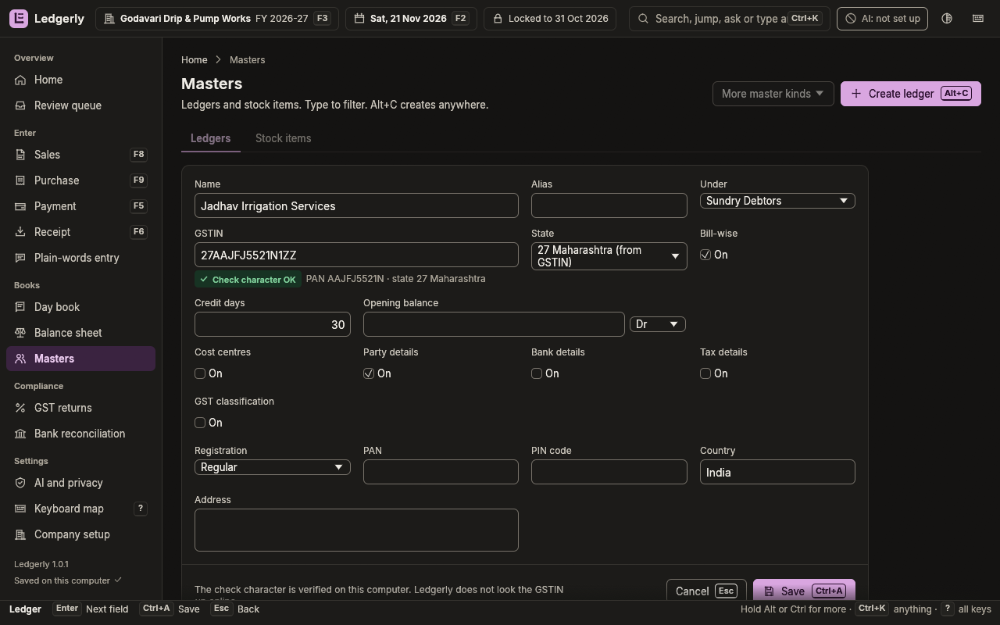</td>
</tr>
</table>

## light / masters.create-ledger

SSIM 0.7900

<table>
<tr><th>Mock</th><th>App</th></tr>
<tr>
<td></td>
<td></td>
</tr>
</table>

## hc / setup.gstin-error

SSIM 0.7927

<table>
<tr><th>Mock</th><th>App</th></tr>
<tr>
<td>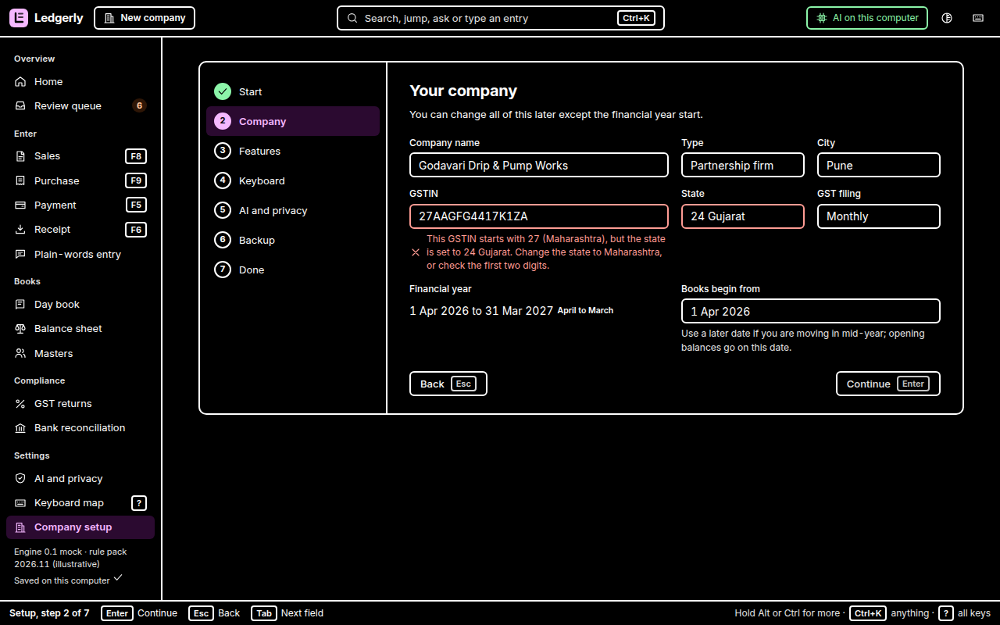</td>
<td>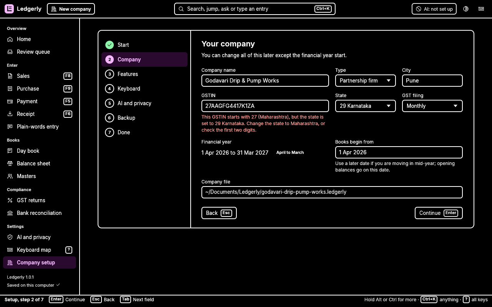</td>
</tr>
</table>

## dark / setup.company

SSIM 0.7980

<table>
<tr><th>Mock</th><th>App</th></tr>
<tr>
<td></td>
<td></td>
</tr>
</table>

## light / setup.company

SSIM 0.7997

<table>
<tr><th>Mock</th><th>App</th></tr>
<tr>
<td></td>
<td></td>
</tr>
</table>

## dark / home.empty

SSIM 0.8019

<table>
<tr><th>Mock</th><th>App</th></tr>
<tr>
<td></td>
<td></td>
</tr>
</table>

## hc / setup.backup

SSIM 0.8025

<table>
<tr><th>Mock</th><th>App</th></tr>
<tr>
<td></td>
<td>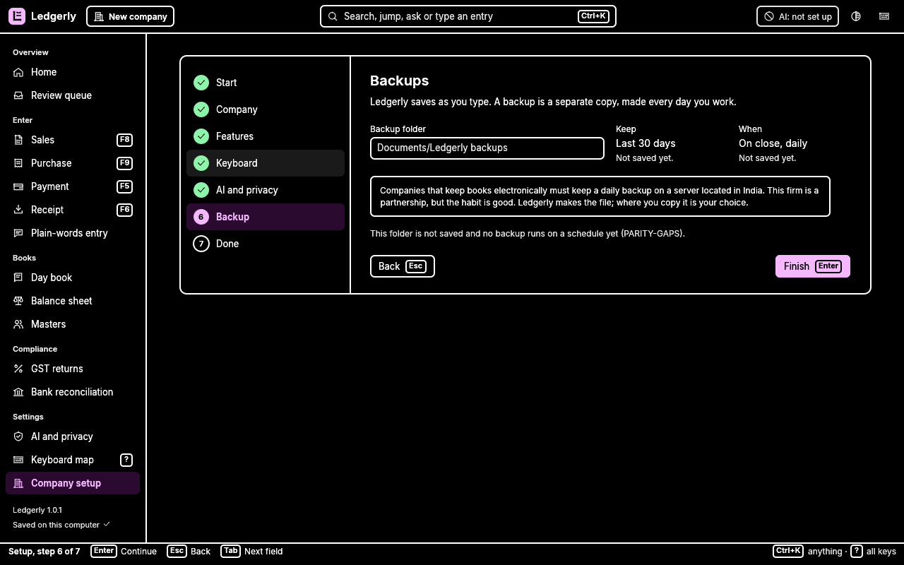</td>
</tr>
</table>

## hc / setup.ai

SSIM 0.8025

<table>
<tr><th>Mock</th><th>App</th></tr>
<tr>
<td></td>
<td>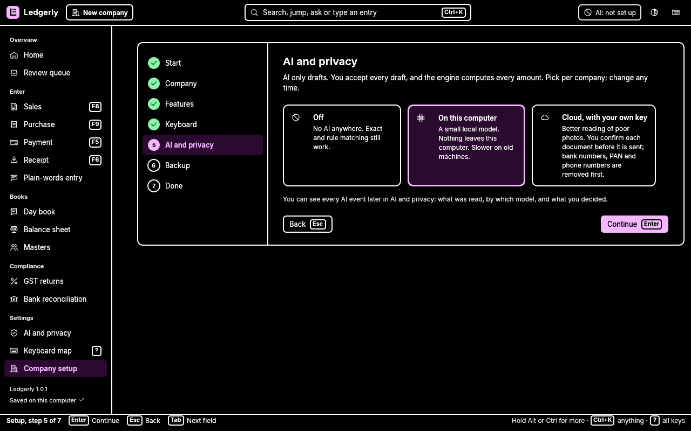</td>
</tr>
</table>

## hc / day-book.empty

SSIM 0.8047

<table>
<tr><th>Mock</th><th>App</th></tr>
<tr>
<td></td>
<td></td>
</tr>
</table>

## light / ask.offline-ai

SSIM 0.8055

<table>
<tr><th>Mock</th><th>App</th></tr>
<tr>
<td></td>
<td></td>
</tr>
</table>

## hc / gst.recon-empty

SSIM 0.8060

<table>
<tr><th>Mock</th><th>App</th></tr>
<tr>
<td></td>
<td></td>
</tr>
</table>

## light / home.empty

SSIM 0.8084

<table>
<tr><th>Mock</th><th>App</th></tr>
<tr>
<td></td>
<td></td>
</tr>
</table>

## dark / setup.gstin-error

SSIM 0.8091

<table>
<tr><th>Mock</th><th>App</th></tr>
<tr>
<td></td>
<td>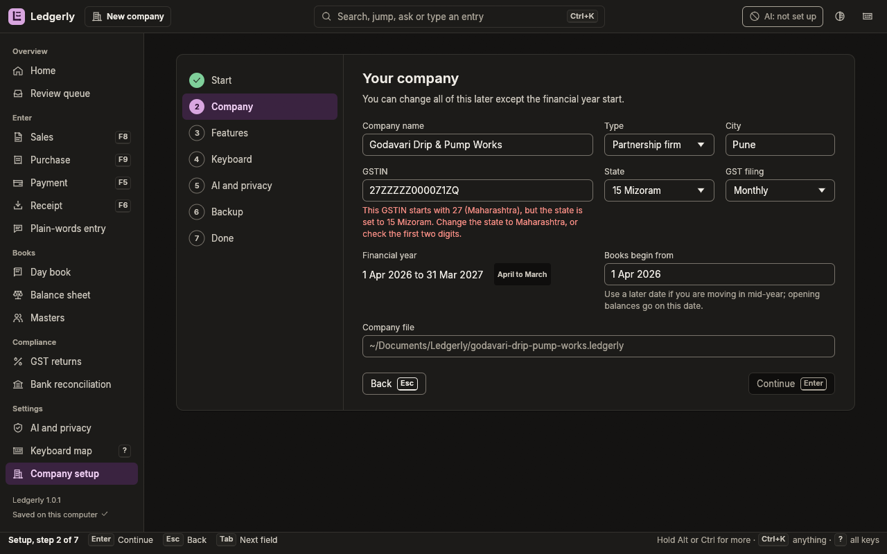</td>
</tr>
</table>

## dark / setup.done

SSIM 0.8097

<table>
<tr><th>Mock</th><th>App</th></tr>
<tr>
<td>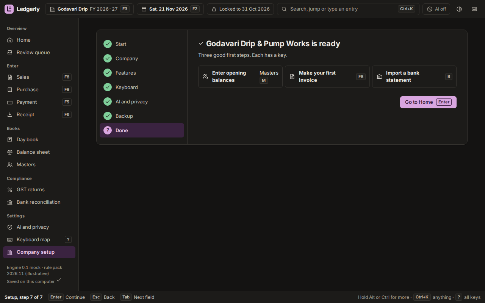</td>
<td></td>
</tr>
</table>

## hc / review.empty

SSIM 0.8099

<table>
<tr><th>Mock</th><th>App</th></tr>
<tr>
<td></td>
<td></td>
</tr>
</table>

## light / setup.gstin-error

SSIM 0.8101

<table>
<tr><th>Mock</th><th>App</th></tr>
<tr>
<td></td>
<td></td>
</tr>
</table>

## dark / ask.offline-ai

SSIM 0.8112

<table>
<tr><th>Mock</th><th>App</th></tr>
<tr>
<td></td>
<td>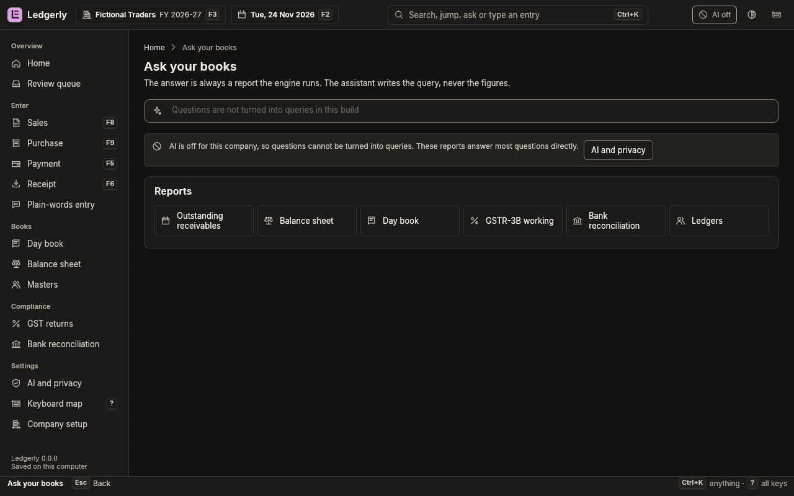</td>
</tr>
</table>

## hc / setup.welcome

SSIM 0.8121

<table>
<tr><th>Mock</th><th>App</th></tr>
<tr>
<td></td>
<td></td>
</tr>
</table>

## light / bank.empty

SSIM 0.8153

<table>
<tr><th>Mock</th><th>App</th></tr>
<tr>
<td></td>
<td></td>
</tr>
</table>

## dark / bank.empty

SSIM 0.8153

<table>
<tr><th>Mock</th><th>App</th></tr>
<tr>
<td></td>
<td></td>
</tr>
</table>

## hc / setup.keyboard

SSIM 0.8180

<table>
<tr><th>Mock</th><th>App</th></tr>
<tr>
<td></td>
<td></td>
</tr>
</table>

## dark / review.empty

SSIM 0.8226

<table>
<tr><th>Mock</th><th>App</th></tr>
<tr>
<td></td>
<td></td>
</tr>
</table>

## dark / gst.recon-empty

SSIM 0.8267

<table>
<tr><th>Mock</th><th>App</th></tr>
<tr>
<td></td>
<td></td>
</tr>
</table>

## light / review.empty

SSIM 0.8272

<table>
<tr><th>Mock</th><th>App</th></tr>
<tr>
<td></td>
<td></td>
</tr>
</table>

## light / gst.recon-empty

SSIM 0.8308

<table>
<tr><th>Mock</th><th>App</th></tr>
<tr>
<td></td>
<td></td>
</tr>
</table>

## light / setup.backup

SSIM 0.8328

<table>
<tr><th>Mock</th><th>App</th></tr>
<tr>
<td></td>
<td></td>
</tr>
</table>

## light / day-book.empty

SSIM 0.8345

<table>
<tr><th>Mock</th><th>App</th></tr>
<tr>
<td></td>
<td></td>
</tr>
</table>

## dark / day-book.empty

SSIM 0.8353

<table>
<tr><th>Mock</th><th>App</th></tr>
<tr>
<td></td>
<td></td>
</tr>
</table>

## dark / setup.backup

SSIM 0.8354

<table>
<tr><th>Mock</th><th>App</th></tr>
<tr>
<td></td>
<td></td>
</tr>
</table>

## light / setup.welcome

SSIM 0.8395

<table>
<tr><th>Mock</th><th>App</th></tr>
<tr>
<td></td>
<td>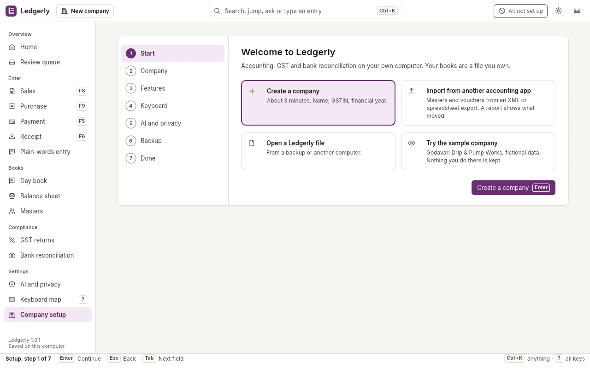</td>
</tr>
</table>

## light / setup.keyboard

SSIM 0.8418

<table>
<tr><th>Mock</th><th>App</th></tr>
<tr>
<td></td>
<td></td>
</tr>
</table>

## dark / setup.keyboard

SSIM 0.8423

<table>
<tr><th>Mock</th><th>App</th></tr>
<tr>
<td></td>
<td>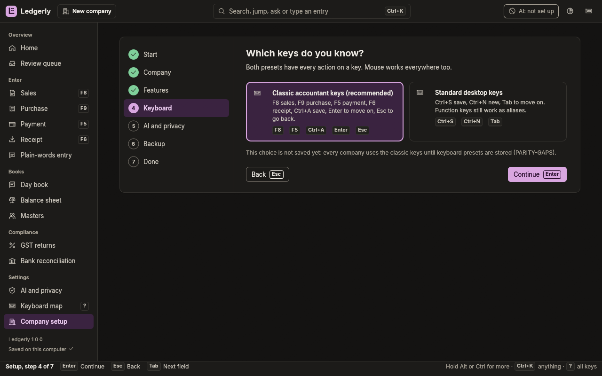</td>
</tr>
</table>

## dark / setup.welcome

SSIM 0.8452

<table>
<tr><th>Mock</th><th>App</th></tr>
<tr>
<td></td>
<td></td>
</tr>
</table>

## light / setup.ai

SSIM 0.8461

<table>
<tr><th>Mock</th><th>App</th></tr>
<tr>
<td></td>
<td></td>
</tr>
</table>

## dark / setup.ai

SSIM 0.8492

<table>
<tr><th>Mock</th><th>App</th></tr>
<tr>
<td></td>
<td></td>
</tr>
</table>

## light / setup.done

SSIM 0.8904

<table>
<tr><th>Mock</th><th>App</th></tr>
<tr>
<td>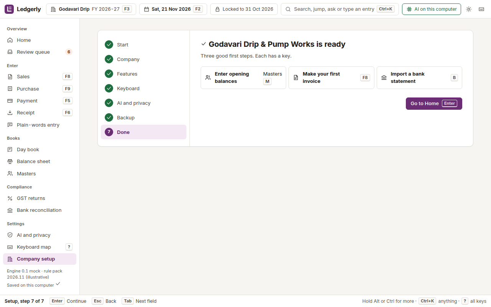</td>
<td></td>
</tr>
</table>

## Mock states with no app capture yet

### light (31)

- `home.loading`
- `home.nudge-open`
- `ask.result`
- `ask.loading`
- `ask.low-confidence`
- `ask.unsupported`
- `purchase-bill.reading`
- `purchase-bill.proposal`
- `purchase-bill.low-confidence`
- `purchase-bill.mismatch`
- `purchase-bill.duplicate`
- `purchase-bill.cloud-consent`
- `purchase-bill.error`
- `purchase-bill.accepted`
- `quick-entry.proposal`
- `quick-entry.hinglish`
- `quick-entry.unknown-ledger`
- `quick-entry.loading`
- `quick-entry.rejected`
- `payment.bill-wise`
- `payment.overdraft`
- `balance-sheet.loading`
- `gst.recon`
- `gst.recon-explain`
- `gst.recon-error`
- `gst.recon-locked`
- `bank.ai-suggestions`
- `bank.suggested-ledger`
- `bank.import-error`
- `bank.offline-ai`
- `masters.suggested-ledger`

### dark (31)

- `home.loading`
- `home.nudge-open`
- `ask.result`
- `ask.loading`
- `ask.low-confidence`
- `ask.unsupported`
- `purchase-bill.reading`
- `purchase-bill.proposal`
- `purchase-bill.low-confidence`
- `purchase-bill.mismatch`
- `purchase-bill.duplicate`
- `purchase-bill.cloud-consent`
- `purchase-bill.error`
- `purchase-bill.accepted`
- `quick-entry.proposal`
- `quick-entry.hinglish`
- `quick-entry.unknown-ledger`
- `quick-entry.loading`
- `quick-entry.rejected`
- `payment.bill-wise`
- `payment.overdraft`
- `balance-sheet.loading`
- `gst.recon`
- `gst.recon-explain`
- `gst.recon-error`
- `gst.recon-locked`
- `bank.ai-suggestions`
- `bank.suggested-ledger`
- `bank.import-error`
- `bank.offline-ai`
- `masters.suggested-ledger`

### hc (31)

- `home.loading`
- `home.nudge-open`
- `ask.result`
- `ask.loading`
- `ask.low-confidence`
- `ask.unsupported`
- `purchase-bill.reading`
- `purchase-bill.proposal`
- `purchase-bill.low-confidence`
- `purchase-bill.mismatch`
- `purchase-bill.duplicate`
- `purchase-bill.cloud-consent`
- `purchase-bill.error`
- `purchase-bill.accepted`
- `quick-entry.proposal`
- `quick-entry.hinglish`
- `quick-entry.unknown-ledger`
- `quick-entry.loading`
- `quick-entry.rejected`
- `payment.bill-wise`
- `payment.overdraft`
- `balance-sheet.loading`
- `gst.recon`
- `gst.recon-explain`
- `gst.recon-error`
- `gst.recon-locked`
- `bank.ai-suggestions`
- `bank.suggested-ledger`
- `bank.import-error`
- `bank.offline-ai`
- `masters.suggested-ledger`

## App captures with no mock capture

- `light/quick-entry.offline-ai`

