# App against mock

137 app captures are paired with a mock capture of the same theme and state id. SSIM is 1 for identical images; lower is a bigger difference, and the list runs worst first.

| Theme | State | SSIM |
| --- | --- | --- |
| hc | home.default | 0.4688 |
| hc | ai-settings.cloud | 0.4695 |
| hc | palette.voucher | 0.4915 |
| hc | palette.entry | 0.4982 |
| hc | palette.ask | 0.5010 |
| hc | ai-settings.local | 0.5220 |
| hc | palette.no-results | 0.5228 |
| hc | palette.search | 0.5552 |
| dark | home.default | 0.5630 |
| hc | ai-settings.off | 0.5651 |
| light | home.default | 0.5777 |
| hc | palette.default | 0.5789 |
| hc | gst.gstr1 | 0.5824 |
| hc | sales-invoice.default | 0.5848 |
| hc | keys.standard | 0.5851 |
| light | ai-settings.cloud | 0.5852 |
| dark | ai-settings.cloud | 0.5887 |
| hc | keys.classic | 0.5908 |
| hc | bank.default | 0.5909 |
| hc | masters.ledgers | 0.5969 |
| hc | purchase-bill.offline-ai | 0.5994 |
| light | ai-settings.local | 0.6054 |
| hc | palette.commands | 0.6092 |
| dark | ai-settings.local | 0.6141 |
| light | balance-sheet.provisional | 0.6164 |
| light | sales-invoice.period-locked | 0.6182 |
| light | masters.ledgers | 0.6230 |
| hc | balance-sheet.detailed | 0.6254 |
| light | sales-invoice.default | 0.6269 |
| light | palette.voucher | 0.6282 |
| light | palette.entry | 0.6287 |
| hc | balance-sheet.default | 0.6305 |
| light | sales-invoice.gst-inter-state | 0.6314 |
| light | palette.ask | 0.6317 |
| light | palette.no-results | 0.6352 |
| light | sales-invoice.save-confirm | 0.6355 |
| light | sales-invoice.item-list | 0.6365 |
| dark | sales-invoice.default | 0.6379 |
| dark | palette.entry | 0.6393 |
| dark | palette.voucher | 0.6401 |
| light | sales-invoice.validation-error | 0.6404 |
| dark | palette.no-results | 0.6420 |
| dark | palette.ask | 0.6421 |
| hc | setup.features | 0.6429 |
| light | balance-sheet.detailed | 0.6431 |
| dark | masters.ledgers | 0.6436 |
| light | ai-settings.off | 0.6451 |
| dark | ai-settings.off | 0.6464 |
| light | home.ai-off | 0.6490 |
| dark | purchase-bill.offline-ai | 0.6512 |
| light | gst.gstr1 | 0.6519 |
| hc | balance-sheet.ledger | 0.6523 |
| light | keys.standard | 0.6537 |
| hc | masters.items | 0.6539 |
| light | day-book.month | 0.6542 |
| dark | keys.standard | 0.6543 |
| dark | keys.classic | 0.6543 |
| dark | gst.gstr1 | 0.6549 |
| light | keys.classic | 0.6549 |
| hc | receipt.default | 0.6556 |
| light | sales-invoice.b2c | 0.6570 |
| light | palette.search | 0.6589 |
| hc | gst.gstr3b | 0.6593 |
| hc | bank.brs | 0.6599 |
| hc | payment.default | 0.6663 |
| dark | bank.default | 0.6701 |
| dark | palette.search | 0.6706 |
| light | balance-sheet.default | 0.6731 |
| light | gst.gstr1-correction | 0.6734 |
| light | palette.default | 0.6754 |
| dark | palette.default | 0.6756 |
| dark | balance-sheet.detailed | 0.6805 |
| light | bank.default | 0.6840 |
| dark | balance-sheet.default | 0.6847 |
| light | palette.commands | 0.6934 |
| hc | setup.welcome | 0.6955 |
| dark | palette.commands | 0.6966 |
| light | gst.gstr3b | 0.7027 |
| light | review.default | 0.7028 |
| light | setup.features | 0.7051 |
| hc | setup.company | 0.7069 |
| hc | setup.ai | 0.7076 |
| dark | setup.features | 0.7088 |
| dark | gst.gstr3b | 0.7100 |
| hc | balance-sheet.group | 0.7165 |
| hc | day-book.default | 0.7189 |
| light | receipt.default | 0.7190 |
| dark | bank.brs | 0.7206 |
| light | bank.brs | 0.7220 |
| dark | receipt.default | 0.7220 |
| hc | setup.keyboard | 0.7273 |
| dark | balance-sheet.ledger | 0.7273 |
| hc | masters.ledger-detail | 0.7274 |
| hc | setup.backup | 0.7335 |
| light | payment.default | 0.7360 |
| dark | payment.default | 0.7372 |
| light | balance-sheet.ledger | 0.7380 |
| light | purchase-bill.offline-ai | 0.7407 |
| dark | setup.company | 0.7409 |
| light | setup.company | 0.7425 |
| light | balance-sheet.group | 0.7446 |
| light | setup.gstin-error | 0.7447 |
| light | masters.gstin-error | 0.7472 |
| dark | masters.items | 0.7479 |
| dark | balance-sheet.group | 0.7479 |
| hc | masters.create-ledger | 0.7525 |
| light | masters.items | 0.7540 |
| dark | setup.welcome | 0.7540 |
| light | balance-sheet.voucher | 0.7574 |
| dark | masters.ledger-detail | 0.7590 |
| hc | ask.offline-ai | 0.7600 |
| dark | setup.ai | 0.7611 |
| light | day-book.default | 0.7617 |
| dark | day-book.default | 0.7623 |
| light | setup.ai | 0.7631 |
| light | masters.ledger-detail | 0.7661 |
| dark | setup.backup | 0.7696 |
| light | setup.backup | 0.7722 |
| dark | setup.keyboard | 0.7753 |
| light | setup.keyboard | 0.7794 |
| hc | setup.done | 0.7807 |
| light | masters.create-ledger | 0.7905 |
| dark | masters.create-ledger | 0.7909 |
| light | bank.empty | 0.8008 |
| light | ask.offline-ai | 0.8040 |
| hc | gst.recon-empty | 0.8063 |
| light | home.empty | 0.8082 |
| hc | review.empty | 0.8095 |
| dark | ask.offline-ai | 0.8102 |
| light | setup.welcome | 0.8199 |
| dark | setup.done | 0.8215 |
| dark | review.empty | 0.8224 |
| light | setup.done | 0.8226 |
| light | review.empty | 0.8269 |
| dark | gst.recon-empty | 0.8276 |
| light | gst.recon-empty | 0.8314 |
| light | day-book.empty | 0.8378 |

## hc / home.default

SSIM 0.4688

<table>
<tr><th>Mock</th><th>App</th></tr>
<tr>
<td></td>
<td>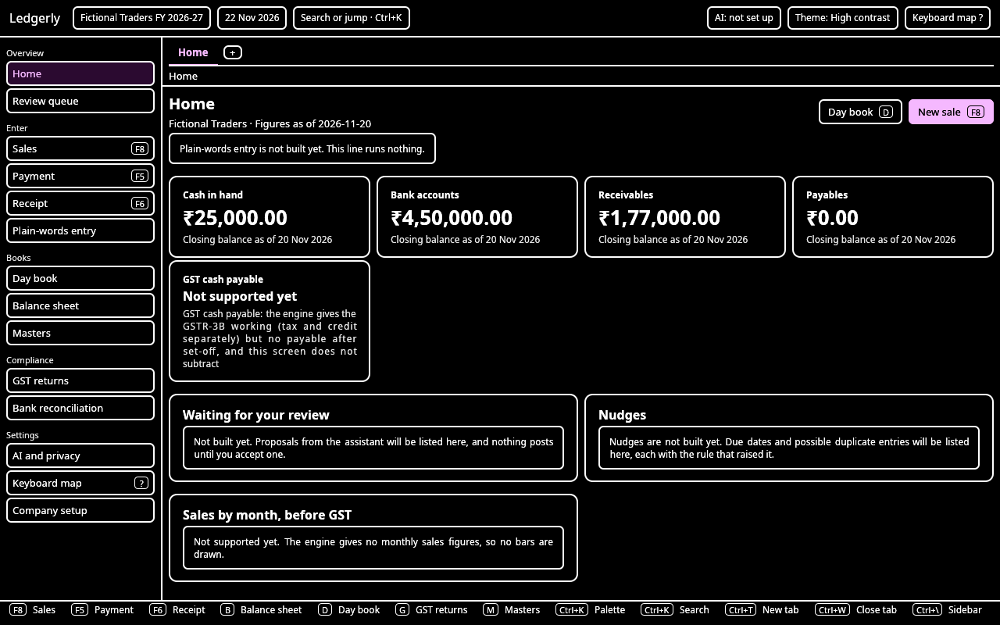</td>
</tr>
</table>

## hc / ai-settings.cloud

SSIM 0.4695

<table>
<tr><th>Mock</th><th>App</th></tr>
<tr>
<td></td>
<td></td>
</tr>
</table>

## hc / palette.voucher

SSIM 0.4915

<table>
<tr><th>Mock</th><th>App</th></tr>
<tr>
<td></td>
<td>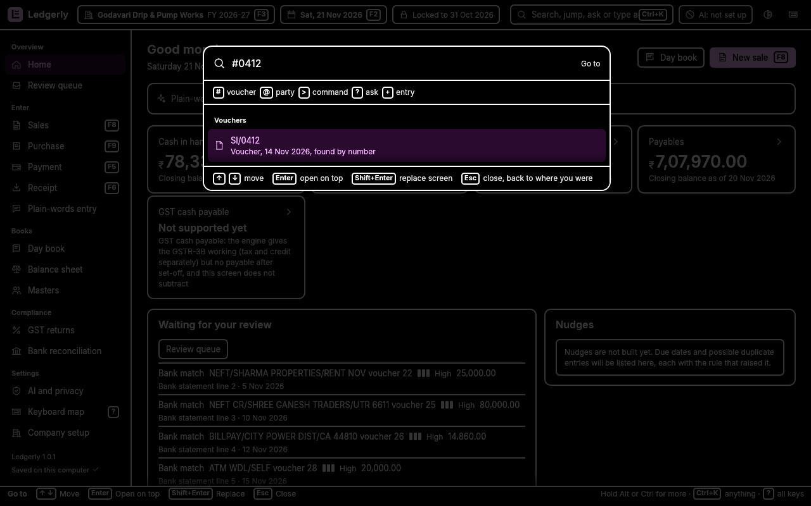</td>
</tr>
</table>

## hc / palette.entry

SSIM 0.4982

<table>
<tr><th>Mock</th><th>App</th></tr>
<tr>
<td></td>
<td></td>
</tr>
</table>

## hc / palette.ask

SSIM 0.5010

<table>
<tr><th>Mock</th><th>App</th></tr>
<tr>
<td>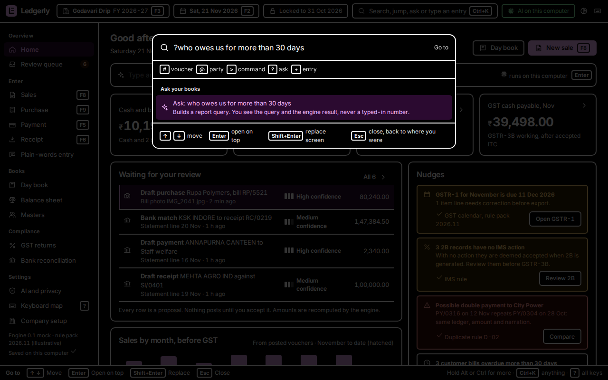</td>
<td></td>
</tr>
</table>

## hc / ai-settings.local

SSIM 0.5220

<table>
<tr><th>Mock</th><th>App</th></tr>
<tr>
<td></td>
<td></td>
</tr>
</table>

## hc / palette.no-results

SSIM 0.5228

<table>
<tr><th>Mock</th><th>App</th></tr>
<tr>
<td></td>
<td></td>
</tr>
</table>

## hc / palette.search

SSIM 0.5552

<table>
<tr><th>Mock</th><th>App</th></tr>
<tr>
<td></td>
<td></td>
</tr>
</table>

## dark / home.default

SSIM 0.5630

<table>
<tr><th>Mock</th><th>App</th></tr>
<tr>
<td></td>
<td></td>
</tr>
</table>

## hc / ai-settings.off

SSIM 0.5651

<table>
<tr><th>Mock</th><th>App</th></tr>
<tr>
<td>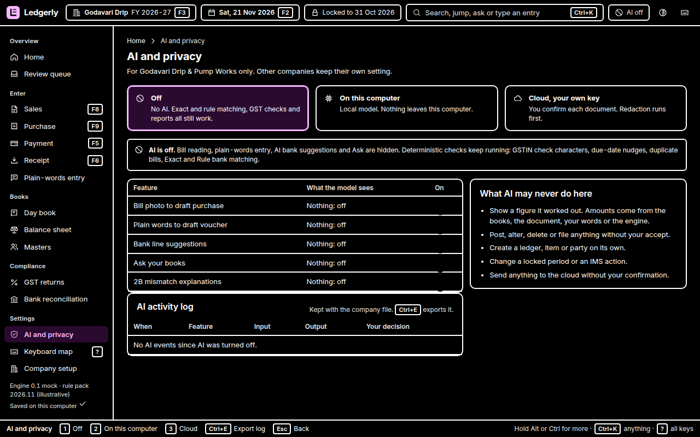</td>
<td></td>
</tr>
</table>

## light / home.default

SSIM 0.5777

<table>
<tr><th>Mock</th><th>App</th></tr>
<tr>
<td></td>
<td></td>
</tr>
</table>

## hc / palette.default

SSIM 0.5789

<table>
<tr><th>Mock</th><th>App</th></tr>
<tr>
<td></td>
<td></td>
</tr>
</table>

## hc / gst.gstr1

SSIM 0.5824

<table>
<tr><th>Mock</th><th>App</th></tr>
<tr>
<td></td>
<td></td>
</tr>
</table>

## hc / sales-invoice.default

SSIM 0.5848

<table>
<tr><th>Mock</th><th>App</th></tr>
<tr>
<td></td>
<td></td>
</tr>
</table>

## hc / keys.standard

SSIM 0.5851

<table>
<tr><th>Mock</th><th>App</th></tr>
<tr>
<td></td>
<td></td>
</tr>
</table>

## light / ai-settings.cloud

SSIM 0.5852

<table>
<tr><th>Mock</th><th>App</th></tr>
<tr>
<td>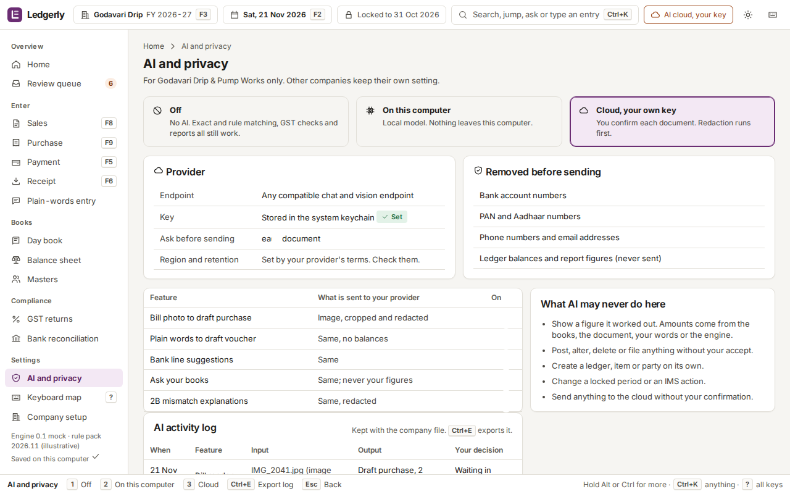</td>
<td></td>
</tr>
</table>

## dark / ai-settings.cloud

SSIM 0.5887

<table>
<tr><th>Mock</th><th>App</th></tr>
<tr>
<td></td>
<td></td>
</tr>
</table>

## hc / keys.classic

SSIM 0.5908

<table>
<tr><th>Mock</th><th>App</th></tr>
<tr>
<td></td>
<td>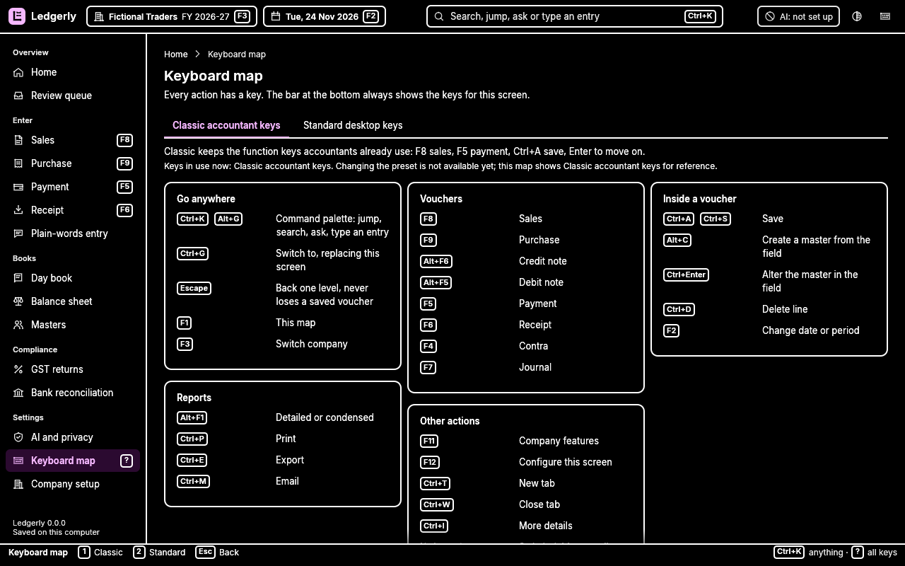</td>
</tr>
</table>

## hc / bank.default

SSIM 0.5909

<table>
<tr><th>Mock</th><th>App</th></tr>
<tr>
<td></td>
<td></td>
</tr>
</table>

## hc / masters.ledgers

SSIM 0.5969

<table>
<tr><th>Mock</th><th>App</th></tr>
<tr>
<td></td>
<td>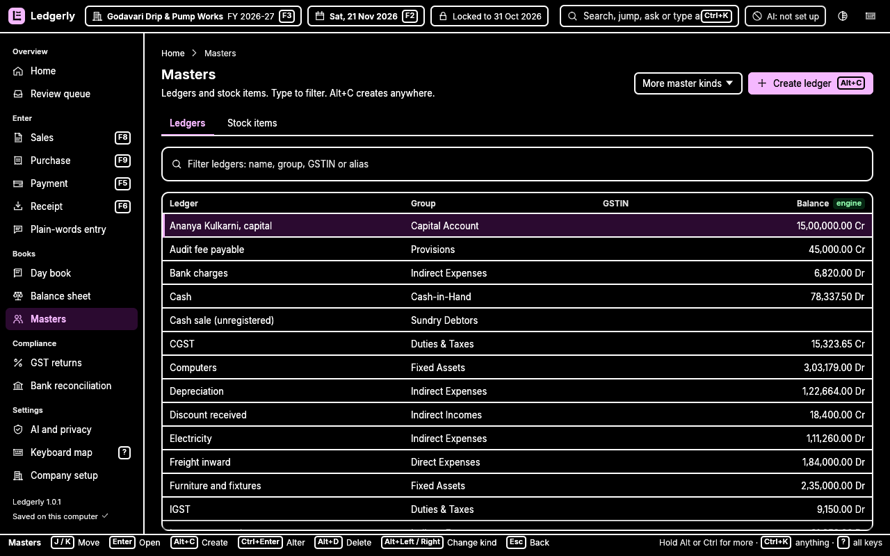</td>
</tr>
</table>

## hc / purchase-bill.offline-ai

SSIM 0.5994

<table>
<tr><th>Mock</th><th>App</th></tr>
<tr>
<td>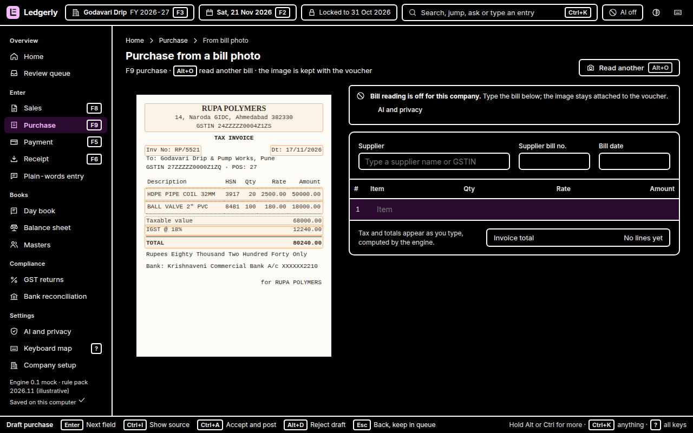</td>
<td></td>
</tr>
</table>

## light / ai-settings.local

SSIM 0.6054

<table>
<tr><th>Mock</th><th>App</th></tr>
<tr>
<td>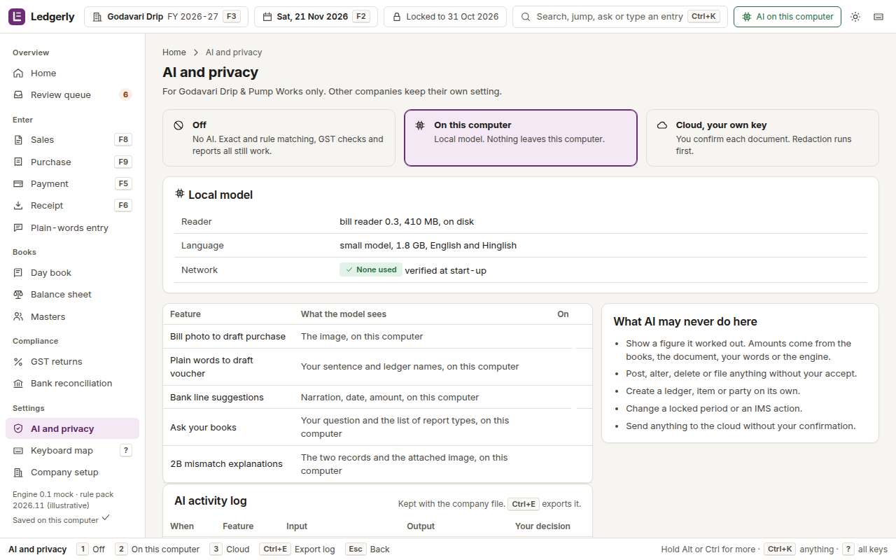</td>
<td>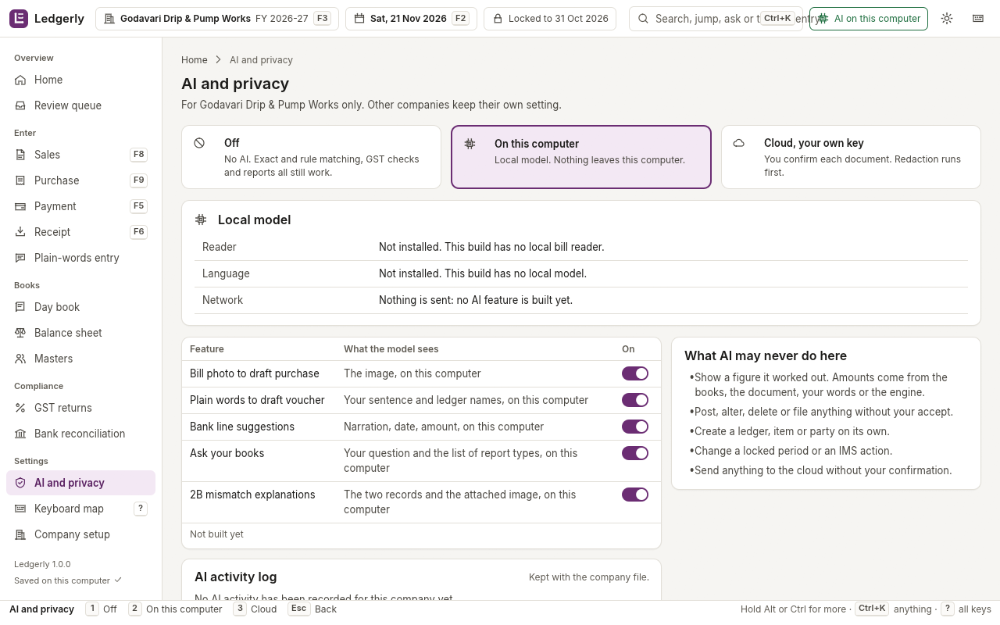</td>
</tr>
</table>

## hc / palette.commands

SSIM 0.6092

<table>
<tr><th>Mock</th><th>App</th></tr>
<tr>
<td></td>
<td>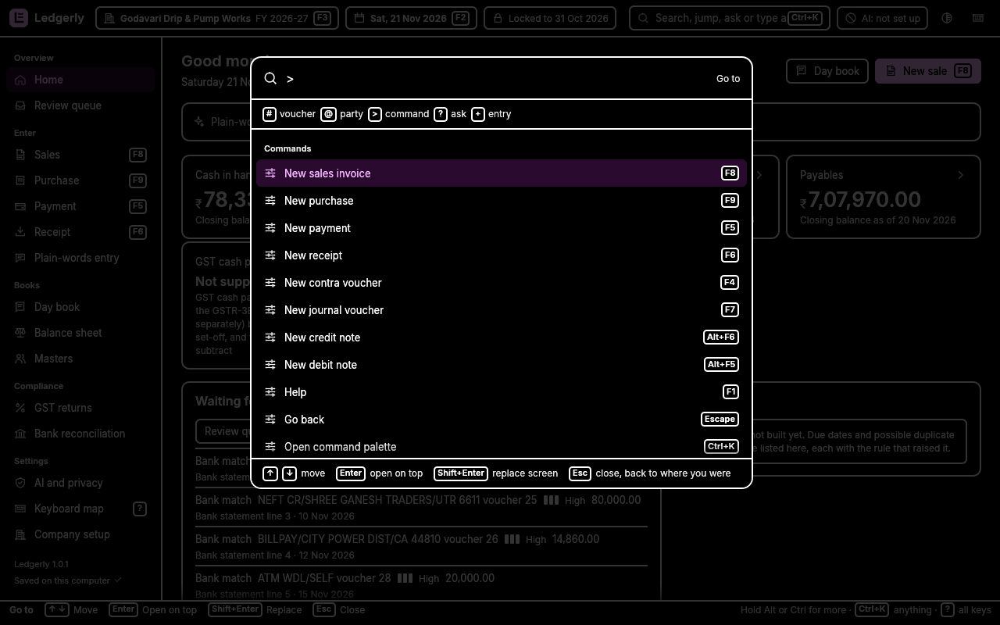</td>
</tr>
</table>

## dark / ai-settings.local

SSIM 0.6141

<table>
<tr><th>Mock</th><th>App</th></tr>
<tr>
<td></td>
<td>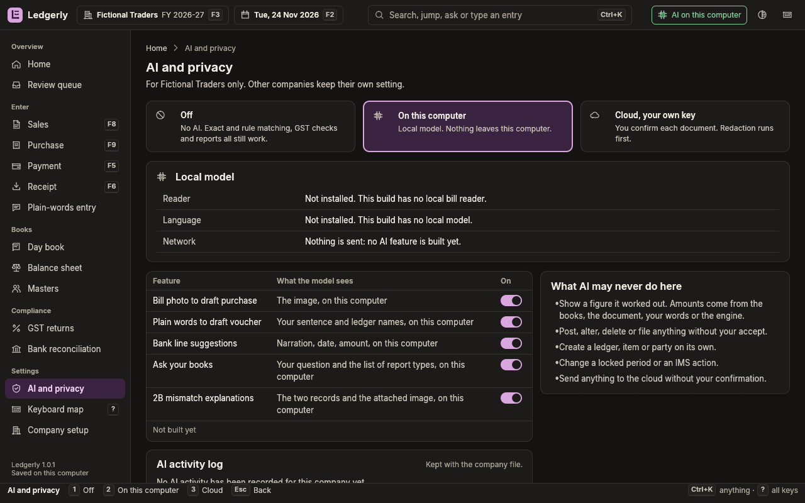</td>
</tr>
</table>

## light / balance-sheet.provisional

SSIM 0.6164

<table>
<tr><th>Mock</th><th>App</th></tr>
<tr>
<td></td>
<td></td>
</tr>
</table>

## light / sales-invoice.period-locked

SSIM 0.6182

<table>
<tr><th>Mock</th><th>App</th></tr>
<tr>
<td></td>
<td></td>
</tr>
</table>

## light / masters.ledgers

SSIM 0.6230

<table>
<tr><th>Mock</th><th>App</th></tr>
<tr>
<td></td>
<td></td>
</tr>
</table>

## hc / balance-sheet.detailed

SSIM 0.6254

<table>
<tr><th>Mock</th><th>App</th></tr>
<tr>
<td>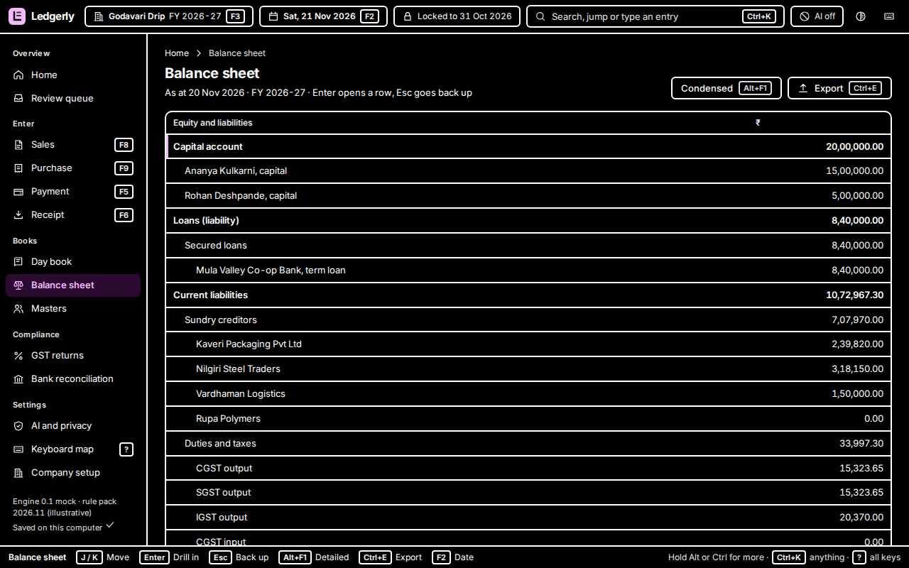</td>
<td>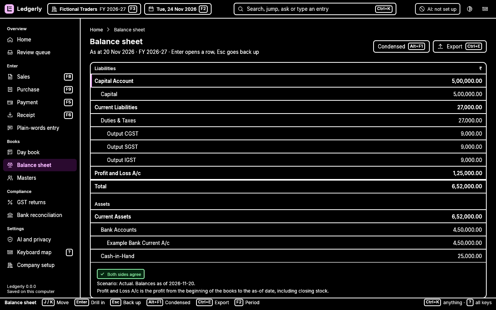</td>
</tr>
</table>

## light / sales-invoice.default

SSIM 0.6269

<table>
<tr><th>Mock</th><th>App</th></tr>
<tr>
<td></td>
<td></td>
</tr>
</table>

## light / palette.voucher

SSIM 0.6282

<table>
<tr><th>Mock</th><th>App</th></tr>
<tr>
<td></td>
<td></td>
</tr>
</table>

## light / palette.entry

SSIM 0.6287

<table>
<tr><th>Mock</th><th>App</th></tr>
<tr>
<td></td>
<td></td>
</tr>
</table>

## hc / balance-sheet.default

SSIM 0.6305

<table>
<tr><th>Mock</th><th>App</th></tr>
<tr>
<td></td>
<td></td>
</tr>
</table>

## light / sales-invoice.gst-inter-state

SSIM 0.6314

<table>
<tr><th>Mock</th><th>App</th></tr>
<tr>
<td></td>
<td></td>
</tr>
</table>

## light / palette.ask

SSIM 0.6317

<table>
<tr><th>Mock</th><th>App</th></tr>
<tr>
<td></td>
<td></td>
</tr>
</table>

## light / palette.no-results

SSIM 0.6352

<table>
<tr><th>Mock</th><th>App</th></tr>
<tr>
<td></td>
<td></td>
</tr>
</table>

## light / sales-invoice.save-confirm

SSIM 0.6355

<table>
<tr><th>Mock</th><th>App</th></tr>
<tr>
<td></td>
<td></td>
</tr>
</table>

## light / sales-invoice.item-list

SSIM 0.6365

<table>
<tr><th>Mock</th><th>App</th></tr>
<tr>
<td></td>
<td></td>
</tr>
</table>

## dark / sales-invoice.default

SSIM 0.6379

<table>
<tr><th>Mock</th><th>App</th></tr>
<tr>
<td></td>
<td></td>
</tr>
</table>

## dark / palette.entry

SSIM 0.6393

<table>
<tr><th>Mock</th><th>App</th></tr>
<tr>
<td></td>
<td>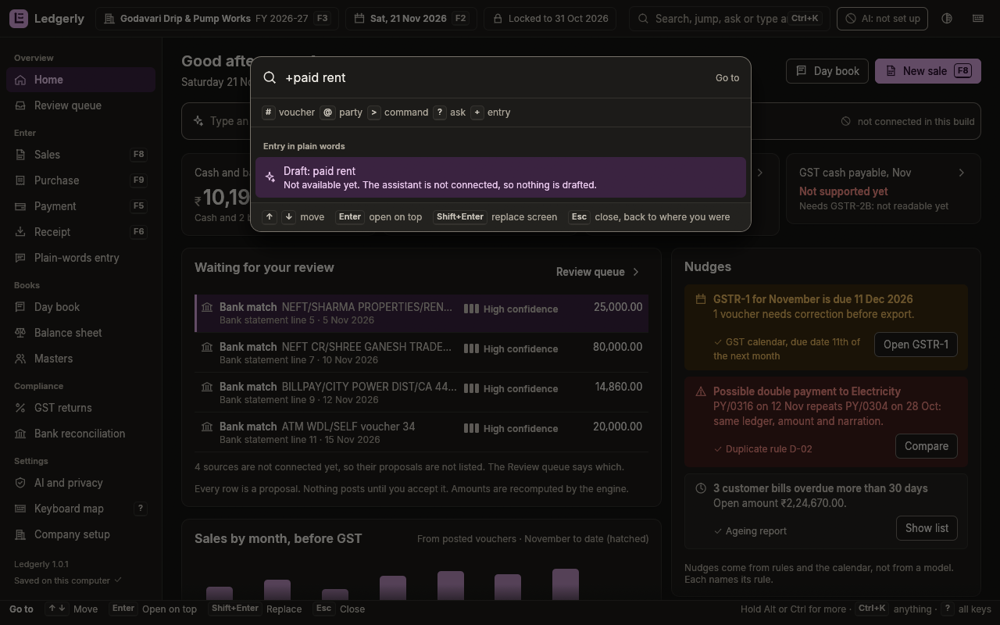</td>
</tr>
</table>

## dark / palette.voucher

SSIM 0.6401

<table>
<tr><th>Mock</th><th>App</th></tr>
<tr>
<td></td>
<td>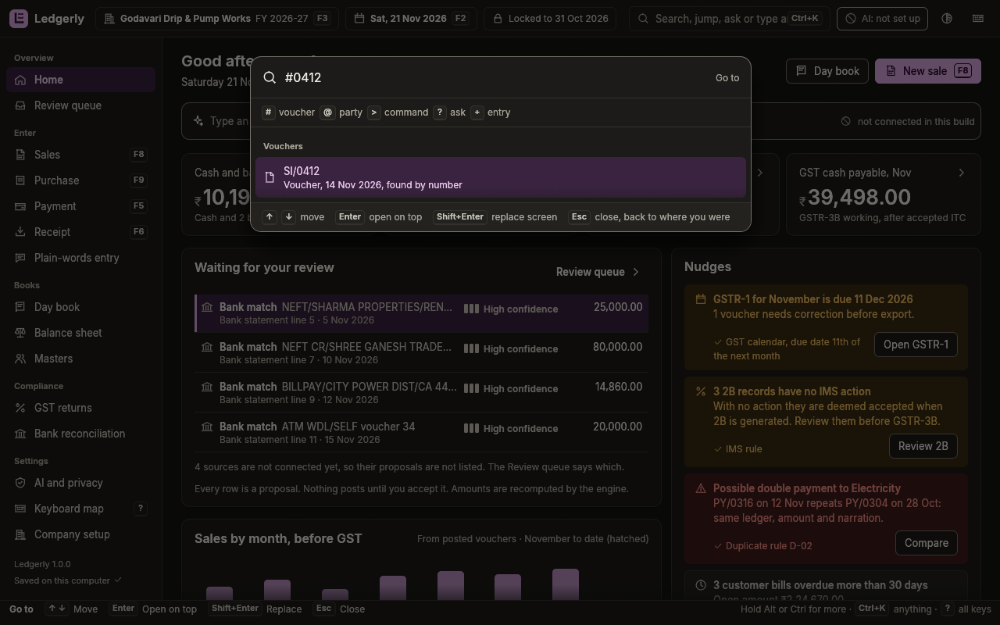</td>
</tr>
</table>

## light / sales-invoice.validation-error

SSIM 0.6404

<table>
<tr><th>Mock</th><th>App</th></tr>
<tr>
<td></td>
<td></td>
</tr>
</table>

## dark / palette.no-results

SSIM 0.6420

<table>
<tr><th>Mock</th><th>App</th></tr>
<tr>
<td></td>
<td></td>
</tr>
</table>

## dark / palette.ask

SSIM 0.6421

<table>
<tr><th>Mock</th><th>App</th></tr>
<tr>
<td>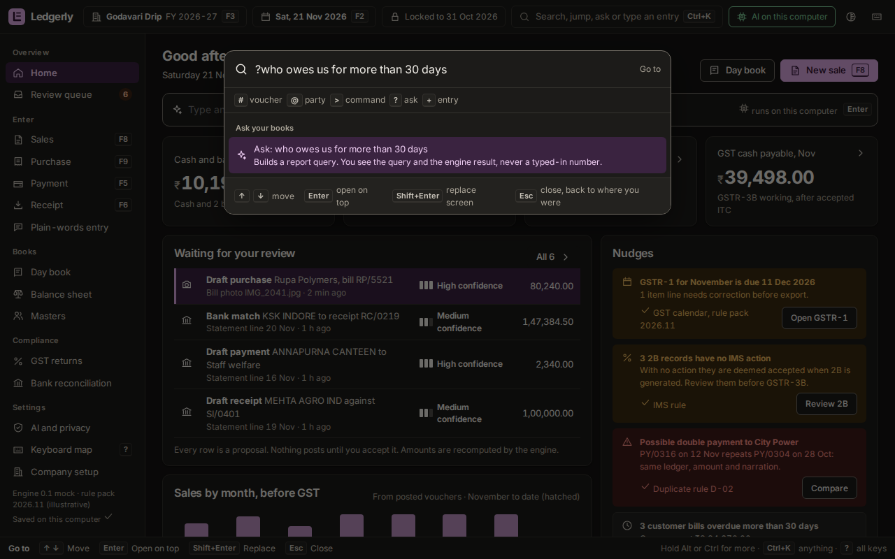</td>
<td></td>
</tr>
</table>

## hc / setup.features

SSIM 0.6429

<table>
<tr><th>Mock</th><th>App</th></tr>
<tr>
<td></td>
<td></td>
</tr>
</table>

## light / balance-sheet.detailed

SSIM 0.6431

<table>
<tr><th>Mock</th><th>App</th></tr>
<tr>
<td></td>
<td></td>
</tr>
</table>

## dark / masters.ledgers

SSIM 0.6436

<table>
<tr><th>Mock</th><th>App</th></tr>
<tr>
<td></td>
<td>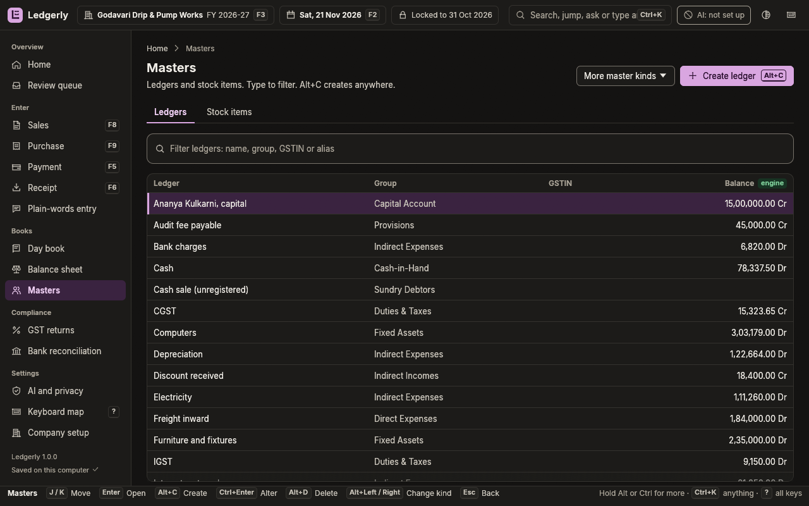</td>
</tr>
</table>

## light / ai-settings.off

SSIM 0.6451

<table>
<tr><th>Mock</th><th>App</th></tr>
<tr>
<td></td>
<td></td>
</tr>
</table>

## dark / ai-settings.off

SSIM 0.6464

<table>
<tr><th>Mock</th><th>App</th></tr>
<tr>
<td></td>
<td></td>
</tr>
</table>

## light / home.ai-off

SSIM 0.6490

<table>
<tr><th>Mock</th><th>App</th></tr>
<tr>
<td></td>
<td></td>
</tr>
</table>

## dark / purchase-bill.offline-ai

SSIM 0.6512

<table>
<tr><th>Mock</th><th>App</th></tr>
<tr>
<td></td>
<td></td>
</tr>
</table>

## light / gst.gstr1

SSIM 0.6519

<table>
<tr><th>Mock</th><th>App</th></tr>
<tr>
<td></td>
<td>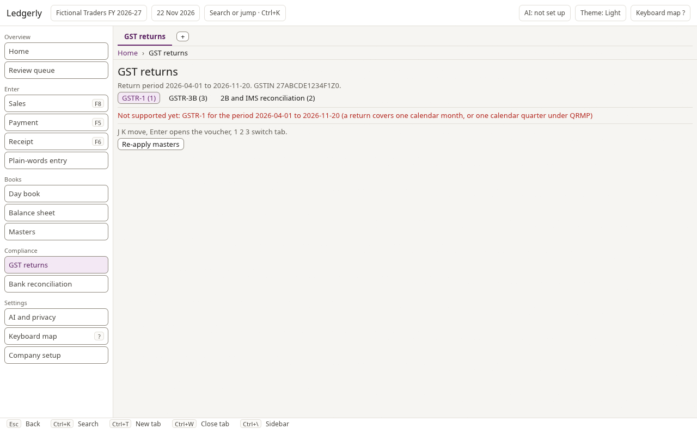</td>
</tr>
</table>

## hc / balance-sheet.ledger

SSIM 0.6523

<table>
<tr><th>Mock</th><th>App</th></tr>
<tr>
<td></td>
<td></td>
</tr>
</table>

## light / keys.standard

SSIM 0.6537

<table>
<tr><th>Mock</th><th>App</th></tr>
<tr>
<td></td>
<td></td>
</tr>
</table>

## hc / masters.items

SSIM 0.6539

<table>
<tr><th>Mock</th><th>App</th></tr>
<tr>
<td></td>
<td></td>
</tr>
</table>

## light / day-book.month

SSIM 0.6542

<table>
<tr><th>Mock</th><th>App</th></tr>
<tr>
<td></td>
<td>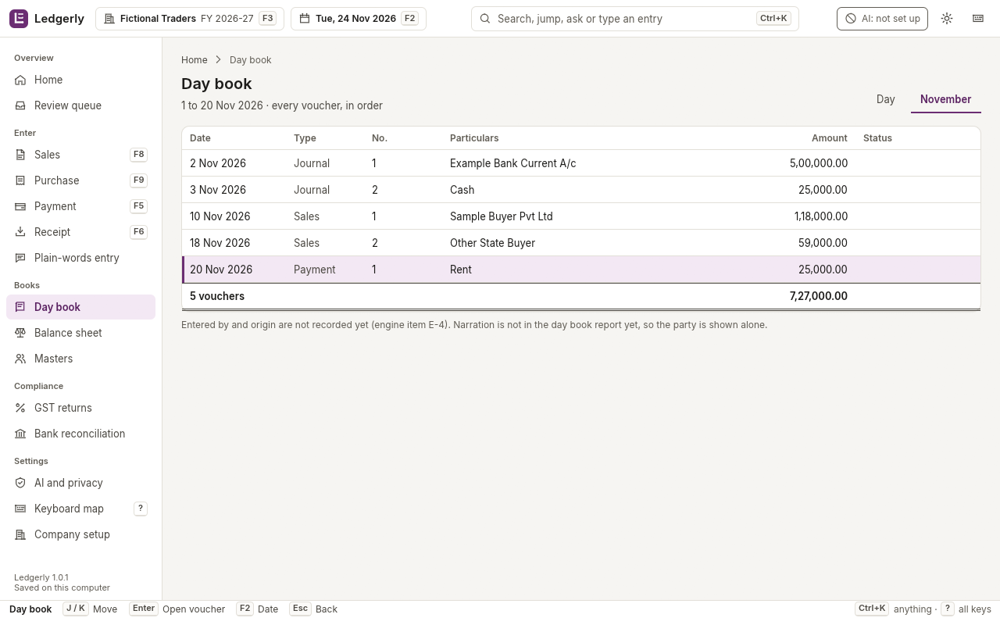</td>
</tr>
</table>

## dark / keys.standard

SSIM 0.6543

<table>
<tr><th>Mock</th><th>App</th></tr>
<tr>
<td></td>
<td></td>
</tr>
</table>

## dark / keys.classic

SSIM 0.6543

<table>
<tr><th>Mock</th><th>App</th></tr>
<tr>
<td></td>
<td></td>
</tr>
</table>

## dark / gst.gstr1

SSIM 0.6549

<table>
<tr><th>Mock</th><th>App</th></tr>
<tr>
<td></td>
<td></td>
</tr>
</table>

## light / keys.classic

SSIM 0.6549

<table>
<tr><th>Mock</th><th>App</th></tr>
<tr>
<td></td>
<td></td>
</tr>
</table>

## hc / receipt.default

SSIM 0.6556

<table>
<tr><th>Mock</th><th>App</th></tr>
<tr>
<td>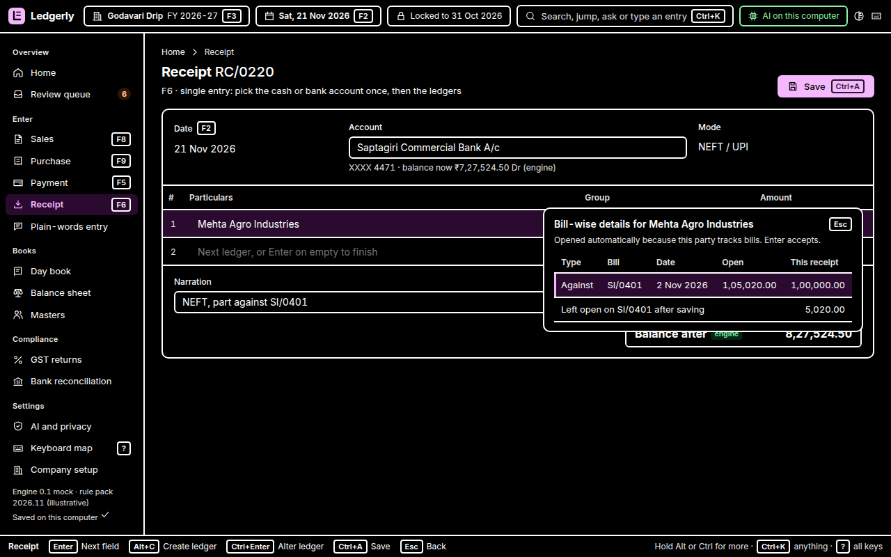</td>
<td></td>
</tr>
</table>

## light / sales-invoice.b2c

SSIM 0.6570

<table>
<tr><th>Mock</th><th>App</th></tr>
<tr>
<td></td>
<td></td>
</tr>
</table>

## light / palette.search

SSIM 0.6589

<table>
<tr><th>Mock</th><th>App</th></tr>
<tr>
<td></td>
<td></td>
</tr>
</table>

## hc / gst.gstr3b

SSIM 0.6593

<table>
<tr><th>Mock</th><th>App</th></tr>
<tr>
<td></td>
<td></td>
</tr>
</table>

## hc / bank.brs

SSIM 0.6599

<table>
<tr><th>Mock</th><th>App</th></tr>
<tr>
<td></td>
<td></td>
</tr>
</table>

## hc / payment.default

SSIM 0.6663

<table>
<tr><th>Mock</th><th>App</th></tr>
<tr>
<td>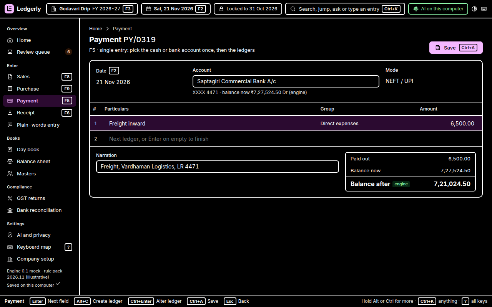</td>
<td></td>
</tr>
</table>

## dark / bank.default

SSIM 0.6701

<table>
<tr><th>Mock</th><th>App</th></tr>
<tr>
<td></td>
<td></td>
</tr>
</table>

## dark / palette.search

SSIM 0.6706

<table>
<tr><th>Mock</th><th>App</th></tr>
<tr>
<td></td>
<td></td>
</tr>
</table>

## light / balance-sheet.default

SSIM 0.6731

<table>
<tr><th>Mock</th><th>App</th></tr>
<tr>
<td></td>
<td></td>
</tr>
</table>

## light / gst.gstr1-correction

SSIM 0.6734

<table>
<tr><th>Mock</th><th>App</th></tr>
<tr>
<td></td>
<td></td>
</tr>
</table>

## light / palette.default

SSIM 0.6754

<table>
<tr><th>Mock</th><th>App</th></tr>
<tr>
<td></td>
<td>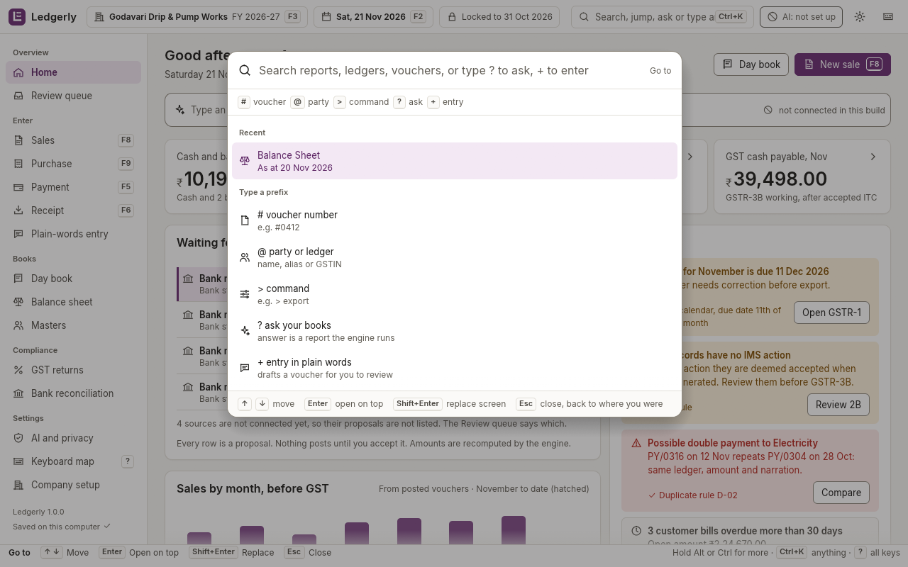</td>
</tr>
</table>

## dark / palette.default

SSIM 0.6756

<table>
<tr><th>Mock</th><th>App</th></tr>
<tr>
<td></td>
<td></td>
</tr>
</table>

## dark / balance-sheet.detailed

SSIM 0.6805

<table>
<tr><th>Mock</th><th>App</th></tr>
<tr>
<td></td>
<td></td>
</tr>
</table>

## light / bank.default

SSIM 0.6840

<table>
<tr><th>Mock</th><th>App</th></tr>
<tr>
<td></td>
<td></td>
</tr>
</table>

## dark / balance-sheet.default

SSIM 0.6847

<table>
<tr><th>Mock</th><th>App</th></tr>
<tr>
<td></td>
<td></td>
</tr>
</table>

## light / palette.commands

SSIM 0.6934

<table>
<tr><th>Mock</th><th>App</th></tr>
<tr>
<td></td>
<td></td>
</tr>
</table>

## hc / setup.welcome

SSIM 0.6955

<table>
<tr><th>Mock</th><th>App</th></tr>
<tr>
<td></td>
<td>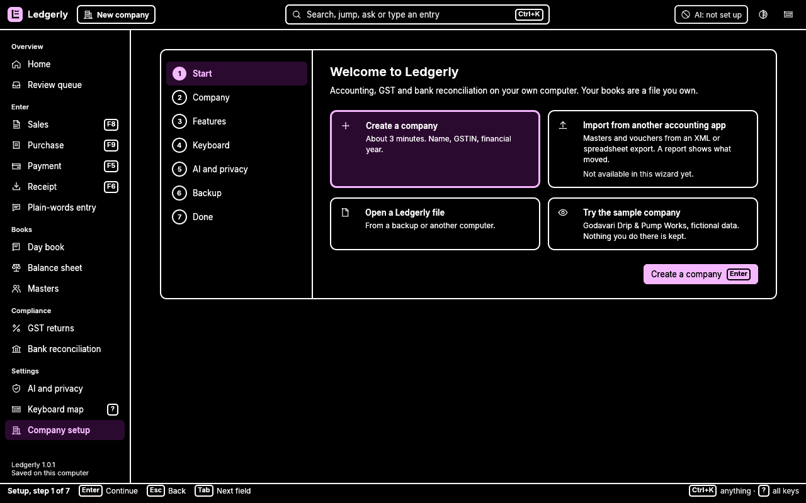</td>
</tr>
</table>

## dark / palette.commands

SSIM 0.6966

<table>
<tr><th>Mock</th><th>App</th></tr>
<tr>
<td></td>
<td>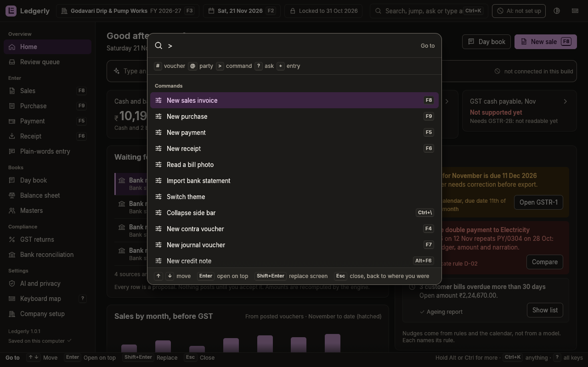</td>
</tr>
</table>

## light / gst.gstr3b

SSIM 0.7027

<table>
<tr><th>Mock</th><th>App</th></tr>
<tr>
<td></td>
<td></td>
</tr>
</table>

## light / review.default

SSIM 0.7028

<table>
<tr><th>Mock</th><th>App</th></tr>
<tr>
<td></td>
<td></td>
</tr>
</table>

## light / setup.features

SSIM 0.7051

<table>
<tr><th>Mock</th><th>App</th></tr>
<tr>
<td></td>
<td></td>
</tr>
</table>

## hc / setup.company

SSIM 0.7069

<table>
<tr><th>Mock</th><th>App</th></tr>
<tr>
<td></td>
<td>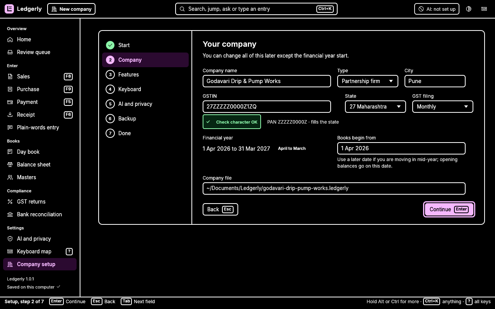</td>
</tr>
</table>

## hc / setup.ai

SSIM 0.7076

<table>
<tr><th>Mock</th><th>App</th></tr>
<tr>
<td>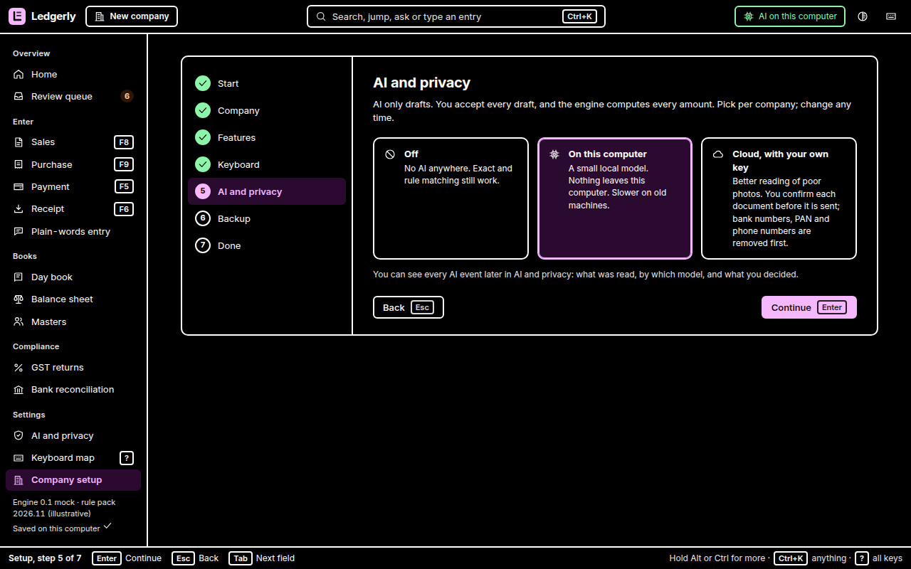</td>
<td></td>
</tr>
</table>

## dark / setup.features

SSIM 0.7088

<table>
<tr><th>Mock</th><th>App</th></tr>
<tr>
<td></td>
<td></td>
</tr>
</table>

## dark / gst.gstr3b

SSIM 0.7100

<table>
<tr><th>Mock</th><th>App</th></tr>
<tr>
<td></td>
<td></td>
</tr>
</table>

## hc / balance-sheet.group

SSIM 0.7165

<table>
<tr><th>Mock</th><th>App</th></tr>
<tr>
<td></td>
<td>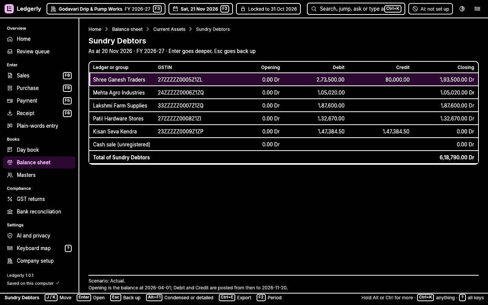</td>
</tr>
</table>

## hc / day-book.default

SSIM 0.7189

<table>
<tr><th>Mock</th><th>App</th></tr>
<tr>
<td></td>
<td></td>
</tr>
</table>

## light / receipt.default

SSIM 0.7190

<table>
<tr><th>Mock</th><th>App</th></tr>
<tr>
<td></td>
<td></td>
</tr>
</table>

## dark / bank.brs

SSIM 0.7206

<table>
<tr><th>Mock</th><th>App</th></tr>
<tr>
<td></td>
<td>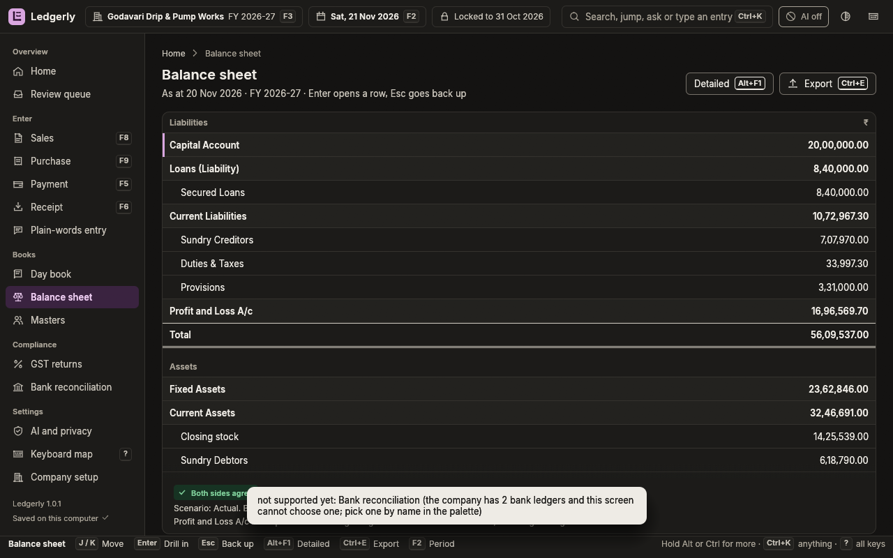</td>
</tr>
</table>

## light / bank.brs

SSIM 0.7220

<table>
<tr><th>Mock</th><th>App</th></tr>
<tr>
<td></td>
<td></td>
</tr>
</table>

## dark / receipt.default

SSIM 0.7220

<table>
<tr><th>Mock</th><th>App</th></tr>
<tr>
<td></td>
<td></td>
</tr>
</table>

## hc / setup.keyboard

SSIM 0.7273

<table>
<tr><th>Mock</th><th>App</th></tr>
<tr>
<td></td>
<td>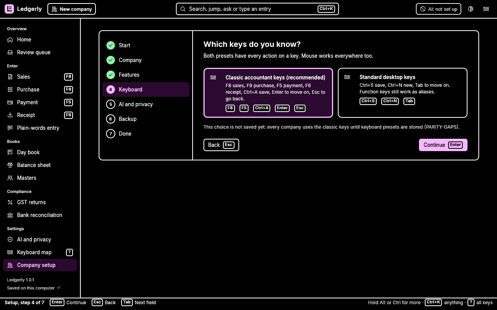</td>
</tr>
</table>

## dark / balance-sheet.ledger

SSIM 0.7273

<table>
<tr><th>Mock</th><th>App</th></tr>
<tr>
<td></td>
<td></td>
</tr>
</table>

## hc / masters.ledger-detail

SSIM 0.7274

<table>
<tr><th>Mock</th><th>App</th></tr>
<tr>
<td></td>
<td>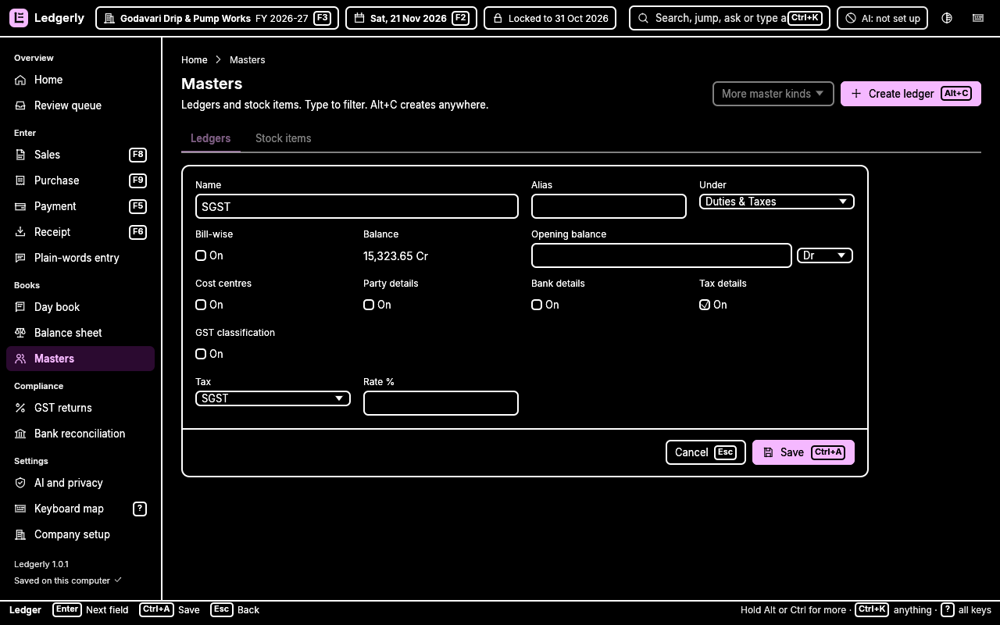</td>
</tr>
</table>

## hc / setup.backup

SSIM 0.7335

<table>
<tr><th>Mock</th><th>App</th></tr>
<tr>
<td></td>
<td></td>
</tr>
</table>

## light / payment.default

SSIM 0.7360

<table>
<tr><th>Mock</th><th>App</th></tr>
<tr>
<td>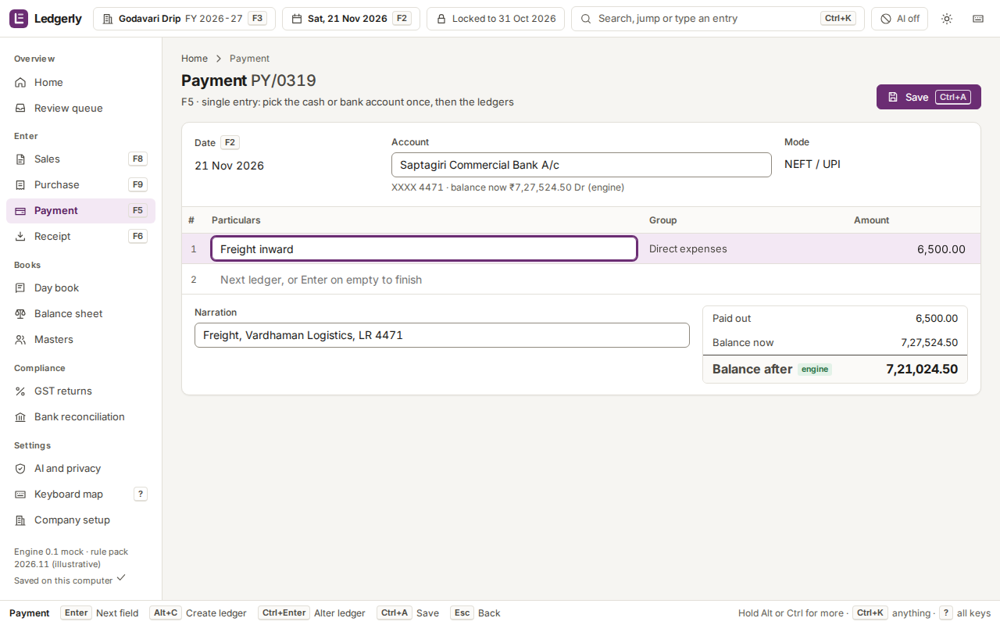</td>
<td></td>
</tr>
</table>

## dark / payment.default

SSIM 0.7372

<table>
<tr><th>Mock</th><th>App</th></tr>
<tr>
<td></td>
<td>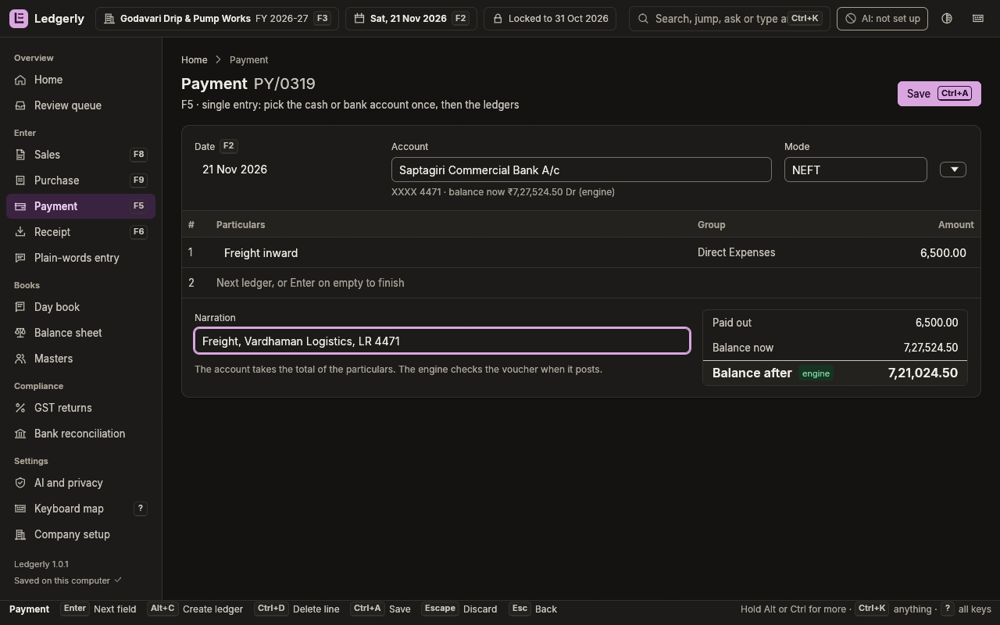</td>
</tr>
</table>

## light / balance-sheet.ledger

SSIM 0.7380

<table>
<tr><th>Mock</th><th>App</th></tr>
<tr>
<td></td>
<td></td>
</tr>
</table>

## light / purchase-bill.offline-ai

SSIM 0.7407

<table>
<tr><th>Mock</th><th>App</th></tr>
<tr>
<td></td>
<td></td>
</tr>
</table>

## dark / setup.company

SSIM 0.7409

<table>
<tr><th>Mock</th><th>App</th></tr>
<tr>
<td></td>
<td></td>
</tr>
</table>

## light / setup.company

SSIM 0.7425

<table>
<tr><th>Mock</th><th>App</th></tr>
<tr>
<td></td>
<td></td>
</tr>
</table>

## light / balance-sheet.group

SSIM 0.7446

<table>
<tr><th>Mock</th><th>App</th></tr>
<tr>
<td>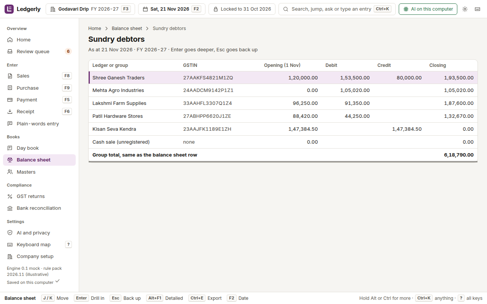</td>
<td></td>
</tr>
</table>

## light / setup.gstin-error

SSIM 0.7447

<table>
<tr><th>Mock</th><th>App</th></tr>
<tr>
<td></td>
<td></td>
</tr>
</table>

## light / masters.gstin-error

SSIM 0.7472

<table>
<tr><th>Mock</th><th>App</th></tr>
<tr>
<td></td>
<td></td>
</tr>
</table>

## dark / masters.items

SSIM 0.7479

<table>
<tr><th>Mock</th><th>App</th></tr>
<tr>
<td>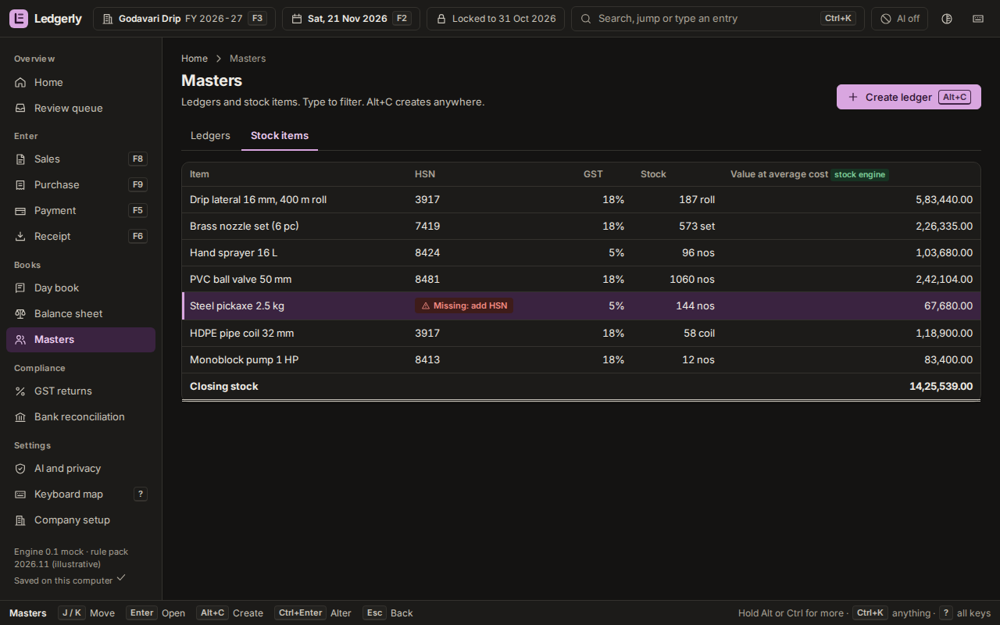</td>
<td></td>
</tr>
</table>

## dark / balance-sheet.group

SSIM 0.7479

<table>
<tr><th>Mock</th><th>App</th></tr>
<tr>
<td></td>
<td></td>
</tr>
</table>

## hc / masters.create-ledger

SSIM 0.7525

<table>
<tr><th>Mock</th><th>App</th></tr>
<tr>
<td></td>
<td></td>
</tr>
</table>

## light / masters.items

SSIM 0.7540

<table>
<tr><th>Mock</th><th>App</th></tr>
<tr>
<td></td>
<td></td>
</tr>
</table>

## dark / setup.welcome

SSIM 0.7540

<table>
<tr><th>Mock</th><th>App</th></tr>
<tr>
<td></td>
<td>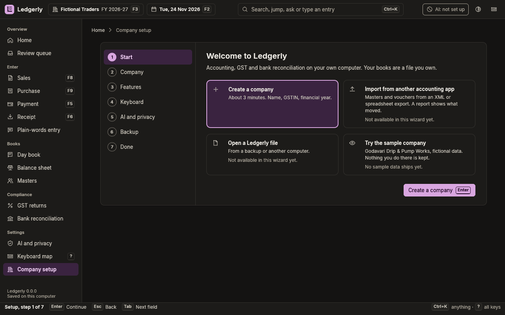</td>
</tr>
</table>

## light / balance-sheet.voucher

SSIM 0.7574

<table>
<tr><th>Mock</th><th>App</th></tr>
<tr>
<td></td>
<td></td>
</tr>
</table>

## dark / masters.ledger-detail

SSIM 0.7590

<table>
<tr><th>Mock</th><th>App</th></tr>
<tr>
<td></td>
<td></td>
</tr>
</table>

## hc / ask.offline-ai

SSIM 0.7600

<table>
<tr><th>Mock</th><th>App</th></tr>
<tr>
<td></td>
<td></td>
</tr>
</table>

## dark / setup.ai

SSIM 0.7611

<table>
<tr><th>Mock</th><th>App</th></tr>
<tr>
<td>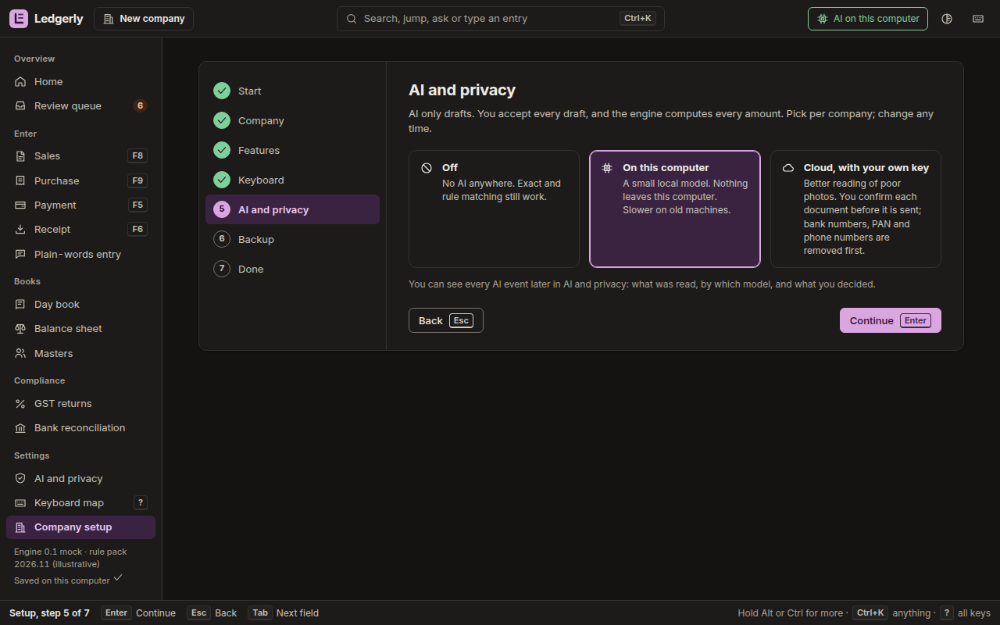</td>
<td></td>
</tr>
</table>

## light / day-book.default

SSIM 0.7617

<table>
<tr><th>Mock</th><th>App</th></tr>
<tr>
<td></td>
<td></td>
</tr>
</table>

## dark / day-book.default

SSIM 0.7623

<table>
<tr><th>Mock</th><th>App</th></tr>
<tr>
<td></td>
<td></td>
</tr>
</table>

## light / setup.ai

SSIM 0.7631

<table>
<tr><th>Mock</th><th>App</th></tr>
<tr>
<td></td>
<td></td>
</tr>
</table>

## light / masters.ledger-detail

SSIM 0.7661

<table>
<tr><th>Mock</th><th>App</th></tr>
<tr>
<td>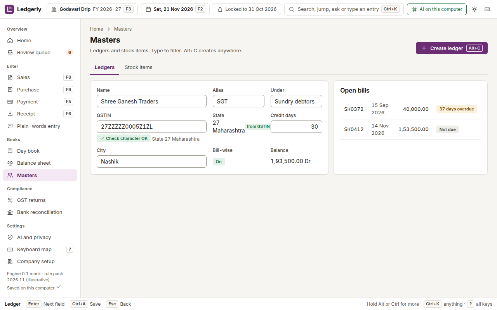</td>
<td></td>
</tr>
</table>

## dark / setup.backup

SSIM 0.7696

<table>
<tr><th>Mock</th><th>App</th></tr>
<tr>
<td></td>
<td></td>
</tr>
</table>

## light / setup.backup

SSIM 0.7722

<table>
<tr><th>Mock</th><th>App</th></tr>
<tr>
<td></td>
<td></td>
</tr>
</table>

## dark / setup.keyboard

SSIM 0.7753

<table>
<tr><th>Mock</th><th>App</th></tr>
<tr>
<td></td>
<td></td>
</tr>
</table>

## light / setup.keyboard

SSIM 0.7794

<table>
<tr><th>Mock</th><th>App</th></tr>
<tr>
<td>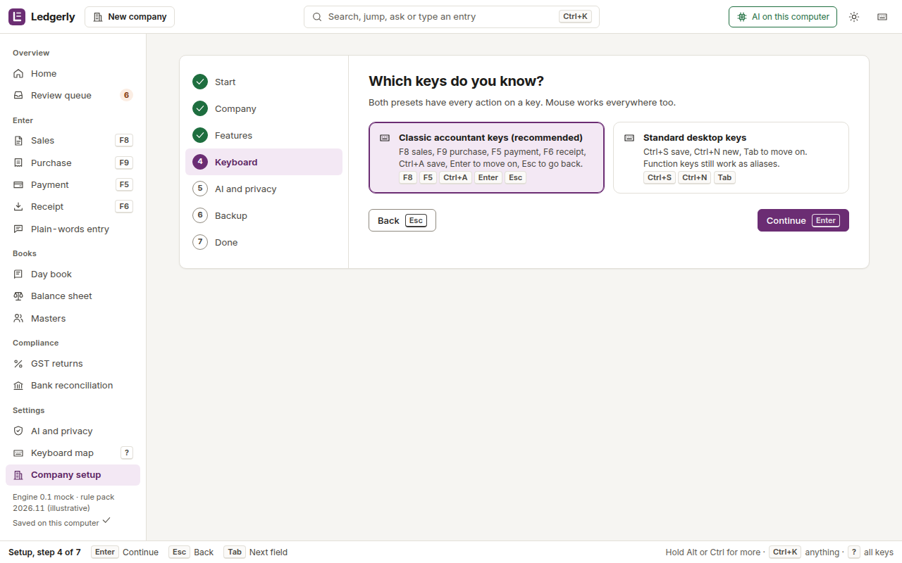</td>
<td>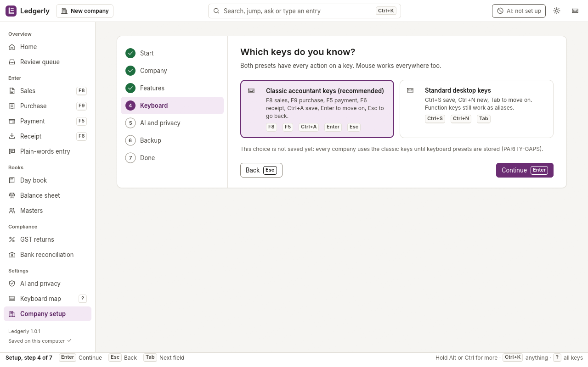</td>
</tr>
</table>

## hc / setup.done

SSIM 0.7807

<table>
<tr><th>Mock</th><th>App</th></tr>
<tr>
<td>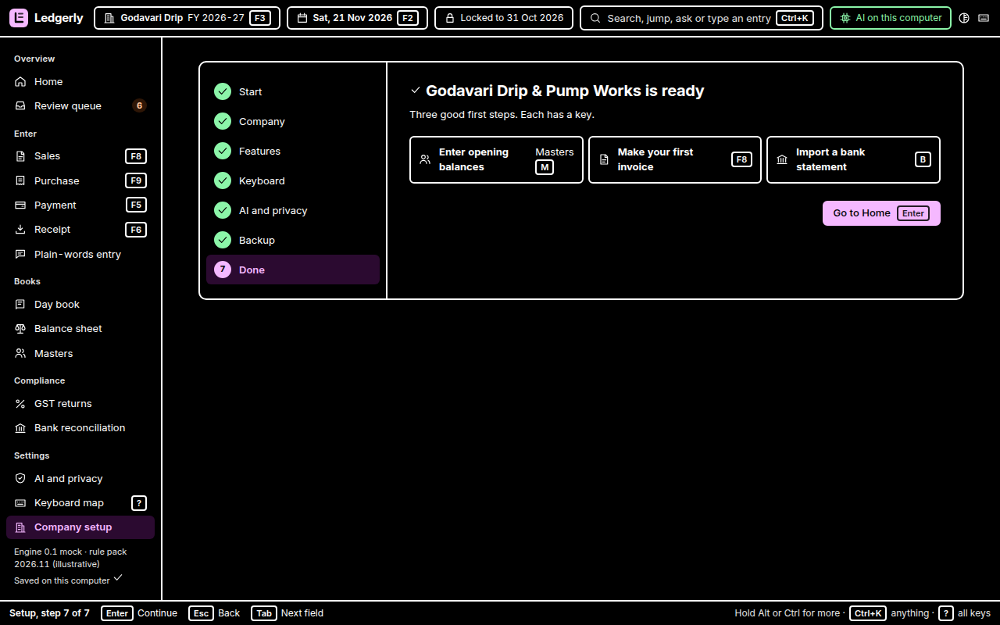</td>
<td></td>
</tr>
</table>

## light / masters.create-ledger

SSIM 0.7905

<table>
<tr><th>Mock</th><th>App</th></tr>
<tr>
<td></td>
<td></td>
</tr>
</table>

## dark / masters.create-ledger

SSIM 0.7909

<table>
<tr><th>Mock</th><th>App</th></tr>
<tr>
<td></td>
<td></td>
</tr>
</table>

## light / bank.empty

SSIM 0.8008

<table>
<tr><th>Mock</th><th>App</th></tr>
<tr>
<td></td>
<td>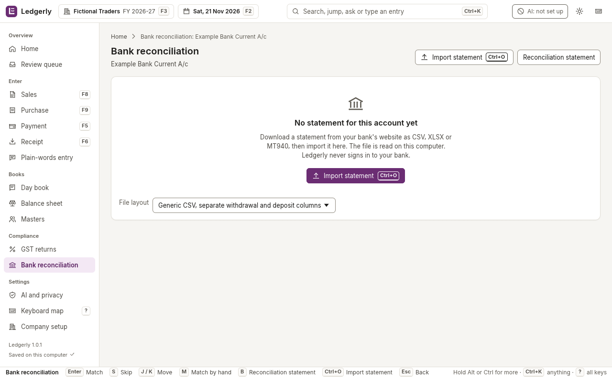</td>
</tr>
</table>

## light / ask.offline-ai

SSIM 0.8040

<table>
<tr><th>Mock</th><th>App</th></tr>
<tr>
<td></td>
<td></td>
</tr>
</table>

## hc / gst.recon-empty

SSIM 0.8063

<table>
<tr><th>Mock</th><th>App</th></tr>
<tr>
<td></td>
<td></td>
</tr>
</table>

## light / home.empty

SSIM 0.8082

<table>
<tr><th>Mock</th><th>App</th></tr>
<tr>
<td></td>
<td></td>
</tr>
</table>

## hc / review.empty

SSIM 0.8095

<table>
<tr><th>Mock</th><th>App</th></tr>
<tr>
<td></td>
<td></td>
</tr>
</table>

## dark / ask.offline-ai

SSIM 0.8102

<table>
<tr><th>Mock</th><th>App</th></tr>
<tr>
<td></td>
<td></td>
</tr>
</table>

## light / setup.welcome

SSIM 0.8199

<table>
<tr><th>Mock</th><th>App</th></tr>
<tr>
<td></td>
<td></td>
</tr>
</table>

## dark / setup.done

SSIM 0.8215

<table>
<tr><th>Mock</th><th>App</th></tr>
<tr>
<td></td>
<td></td>
</tr>
</table>

## dark / review.empty

SSIM 0.8224

<table>
<tr><th>Mock</th><th>App</th></tr>
<tr>
<td></td>
<td>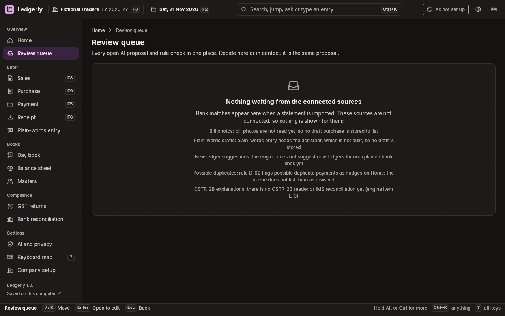</td>
</tr>
</table>

## light / setup.done

SSIM 0.8226

<table>
<tr><th>Mock</th><th>App</th></tr>
<tr>
<td></td>
<td></td>
</tr>
</table>

## light / review.empty

SSIM 0.8269

<table>
<tr><th>Mock</th><th>App</th></tr>
<tr>
<td></td>
<td></td>
</tr>
</table>

## dark / gst.recon-empty

SSIM 0.8276

<table>
<tr><th>Mock</th><th>App</th></tr>
<tr>
<td></td>
<td></td>
</tr>
</table>

## light / gst.recon-empty

SSIM 0.8314

<table>
<tr><th>Mock</th><th>App</th></tr>
<tr>
<td></td>
<td></td>
</tr>
</table>

## light / day-book.empty

SSIM 0.8378

<table>
<tr><th>Mock</th><th>App</th></tr>
<tr>
<td></td>
<td>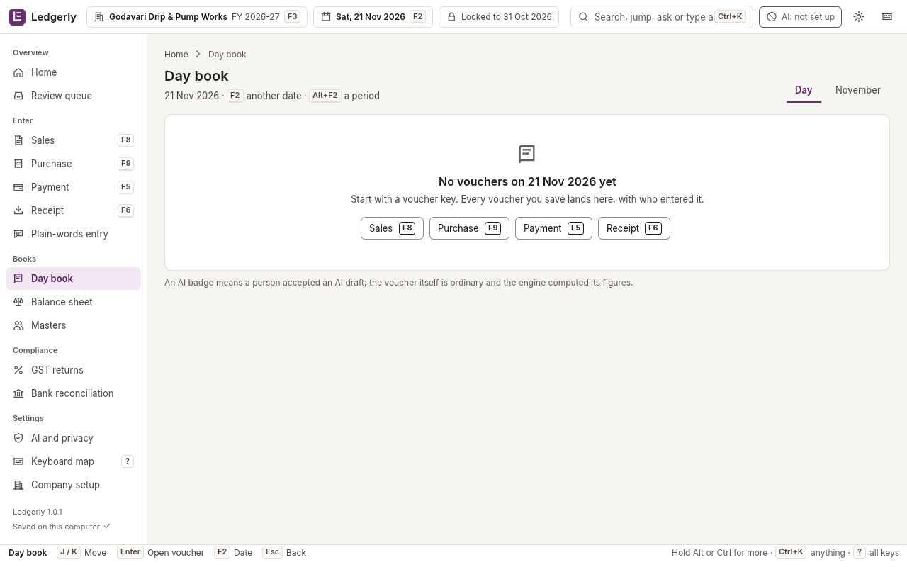</td>
</tr>
</table>

## Mock states with no app capture yet

### light (32)

- `home.loading`
- `home.nudge-open`
- `ask.result`
- `ask.loading`
- `ask.low-confidence`
- `ask.unsupported`
- `sales-invoice.saved`
- `purchase-bill.reading`
- `purchase-bill.proposal`
- `purchase-bill.low-confidence`
- `purchase-bill.mismatch`
- `purchase-bill.duplicate`
- `purchase-bill.cloud-consent`
- `purchase-bill.error`
- `purchase-bill.accepted`
- `quick-entry.proposal`
- `quick-entry.hinglish`
- `quick-entry.unknown-ledger`
- `quick-entry.loading`
- `quick-entry.rejected`
- `payment.bill-wise`
- `payment.overdraft`
- `balance-sheet.loading`
- `gst.recon`
- `gst.recon-explain`
- `gst.recon-error`
- `gst.recon-locked`
- `bank.ai-suggestions`
- `bank.suggested-ledger`
- `bank.import-error`
- `bank.offline-ai`
- `masters.suggested-ledger`

### dark (49)

- `home.loading`
- `home.empty`
- `home.ai-off`
- `home.nudge-open`
- `ask.result`
- `ask.loading`
- `ask.low-confidence`
- `ask.unsupported`
- `sales-invoice.gst-inter-state`
- `sales-invoice.b2c`
- `sales-invoice.item-list`
- `sales-invoice.validation-error`
- `sales-invoice.period-locked`
- `sales-invoice.save-confirm`
- `sales-invoice.saved`
- `purchase-bill.reading`
- `purchase-bill.proposal`
- `purchase-bill.low-confidence`
- `purchase-bill.mismatch`
- `purchase-bill.duplicate`
- `purchase-bill.cloud-consent`
- `purchase-bill.error`
- `purchase-bill.accepted`
- `quick-entry.proposal`
- `quick-entry.hinglish`
- `quick-entry.unknown-ledger`
- `quick-entry.loading`
- `quick-entry.rejected`
- `payment.bill-wise`
- `payment.overdraft`
- `balance-sheet.voucher`
- `balance-sheet.loading`
- `balance-sheet.provisional`
- `day-book.month`
- `day-book.empty`
- `gst.gstr1-correction`
- `gst.recon`
- `gst.recon-explain`
- `gst.recon-error`
- `gst.recon-locked`
- `bank.ai-suggestions`
- `bank.suggested-ledger`
- `bank.empty`
- `bank.import-error`
- `bank.offline-ai`
- `masters.gstin-error`
- `masters.suggested-ledger`
- `review.default`
- `setup.gstin-error`

### hc (49)

- `home.loading`
- `home.empty`
- `home.ai-off`
- `home.nudge-open`
- `ask.result`
- `ask.loading`
- `ask.low-confidence`
- `ask.unsupported`
- `sales-invoice.gst-inter-state`
- `sales-invoice.b2c`
- `sales-invoice.item-list`
- `sales-invoice.validation-error`
- `sales-invoice.period-locked`
- `sales-invoice.save-confirm`
- `sales-invoice.saved`
- `purchase-bill.reading`
- `purchase-bill.proposal`
- `purchase-bill.low-confidence`
- `purchase-bill.mismatch`
- `purchase-bill.duplicate`
- `purchase-bill.cloud-consent`
- `purchase-bill.error`
- `purchase-bill.accepted`
- `quick-entry.proposal`
- `quick-entry.hinglish`
- `quick-entry.unknown-ledger`
- `quick-entry.loading`
- `quick-entry.rejected`
- `payment.bill-wise`
- `payment.overdraft`
- `balance-sheet.voucher`
- `balance-sheet.loading`
- `balance-sheet.provisional`
- `day-book.month`
- `day-book.empty`
- `gst.gstr1-correction`
- `gst.recon`
- `gst.recon-explain`
- `gst.recon-error`
- `gst.recon-locked`
- `bank.ai-suggestions`
- `bank.suggested-ledger`
- `bank.empty`
- `bank.import-error`
- `bank.offline-ai`
- `masters.gstin-error`
- `masters.suggested-ledger`
- `review.default`
- `setup.gstin-error`

## App captures with no mock capture

- `light/quick-entry.offline-ai`

