# App against mock

411 app captures are paired with a mock capture of the same theme and state id. SSIM is 1 for identical images; lower is a bigger difference, and the list runs worst first.

| Theme | State | SSIM |
| --- | --- | --- |
| hc | home.new-tab | 0.4541 |
| hc | home.gst-unsupported | 0.4584 |
| hc | home.nudge-open | 0.4687 |
| hc | sales-invoice.save-confirm | 0.4733 |
| hc | profit-and-loss.print-config | 0.4866 |
| hc | bank.default | 0.4967 |
| hc | home.default | 0.4988 |
| hc | audit.default | 0.5103 |
| hc | day-book.month | 0.5107 |
| hc | profit-and-loss.print-failed | 0.5133 |
| dark | profit-and-loss.print-config | 0.5157 |
| hc | hi.home.default | 0.5162 |
| hc | masters.loading | 0.5166 |
| hc | hi.bank.default | 0.5173 |
| hc | profit-and-loss.provisional | 0.5208 |
| hc | sales-invoice.as-voucher | 0.5248 |
| hc | profit-and-loss.detailed | 0.5256 |
| dark | home.new-tab | 0.5343 |
| light | home.new-tab | 0.5343 |
| light | home.gst-unsupported | 0.5379 |
| dark | home.gst-unsupported | 0.5395 |
| hc | palette.entry | 0.5414 |
| light | home.default | 0.5436 |
| hc | palette.ask | 0.5442 |
| hc | ai-settings.cloud | 0.5460 |
| hc | review.default | 0.5479 |
| hc | bank.offline-ai | 0.5492 |
| hc | stock-summary.provisional | 0.5496 |
| dark | home.default | 0.5504 |
| light | home.nudge-open | 0.5508 |
| hc | palette.voucher | 0.5529 |
| hc | ai-settings.local | 0.5534 |
| hc | sales-invoice.einvoice-not-ready | 0.5538 |
| hc | palette.no-results | 0.5592 |
| hc | profit-and-loss.print-range-error | 0.5597 |
| dark | profit-and-loss.print-range-error | 0.5615 |
| hc | trial-balance.default | 0.5691 |
| dark | home.nudge-open | 0.5712 |
| hc | import.imported | 0.5720 |
| hc | profit-and-loss.print-preview | 0.5720 |
| dark | profit-and-loss.print-preview | 0.5728 |
| hc | gst.gstr3b | 0.5742 |
| hc | masters.ledgers | 0.5753 |
| hc | purchase.validation-error | 0.5777 |
| hc | import.no-company | 0.5779 |
| dark | bank.default | 0.5784 |
| hc | sales-invoice.item-list | 0.5857 |
| hc | bank.brs-exported | 0.5861 |
| light | audit.default | 0.5870 |
| hc | hi.masters.ledgers | 0.5879 |
| hc | home.ai-off | 0.5895 |
| light | hi.home.default | 0.5912 |
| light | palette.entry | 0.5920 |
| hc | import.port-error | 0.5923 |
| hc | import.validation-error | 0.5934 |
| hc | import.failed | 0.5945 |
| light | palette.ask | 0.5948 |
| hc | import.refused | 0.5949 |
| dark | hi.home.default | 0.5952 |
| hc | sales-invoice.period-locked | 0.5952 |
| hc | sales-invoice.validation-error | 0.5963 |
| hc | balance-sheet.provisional | 0.5968 |
| dark | hi.bank.default | 0.5986 |
| hc | keys.standard | 0.6004 |
| hc | purchase-bill.offline-ai | 0.6015 |
| hc | sales-invoice.mode-list | 0.6015 |
| hc | balance-sheet.detailed | 0.6022 |
| light | masters.ledgers | 0.6024 |
| light | review.default | 0.6026 |
| hc | palette.search | 0.6029 |
| light | sales-invoice.save-confirm | 0.6031 |
| hc | gst.gstr1-correction | 0.6034 |
| hc | gst.gstr1 | 0.6034 |
| dark | audit.default | 0.6034 |
| light | palette.voucher | 0.6038 |
| dark | review.default | 0.6039 |
| light | palette.no-results | 0.6048 |
| light | bank.default | 0.6060 |
| hc | masters.items | 0.6068 |
| hc | keys.classic | 0.6070 |
| dark | bank.offline-ai | 0.6071 |
| hc | profit-and-loss.print-busy | 0.6083 |
| hc | balance-sheet.default | 0.6087 |
| hc | profit-and-loss.print-saved | 0.6117 |
| light | balance-sheet.provisional | 0.6130 |
| hc | masters.no-match | 0.6139 |
| hc | sales-invoice.gst-inter-state | 0.6139 |
| light | ai-settings.cloud | 0.6141 |
| light | hi.masters.ledgers | 0.6142 |
| light | sales-invoice.einvoice-not-ready | 0.6157 |
| hc | palette.default | 0.6162 |
| light | day-book.month | 0.6163 |
| light | trial-balance.default | 0.6168 |
| dark | sales-invoice.save-confirm | 0.6169 |
| light | sales-invoice.period-locked | 0.6176 |
| hc | hi.gst.gstr1 | 0.6196 |
| hc | sales-invoice.default | 0.6197 |
| hc | hi.balance-sheet.default | 0.6202 |
| light | profit-and-loss.detailed | 0.6242 |
| hc | bank.brs | 0.6246 |
| dark | palette.entry | 0.6247 |
| dark | ai-settings.cloud | 0.6252 |
| light | sales-invoice.validation-error | 0.6263 |
| hc | sales-invoice.print-preview | 0.6266 |
| dark | day-book.month | 0.6274 |
| light | bank.offline-ai | 0.6274 |
| dark | palette.ask | 0.6274 |
| hc | hi.sales-invoice.default | 0.6282 |
| light | sales-invoice.default | 0.6284 |
| light | sales-invoice.as-voucher | 0.6292 |
| light | sales-invoice.item-list | 0.6294 |
| light | hi.bank.default | 0.6295 |
| hc | import.running | 0.6306 |
| light | gst.gstr3b | 0.6309 |
| dark | palette.no-results | 0.6320 |
| dark | sales-invoice.print-preview | 0.6321 |
| hc | day-book.print-preview | 0.6322 |
| light | sales-invoice.gst-inter-state | 0.6326 |
| dark | gst.gstr3b | 0.6331 |
| dark | masters.ledgers | 0.6331 |
| dark | sales-invoice.einvoice-not-ready | 0.6337 |
| dark | day-book.print-preview | 0.6347 |
| light | palette.search | 0.6361 |
| dark | palette.voucher | 0.6366 |
| hc | ai-settings.off | 0.6367 |
| dark | sales-invoice.period-locked | 0.6370 |
| dark | sales-invoice.validation-error | 0.6371 |
| hc | hi.sales-invoice.print-preview | 0.6373 |
| hc | credit-note.validation-error | 0.6375 |
| dark | sales-invoice.item-list | 0.6375 |
| light | hi.sales-invoice.default | 0.6398 |
| hc | debit-note.validation-error | 0.6408 |
| light | sales-invoice.mode-list | 0.6416 |
| dark | sales-invoice.as-voucher | 0.6423 |
| light | profit-and-loss.provisional | 0.6433 |
| hc | purchase.default | 0.6436 |
| dark | hi.sales-invoice.print-preview | 0.6441 |
| dark | sales-invoice.mode-list | 0.6446 |
| dark | hi.masters.ledgers | 0.6448 |
| hc | sales-invoice.b2c | 0.6468 |
| dark | bank.brs-exported | 0.6469 |
| dark | balance-sheet.provisional | 0.6471 |
| hc | import.default | 0.6475 |
| dark | profit-and-loss.detailed | 0.6486 |
| dark | sales-invoice.default | 0.6487 |
| light | bank.brs-exported | 0.6493 |
| dark | trial-balance.default | 0.6510 |
| light | profit-and-loss.print-busy | 0.6517 |
| dark | profit-and-loss.provisional | 0.6519 |
| hc | palette.commands | 0.6529 |
| dark | purchase-bill.offline-ai | 0.6533 |
| dark | sales-invoice.gst-inter-state | 0.6543 |
| light | keys.standard | 0.6547 |
| light | balance-sheet.detailed | 0.6556 |
| dark | keys.standard | 0.6557 |
| light | profit-and-loss.print-failed | 0.6571 |
| dark | profit-and-loss.print-failed | 0.6580 |
| dark | stock-summary.provisional | 0.6590 |
| light | stock-summary.provisional | 0.6591 |
| dark | hi.sales-invoice.default | 0.6593 |
| dark | palette.search | 0.6598 |
| hc | sales-invoice.saved | 0.6602 |
| light | ai-settings.local | 0.6612 |
| light | profit-and-loss.print-range-error | 0.6612 |
| light | sales-invoice.b2c | 0.6613 |
| hc | journal.print-preview | 0.6615 |
| light | palette.default | 0.6624 |
| hc | profit-and-loss.default | 0.6626 |
| light | balance-sheet.default | 0.6633 |
| dark | home.ai-off | 0.6634 |
| light | sales-invoice.print-preview | 0.6636 |
| hc | balance-sheet.voucher | 0.6647 |
| light | keys.classic | 0.6648 |
| dark | keys.classic | 0.6651 |
| hc | balance-sheet.ledger | 0.6653 |
| dark | ai-settings.local | 0.6668 |
| dark | profit-and-loss.print-busy | 0.6672 |
| light | home.ai-off | 0.6676 |
| light | hi.sales-invoice.print-preview | 0.6690 |
| hc | payment.overdraft | 0.6698 |
| light | bank.brs | 0.6704 |
| light | profit-and-loss.print-config | 0.6704 |
| light | profit-and-loss.print-preview | 0.6718 |
| dark | import.no-company | 0.6737 |
| light | gst.gstr1 | 0.6738 |
| light | hi.balance-sheet.default | 0.6738 |
| dark | bank.brs | 0.6746 |
| dark | gst.gstr1 | 0.6781 |
| dark | journal.print-preview | 0.6787 |
| light | import.no-company | 0.6804 |
| dark | import.refused | 0.6807 |
| light | sales-invoice.saved | 0.6814 |
| dark | sales-invoice.b2c | 0.6815 |
| light | import.refused | 0.6821 |
| dark | palette.default | 0.6821 |
| dark | import.failed | 0.6823 |
| hc | outstanding.receivables | 0.6826 |
| dark | import.imported | 0.6828 |
| light | palette.commands | 0.6831 |
| hc | journal.validation-error | 0.6831 |
| light | import.failed | 0.6833 |
| light | gst.gstr1-correction | 0.6847 |
| dark | import.port-error | 0.6857 |
| light | ai-settings.off | 0.6872 |
| light | import.imported | 0.6873 |
| dark | import.validation-error | 0.6873 |
| light | hi.gst.gstr1 | 0.6888 |
| dark | gst.gstr1-correction | 0.6893 |
| hc | receipt.default | 0.6897 |
| light | purchase.validation-error | 0.6898 |
| dark | ai-settings.off | 0.6917 |
| light | import.port-error | 0.6918 |
| dark | masters.no-match | 0.6925 |
| hc | payment.bill-wise | 0.6925 |
| hc | credit-note.default | 0.6928 |
| light | import.validation-error | 0.6932 |
| light | outstanding.receivables | 0.6936 |
| dark | hi.gst.gstr1 | 0.6940 |
| dark | purchase.validation-error | 0.6942 |
| dark | balance-sheet.detailed | 0.6956 |
| dark | sales-invoice.saved | 0.6965 |
| dark | import.running | 0.6974 |
| light | purchase.default | 0.6977 |
| dark | import.default | 0.6977 |
| light | masters.no-match | 0.6987 |
| hc | debit-note.default | 0.7006 |
| dark | balance-sheet.default | 0.7009 |
| light | import.running | 0.7014 |
| light | profit-and-loss.default | 0.7020 |
| light | profit-and-loss.print-saved | 0.7049 |
| light | import.default | 0.7051 |
| dark | palette.commands | 0.7057 |
| dark | outstanding.receivables | 0.7060 |
| dark | purchase.default | 0.7070 |
| hc | balance-sheet.group | 0.7073 |
| hc | gst.recon | 0.7087 |
| hc | setup.features | 0.7088 |
| hc | contra.default | 0.7098 |
| hc | journal.default | 0.7105 |
| hc | stock-summary.default | 0.7111 |
| dark | hi.balance-sheet.default | 0.7114 |
| light | payment.overdraft | 0.7131 |
| dark | profit-and-loss.print-saved | 0.7150 |
| light | day-book.print-preview | 0.7162 |
| dark | masters.items | 0.7172 |
| light | masters.loading | 0.7179 |
| hc | payment.default | 0.7180 |
| dark | profit-and-loss.default | 0.7190 |
| light | masters.items | 0.7196 |
| dark | payment.overdraft | 0.7196 |
| hc | setup.new-tab | 0.7204 |
| light | credit-note.validation-error | 0.7209 |
| hc | home.loading | 0.7220 |
| light | debit-note.validation-error | 0.7222 |
| light | balance-sheet.voucher | 0.7230 |
| dark | masters.loading | 0.7258 |
| light | receipt.default | 0.7259 |
| light | stock-summary.default | 0.7277 |
| dark | credit-note.validation-error | 0.7278 |
| light | payment.bill-wise | 0.7283 |
| light | balance-sheet.group | 0.7285 |
| dark | debit-note.validation-error | 0.7294 |
| hc | masters.ledger-detail | 0.7316 |
| light | gst.recon | 0.7322 |
| dark | balance-sheet.voucher | 0.7326 |
| hc | contra.validation-error | 0.7329 |
| dark | receipt.default | 0.7351 |
| dark | balance-sheet.ledger | 0.7363 |
| hc | day-book.default | 0.7368 |
| light | balance-sheet.ledger | 0.7371 |
| dark | balance-sheet.group | 0.7375 |
| dark | payment.bill-wise | 0.7379 |
| dark | gst.recon | 0.7384 |
| light | outstanding.payables | 0.7391 |
| dark | stock-summary.default | 0.7402 |
| hc | outstanding.payables | 0.7414 |
| light | purchase-bill.offline-ai | 0.7439 |
| dark | outstanding.payables | 0.7474 |
| light | payment.default | 0.7476 |
| hc | bank.import-error | 0.7478 |
| hc | profit-and-loss.loading | 0.7502 |
| hc | masters.create-ledger | 0.7514 |
| light | credit-note.default | 0.7532 |
| dark | payment.default | 0.7550 |
| light | day-book.default | 0.7562 |
| light | debit-note.default | 0.7574 |
| dark | credit-note.default | 0.7590 |
| hc | home.empty | 0.7591 |
| light | setup.features | 0.7592 |
| hc | audit.integrity | 0.7598 |
| hc | balance-sheet.loading | 0.7602 |
| hc | masters.gstin-error | 0.7611 |
| hc | setup.ai | 0.7634 |
| dark | debit-note.default | 0.7640 |
| light | journal.validation-error | 0.7642 |
| light | contra.default | 0.7646 |
| light | setup.new-tab | 0.7649 |
| dark | masters.ledger-detail | 0.7649 |
| hc | ask.offline-ai | 0.7653 |
| dark | day-book.default | 0.7656 |
| hc | stock-summary.loading | 0.7666 |
| hc | audit.loading | 0.7673 |
| hc | outstanding.loading | 0.7674 |
| dark | journal.validation-error | 0.7678 |
| hc | trial-balance.loading | 0.7681 |
| dark | setup.features | 0.7683 |
| dark | setup.new-tab | 0.7701 |
| dark | contra.default | 0.7704 |
| light | masters.ledger-detail | 0.7727 |
| light | journal.print-preview | 0.7754 |
| hc | setup.company | 0.7764 |
| light | journal.default | 0.7782 |
| light | contra.validation-error | 0.7815 |
| dark | journal.default | 0.7824 |
| hc | bank.empty | 0.7837 |
| hc | masters.create-item | 0.7837 |
| dark | contra.validation-error | 0.7882 |
| hc | gst.recon-locked | 0.7901 |
| hc | masters.items-empty | 0.7925 |
| hc | masters.empty | 0.7936 |
| dark | setup.company | 0.7954 |
| light | masters.gstin-error | 0.7956 |
| dark | masters.gstin-error | 0.7964 |
| light | masters.create-ledger | 0.7965 |
| light | setup.company | 0.7971 |
| dark | masters.create-ledger | 0.7974 |
| hc | audit.unsupported | 0.7980 |
| dark | bank.import-error | 0.7989 |
| hc | setup.gstin-error | 0.7996 |
| dark | home.empty | 0.8001 |
| light | home.loading | 0.8022 |
| light | audit.loading | 0.8025 |
| hc | gst.recon-empty | 0.8038 |
| light | home.empty | 0.8046 |
| light | bank.import-error | 0.8052 |
| hc | setup.backup | 0.8053 |
| light | profit-and-loss.loading | 0.8060 |
| hc | day-book.empty | 0.8067 |
| light | ask.offline-ai | 0.8106 |
| dark | bank.empty | 0.8108 |
| light | bank.empty | 0.8112 |
| hc | bank-chooser.default | 0.8112 |
| hc | review.empty | 0.8123 |
| dark | gst.recon-locked | 0.8128 |
| light | gst.recon-locked | 0.8136 |
| hc | setup.welcome | 0.8147 |
| light | balance-sheet.loading | 0.8160 |
| dark | ask.offline-ai | 0.8162 |
| dark | setup.gstin-error | 0.8162 |
| light | setup.gstin-error | 0.8173 |
| hc | gst.recon-error | 0.8173 |
| light | audit.integrity | 0.8181 |
| light | stock-summary.loading | 0.8203 |
| light | masters.create-item | 0.8205 |
| hc | setup.keyboard | 0.8207 |
| light | outstanding.loading | 0.8213 |
| light | trial-balance.loading | 0.8220 |
| dark | profit-and-loss.loading | 0.8223 |
| dark | masters.create-item | 0.8241 |
| dark | audit.integrity | 0.8251 |
| dark | home.loading | 0.8257 |
| light | audit.unsupported | 0.8267 |
| dark | audit.unsupported | 0.8270 |
| dark | masters.items-empty | 0.8273 |
| hc | hi.setup.welcome | 0.8281 |
| dark | masters.empty | 0.8286 |
| light | gst.recon-empty | 0.8296 |
| dark | gst.recon-empty | 0.8302 |
| light | masters.items-empty | 0.8309 |
| dark | balance-sheet.loading | 0.8311 |
| dark | review.empty | 0.8317 |
| light | masters.empty | 0.8319 |
| light | review.empty | 0.8335 |
| dark | audit.loading | 0.8338 |
| light | setup.backup | 0.8350 |
| dark | setup.ai | 0.8350 |
| light | day-book.empty | 0.8361 |
| dark | stock-summary.loading | 0.8363 |
| dark | day-book.empty | 0.8368 |
| dark | outstanding.loading | 0.8373 |
| dark | setup.backup | 0.8375 |
| dark | trial-balance.loading | 0.8380 |
| light | setup.ai | 0.8412 |
| light | setup.welcome | 0.8417 |
| hc | gst.gstr3b-unsupported | 0.8426 |
| dark | gst.recon-error | 0.8429 |
| light | setup.keyboard | 0.8440 |
| dark | setup.keyboard | 0.8444 |
| hc | setup.rail | 0.8450 |
| hc | start.recent | 0.8450 |
| light | bank-chooser.default | 0.8460 |
| dark | bank-chooser.default | 0.8470 |
| dark | setup.welcome | 0.8473 |
| light | gst.recon-error | 0.8477 |
| hc | gst.gstr1-not-loaded | 0.8492 |
| hc | gst.gstr3b-not-loaded | 0.8511 |
| light | hi.setup.welcome | 0.8520 |
| dark | gst.gstr3b-unsupported | 0.8559 |
| dark | hi.setup.welcome | 0.8577 |
| light | gst.gstr3b-unsupported | 0.8593 |
| light | gst.gstr1-not-loaded | 0.8618 |
| light | gst.gstr3b-not-loaded | 0.8622 |
| dark | gst.gstr1-not-loaded | 0.8632 |
| dark | gst.gstr3b-not-loaded | 0.8637 |
| light | setup.rail | 0.8661 |
| hc | setup.done | 0.8662 |
| dark | start.recent | 0.8665 |
| light | start.recent | 0.8669 |
| dark | setup.rail | 0.8719 |
| light | setup.done | 0.8913 |
| dark | setup.done | 0.8937 |

## hc / home.new-tab

SSIM 0.4541

<table>
<tr><th>Mock</th><th>App</th></tr>
<tr>
<td>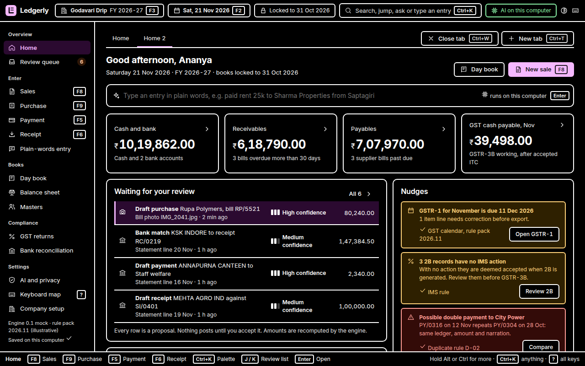</td>
<td></td>
</tr>
</table>

## hc / home.gst-unsupported

SSIM 0.4584

<table>
<tr><th>Mock</th><th>App</th></tr>
<tr>
<td></td>
<td>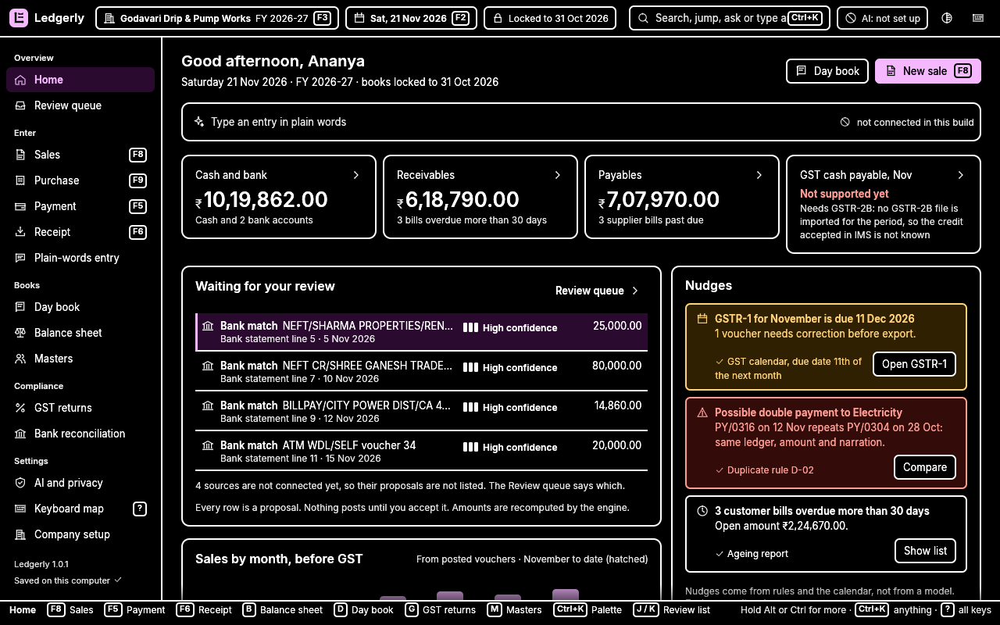</td>
</tr>
</table>

## hc / home.nudge-open

SSIM 0.4687

<table>
<tr><th>Mock</th><th>App</th></tr>
<tr>
<td></td>
<td></td>
</tr>
</table>

## hc / sales-invoice.save-confirm

SSIM 0.4733

<table>
<tr><th>Mock</th><th>App</th></tr>
<tr>
<td>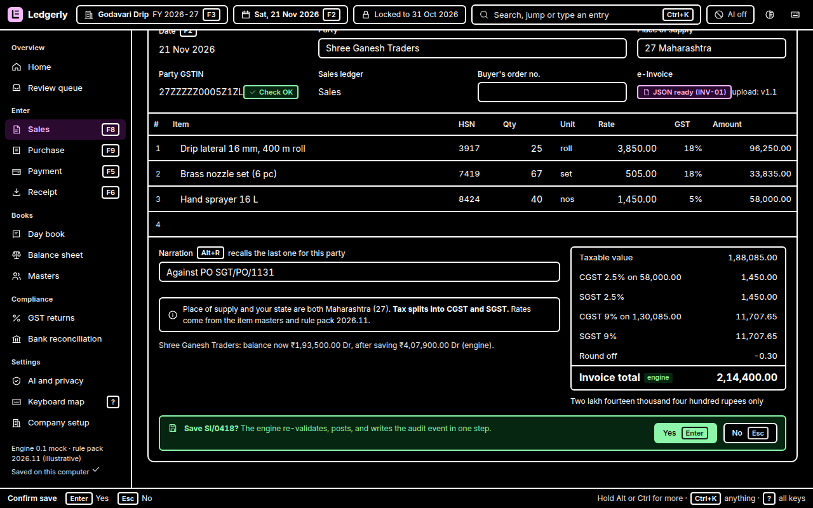</td>
<td>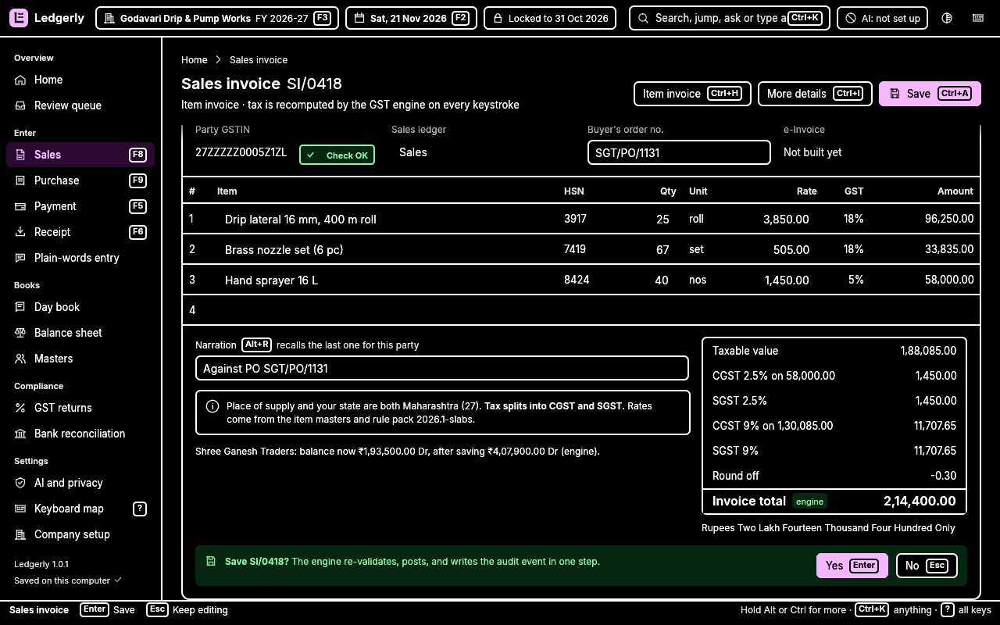</td>
</tr>
</table>

## hc / profit-and-loss.print-config

SSIM 0.4866

<table>
<tr><th>Mock</th><th>App</th></tr>
<tr>
<td>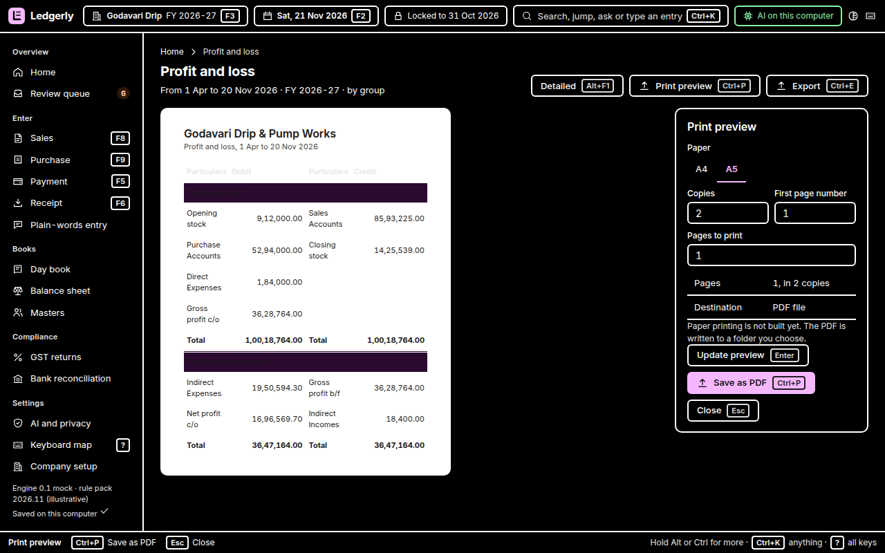</td>
<td></td>
</tr>
</table>

## hc / bank.default

SSIM 0.4967

<table>
<tr><th>Mock</th><th>App</th></tr>
<tr>
<td></td>
<td></td>
</tr>
</table>

## hc / home.default

SSIM 0.4988

<table>
<tr><th>Mock</th><th>App</th></tr>
<tr>
<td></td>
<td></td>
</tr>
</table>

## hc / audit.default

SSIM 0.5103

<table>
<tr><th>Mock</th><th>App</th></tr>
<tr>
<td></td>
<td></td>
</tr>
</table>

## hc / day-book.month

SSIM 0.5107

<table>
<tr><th>Mock</th><th>App</th></tr>
<tr>
<td>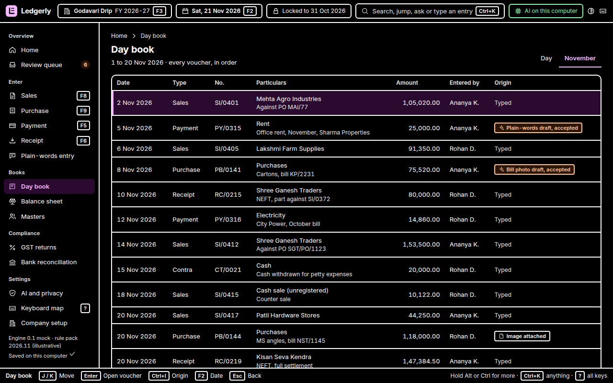</td>
<td></td>
</tr>
</table>

## hc / profit-and-loss.print-failed

SSIM 0.5133

<table>
<tr><th>Mock</th><th>App</th></tr>
<tr>
<td></td>
<td></td>
</tr>
</table>

## dark / profit-and-loss.print-config

SSIM 0.5157

<table>
<tr><th>Mock</th><th>App</th></tr>
<tr>
<td>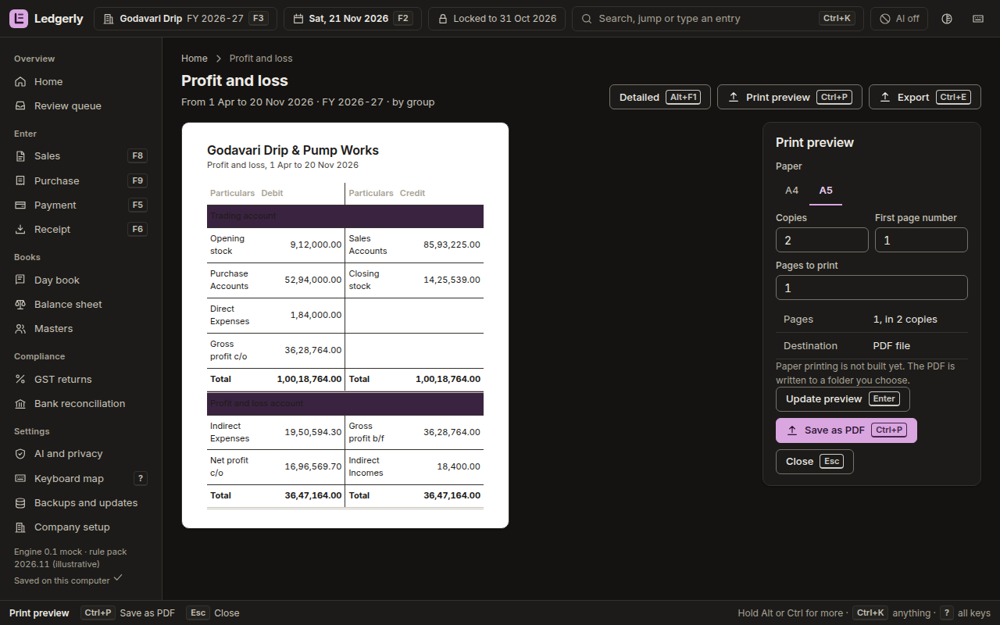</td>
<td>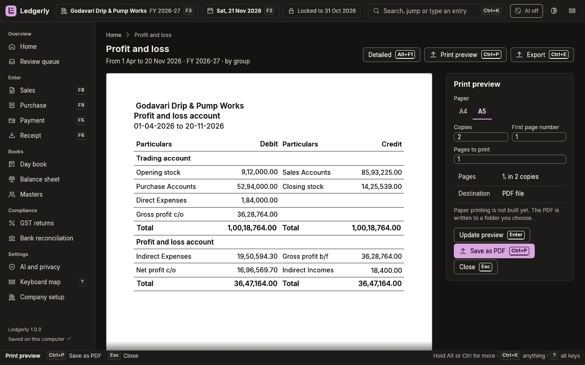</td>
</tr>
</table>

## hc / hi.home.default

SSIM 0.5162

<table>
<tr><th>Mock</th><th>App</th></tr>
<tr>
<td></td>
<td></td>
</tr>
</table>

## hc / masters.loading

SSIM 0.5166

<table>
<tr><th>Mock</th><th>App</th></tr>
<tr>
<td></td>
<td>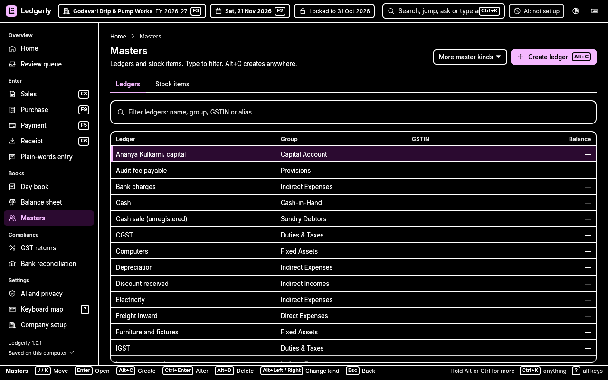</td>
</tr>
</table>

## hc / hi.bank.default

SSIM 0.5173

<table>
<tr><th>Mock</th><th>App</th></tr>
<tr>
<td></td>
<td></td>
</tr>
</table>

## hc / profit-and-loss.provisional

SSIM 0.5208

<table>
<tr><th>Mock</th><th>App</th></tr>
<tr>
<td></td>
<td></td>
</tr>
</table>

## hc / sales-invoice.as-voucher

SSIM 0.5248

<table>
<tr><th>Mock</th><th>App</th></tr>
<tr>
<td></td>
<td>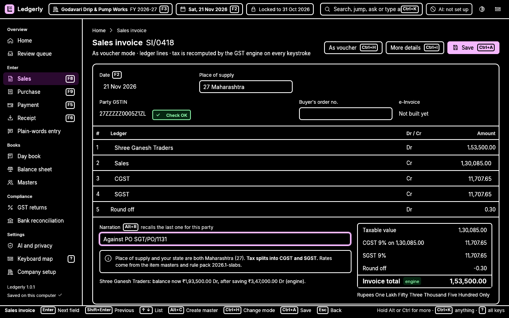</td>
</tr>
</table>

## hc / profit-and-loss.detailed

SSIM 0.5256

<table>
<tr><th>Mock</th><th>App</th></tr>
<tr>
<td>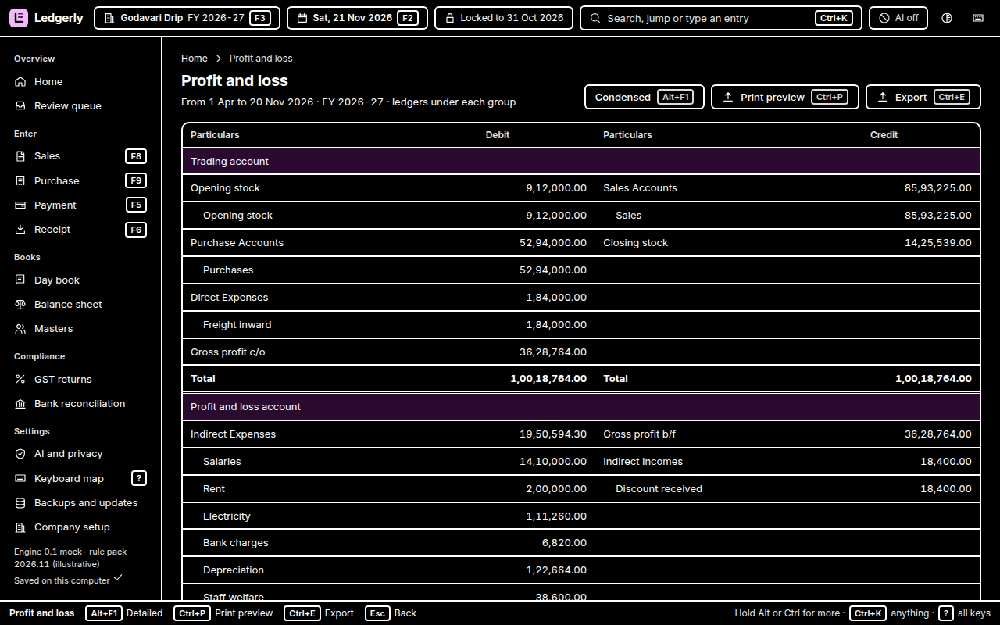</td>
<td></td>
</tr>
</table>

## dark / home.new-tab

SSIM 0.5343

<table>
<tr><th>Mock</th><th>App</th></tr>
<tr>
<td>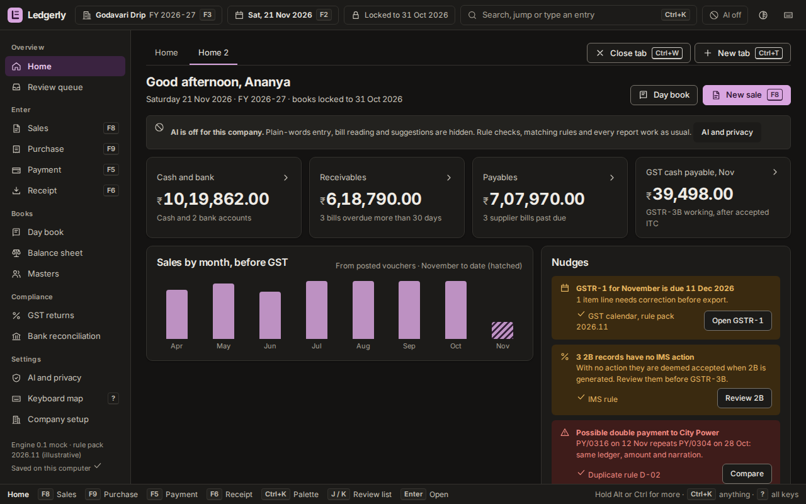</td>
<td>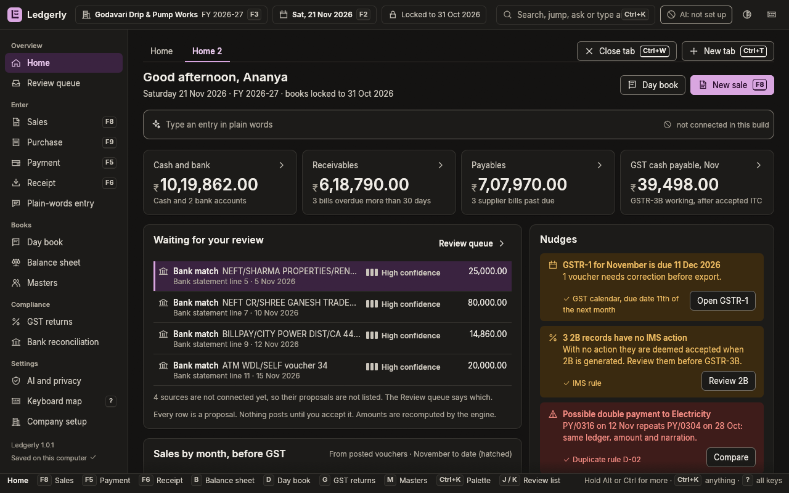</td>
</tr>
</table>

## light / home.new-tab

SSIM 0.5343

<table>
<tr><th>Mock</th><th>App</th></tr>
<tr>
<td>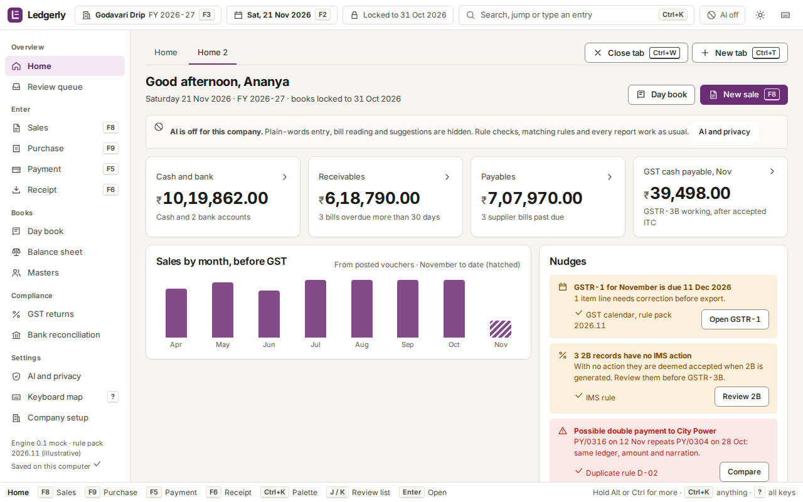</td>
<td>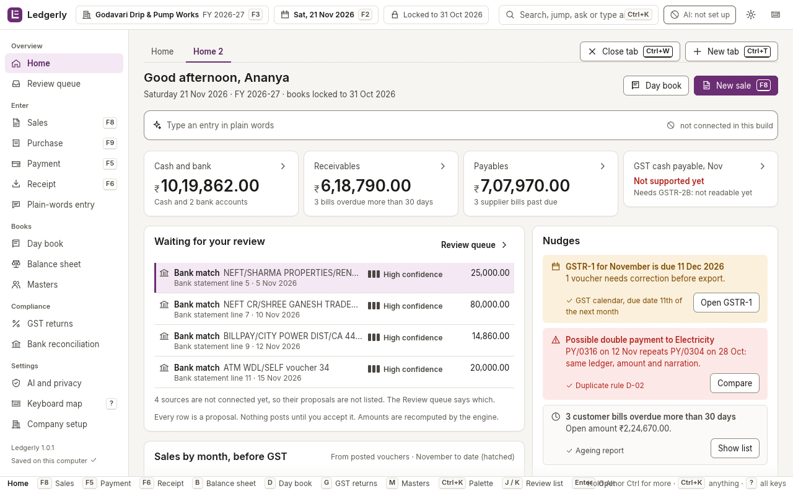</td>
</tr>
</table>

## light / home.gst-unsupported

SSIM 0.5379

<table>
<tr><th>Mock</th><th>App</th></tr>
<tr>
<td></td>
<td>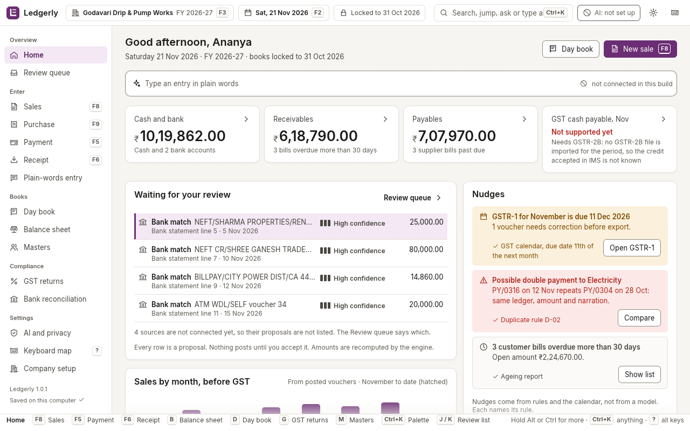</td>
</tr>
</table>

## dark / home.gst-unsupported

SSIM 0.5395

<table>
<tr><th>Mock</th><th>App</th></tr>
<tr>
<td></td>
<td></td>
</tr>
</table>

## hc / palette.entry

SSIM 0.5414

<table>
<tr><th>Mock</th><th>App</th></tr>
<tr>
<td></td>
<td></td>
</tr>
</table>

## light / home.default

SSIM 0.5436

<table>
<tr><th>Mock</th><th>App</th></tr>
<tr>
<td></td>
<td></td>
</tr>
</table>

## hc / palette.ask

SSIM 0.5442

<table>
<tr><th>Mock</th><th>App</th></tr>
<tr>
<td></td>
<td>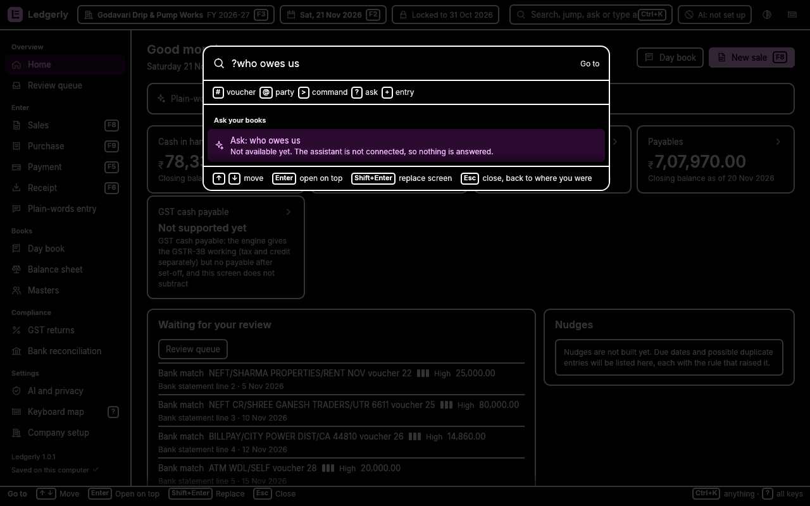</td>
</tr>
</table>

## hc / ai-settings.cloud

SSIM 0.5460

<table>
<tr><th>Mock</th><th>App</th></tr>
<tr>
<td>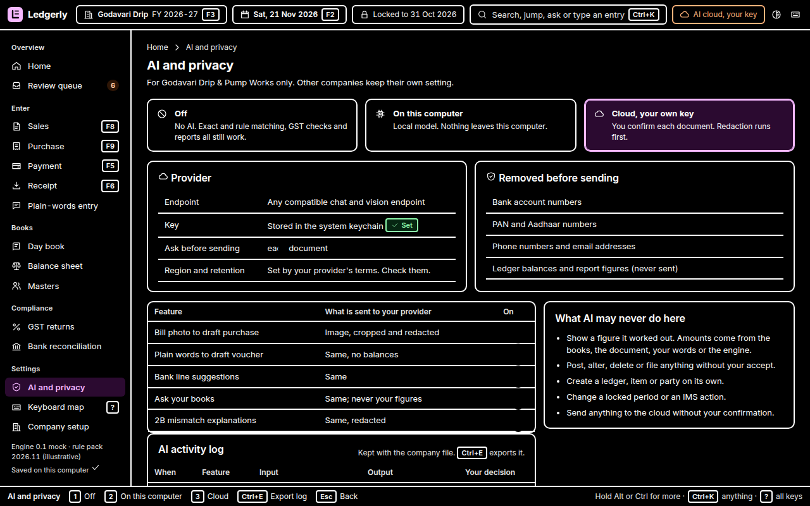</td>
<td>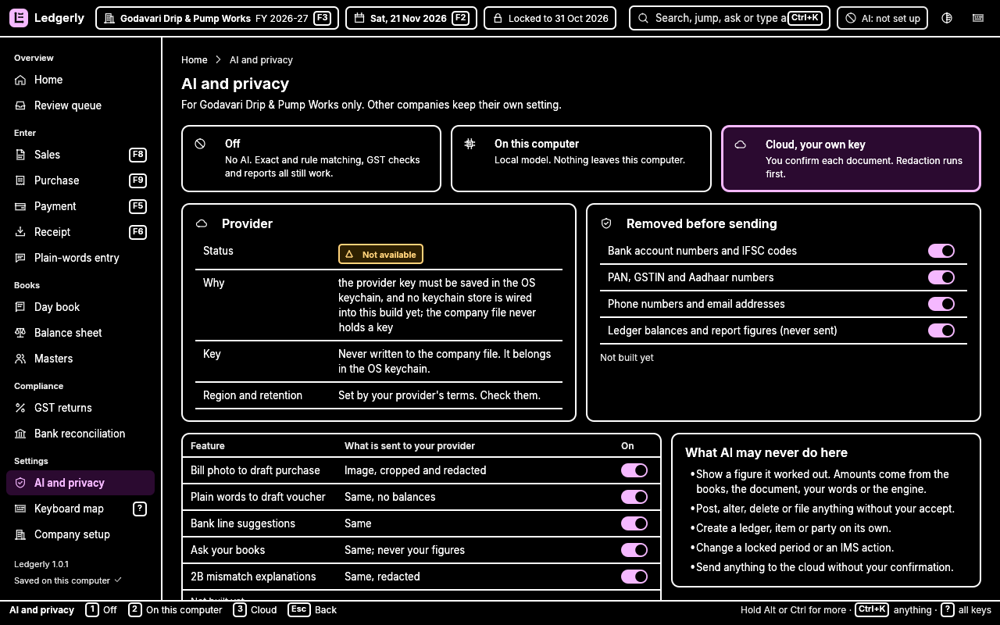</td>
</tr>
</table>

## hc / review.default

SSIM 0.5479

<table>
<tr><th>Mock</th><th>App</th></tr>
<tr>
<td></td>
<td></td>
</tr>
</table>

## hc / bank.offline-ai

SSIM 0.5492

<table>
<tr><th>Mock</th><th>App</th></tr>
<tr>
<td></td>
<td></td>
</tr>
</table>

## hc / stock-summary.provisional

SSIM 0.5496

<table>
<tr><th>Mock</th><th>App</th></tr>
<tr>
<td></td>
<td></td>
</tr>
</table>

## dark / home.default

SSIM 0.5504

<table>
<tr><th>Mock</th><th>App</th></tr>
<tr>
<td></td>
<td></td>
</tr>
</table>

## light / home.nudge-open

SSIM 0.5508

<table>
<tr><th>Mock</th><th>App</th></tr>
<tr>
<td></td>
<td></td>
</tr>
</table>

## hc / palette.voucher

SSIM 0.5529

<table>
<tr><th>Mock</th><th>App</th></tr>
<tr>
<td></td>
<td></td>
</tr>
</table>

## hc / ai-settings.local

SSIM 0.5534

<table>
<tr><th>Mock</th><th>App</th></tr>
<tr>
<td></td>
<td></td>
</tr>
</table>

## hc / sales-invoice.einvoice-not-ready

SSIM 0.5538

<table>
<tr><th>Mock</th><th>App</th></tr>
<tr>
<td></td>
<td></td>
</tr>
</table>

## hc / palette.no-results

SSIM 0.5592

<table>
<tr><th>Mock</th><th>App</th></tr>
<tr>
<td>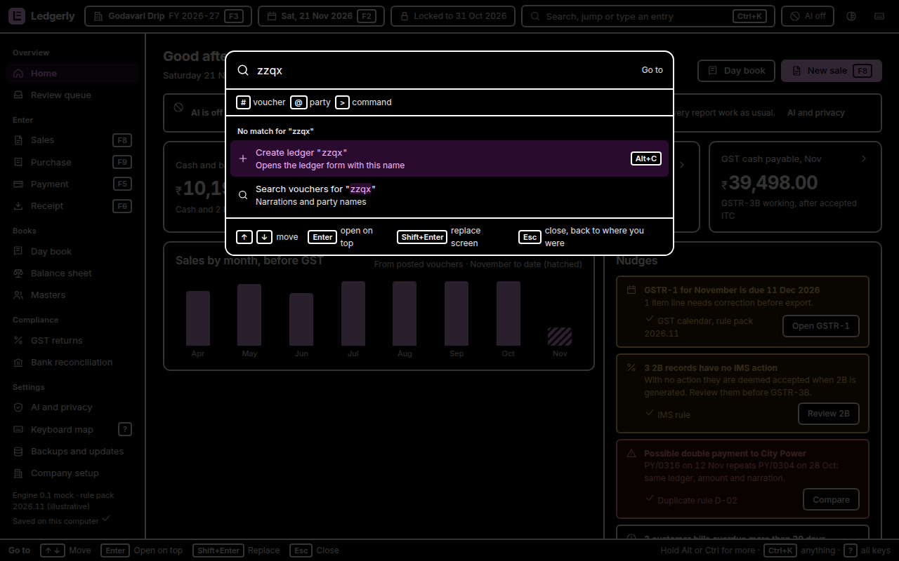</td>
<td></td>
</tr>
</table>

## hc / profit-and-loss.print-range-error

SSIM 0.5597

<table>
<tr><th>Mock</th><th>App</th></tr>
<tr>
<td></td>
<td></td>
</tr>
</table>

## dark / profit-and-loss.print-range-error

SSIM 0.5615

<table>
<tr><th>Mock</th><th>App</th></tr>
<tr>
<td>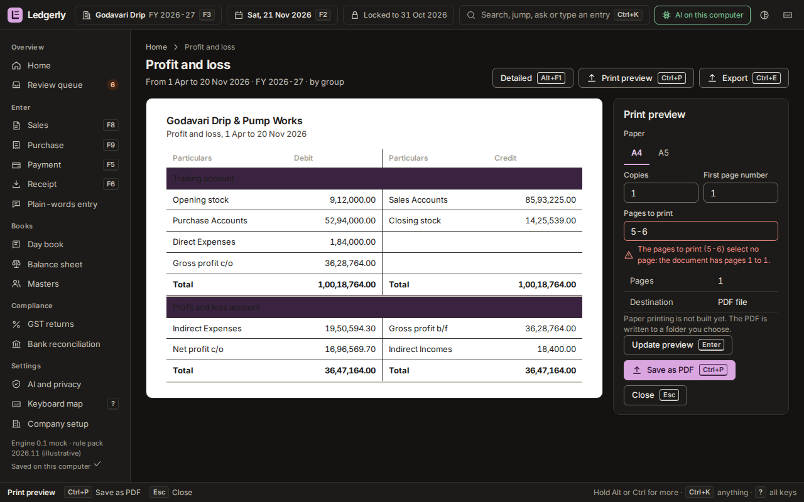</td>
<td></td>
</tr>
</table>

## hc / trial-balance.default

SSIM 0.5691

<table>
<tr><th>Mock</th><th>App</th></tr>
<tr>
<td></td>
<td></td>
</tr>
</table>

## dark / home.nudge-open

SSIM 0.5712

<table>
<tr><th>Mock</th><th>App</th></tr>
<tr>
<td></td>
<td></td>
</tr>
</table>

## hc / import.imported

SSIM 0.5720

<table>
<tr><th>Mock</th><th>App</th></tr>
<tr>
<td></td>
<td></td>
</tr>
</table>

## hc / profit-and-loss.print-preview

SSIM 0.5720

<table>
<tr><th>Mock</th><th>App</th></tr>
<tr>
<td></td>
<td></td>
</tr>
</table>

## dark / profit-and-loss.print-preview

SSIM 0.5728

<table>
<tr><th>Mock</th><th>App</th></tr>
<tr>
<td></td>
<td></td>
</tr>
</table>

## hc / gst.gstr3b

SSIM 0.5742

<table>
<tr><th>Mock</th><th>App</th></tr>
<tr>
<td>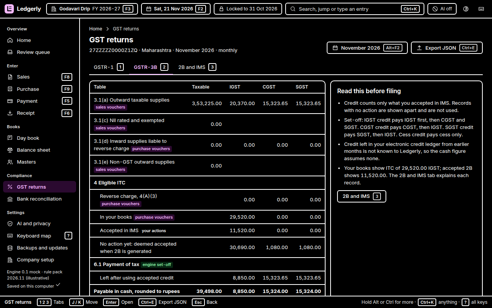</td>
<td></td>
</tr>
</table>

## hc / masters.ledgers

SSIM 0.5753

<table>
<tr><th>Mock</th><th>App</th></tr>
<tr>
<td></td>
<td></td>
</tr>
</table>

## hc / purchase.validation-error

SSIM 0.5777

<table>
<tr><th>Mock</th><th>App</th></tr>
<tr>
<td></td>
<td>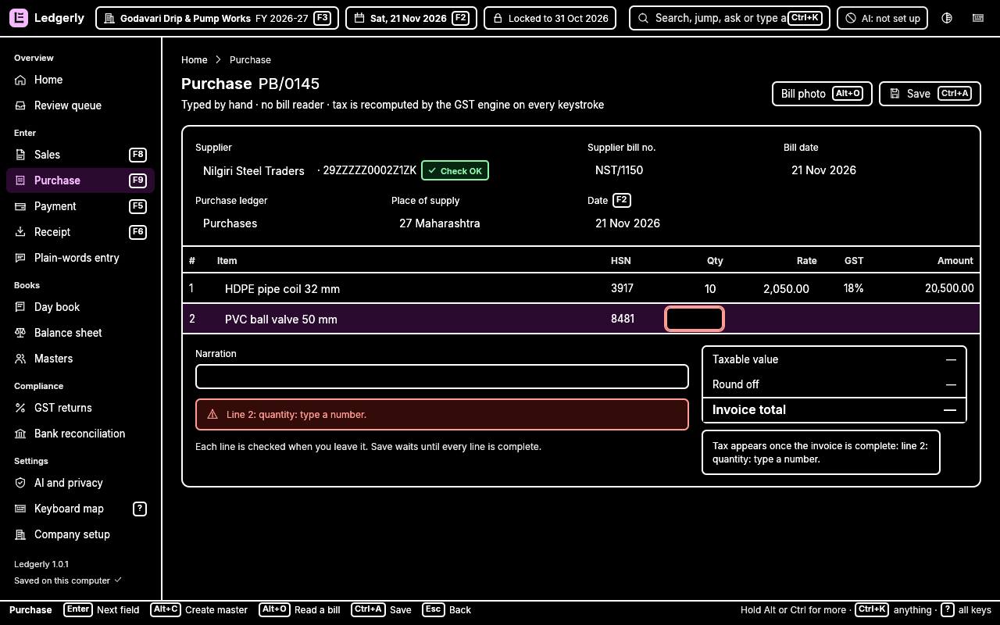</td>
</tr>
</table>

## hc / import.no-company

SSIM 0.5779

<table>
<tr><th>Mock</th><th>App</th></tr>
<tr>
<td></td>
<td></td>
</tr>
</table>

## dark / bank.default

SSIM 0.5784

<table>
<tr><th>Mock</th><th>App</th></tr>
<tr>
<td>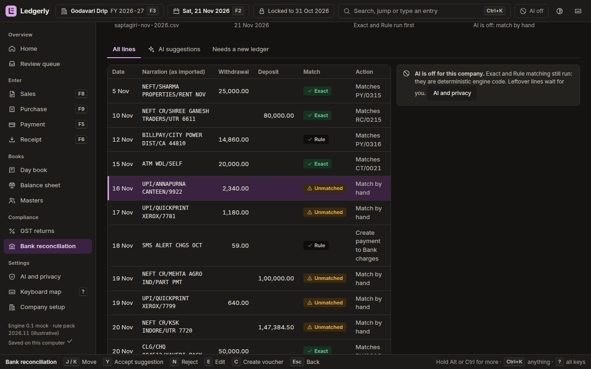</td>
<td></td>
</tr>
</table>

## hc / sales-invoice.item-list

SSIM 0.5857

<table>
<tr><th>Mock</th><th>App</th></tr>
<tr>
<td></td>
<td></td>
</tr>
</table>

## hc / bank.brs-exported

SSIM 0.5861

<table>
<tr><th>Mock</th><th>App</th></tr>
<tr>
<td></td>
<td></td>
</tr>
</table>

## light / audit.default

SSIM 0.5870

<table>
<tr><th>Mock</th><th>App</th></tr>
<tr>
<td></td>
<td>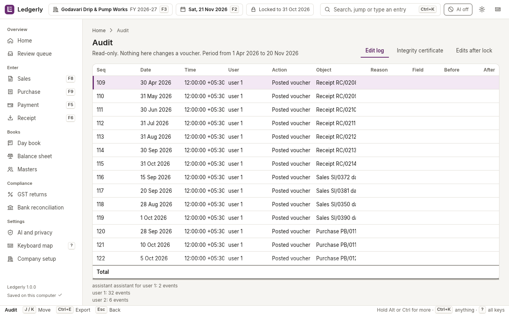</td>
</tr>
</table>

## hc / hi.masters.ledgers

SSIM 0.5879

<table>
<tr><th>Mock</th><th>App</th></tr>
<tr>
<td>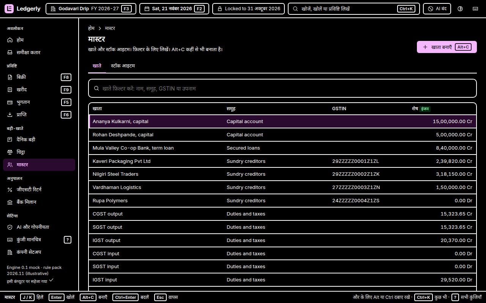</td>
<td></td>
</tr>
</table>

## hc / home.ai-off

SSIM 0.5895

<table>
<tr><th>Mock</th><th>App</th></tr>
<tr>
<td></td>
<td></td>
</tr>
</table>

## light / hi.home.default

SSIM 0.5912

<table>
<tr><th>Mock</th><th>App</th></tr>
<tr>
<td></td>
<td></td>
</tr>
</table>

## light / palette.entry

SSIM 0.5920

<table>
<tr><th>Mock</th><th>App</th></tr>
<tr>
<td></td>
<td>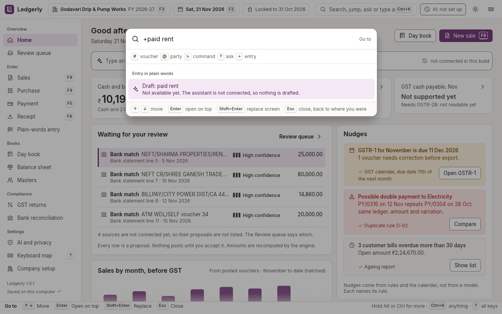</td>
</tr>
</table>

## hc / import.port-error

SSIM 0.5923

<table>
<tr><th>Mock</th><th>App</th></tr>
<tr>
<td></td>
<td></td>
</tr>
</table>

## hc / import.validation-error

SSIM 0.5934

<table>
<tr><th>Mock</th><th>App</th></tr>
<tr>
<td>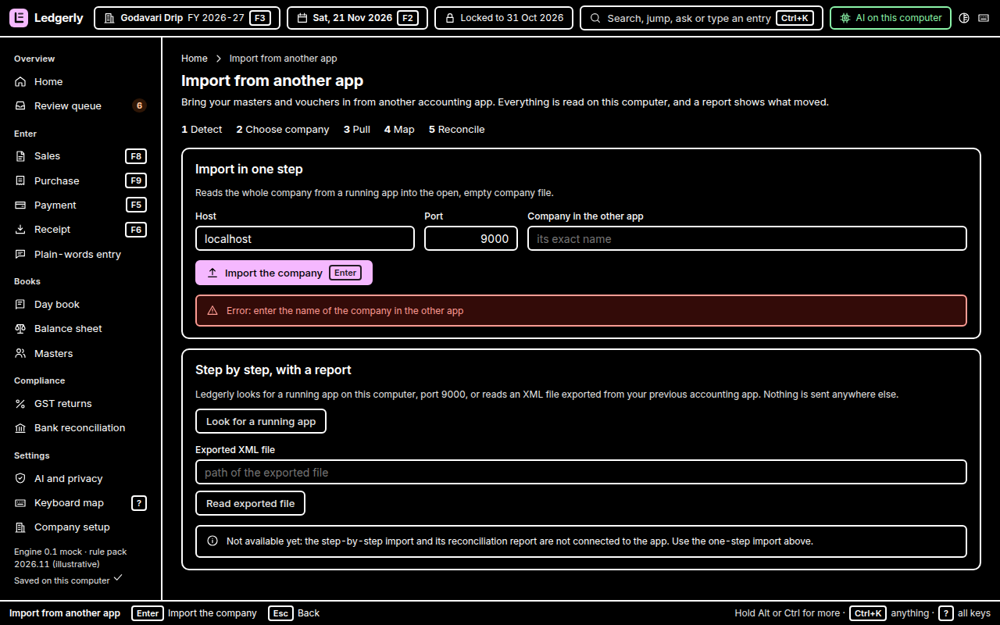</td>
<td>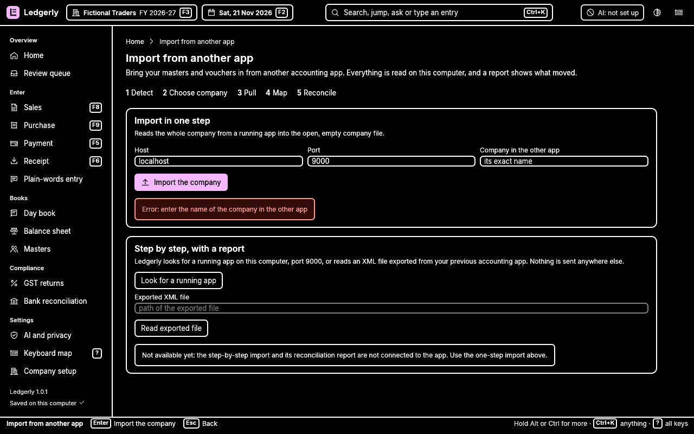</td>
</tr>
</table>

## hc / import.failed

SSIM 0.5945

<table>
<tr><th>Mock</th><th>App</th></tr>
<tr>
<td>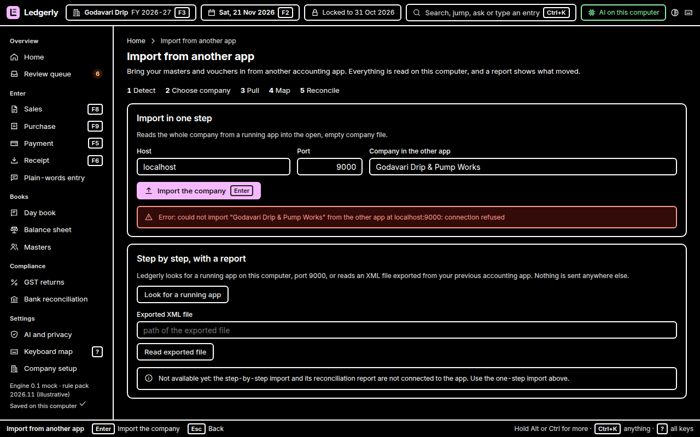</td>
<td></td>
</tr>
</table>

## light / palette.ask

SSIM 0.5948

<table>
<tr><th>Mock</th><th>App</th></tr>
<tr>
<td></td>
<td></td>
</tr>
</table>

## hc / import.refused

SSIM 0.5949

<table>
<tr><th>Mock</th><th>App</th></tr>
<tr>
<td></td>
<td></td>
</tr>
</table>

## dark / hi.home.default

SSIM 0.5952

<table>
<tr><th>Mock</th><th>App</th></tr>
<tr>
<td></td>
<td></td>
</tr>
</table>

## hc / sales-invoice.period-locked

SSIM 0.5952

<table>
<tr><th>Mock</th><th>App</th></tr>
<tr>
<td></td>
<td></td>
</tr>
</table>

## hc / sales-invoice.validation-error

SSIM 0.5963

<table>
<tr><th>Mock</th><th>App</th></tr>
<tr>
<td></td>
<td></td>
</tr>
</table>

## hc / balance-sheet.provisional

SSIM 0.5968

<table>
<tr><th>Mock</th><th>App</th></tr>
<tr>
<td></td>
<td>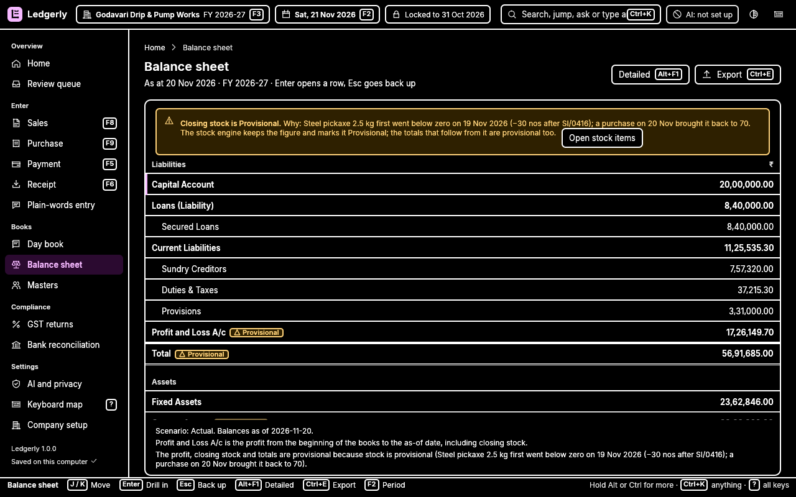</td>
</tr>
</table>

## dark / hi.bank.default

SSIM 0.5986

<table>
<tr><th>Mock</th><th>App</th></tr>
<tr>
<td></td>
<td>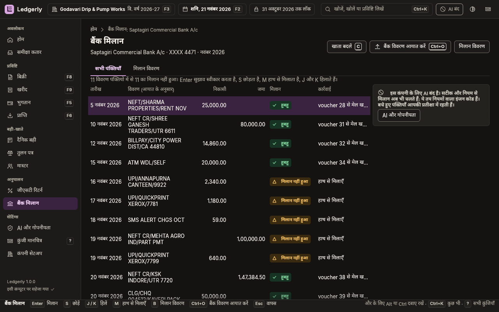</td>
</tr>
</table>

## hc / keys.standard

SSIM 0.6004

<table>
<tr><th>Mock</th><th>App</th></tr>
<tr>
<td></td>
<td></td>
</tr>
</table>

## hc / purchase-bill.offline-ai

SSIM 0.6015

<table>
<tr><th>Mock</th><th>App</th></tr>
<tr>
<td></td>
<td></td>
</tr>
</table>

## hc / sales-invoice.mode-list

SSIM 0.6015

<table>
<tr><th>Mock</th><th>App</th></tr>
<tr>
<td></td>
<td></td>
</tr>
</table>

## hc / balance-sheet.detailed

SSIM 0.6022

<table>
<tr><th>Mock</th><th>App</th></tr>
<tr>
<td></td>
<td></td>
</tr>
</table>

## light / masters.ledgers

SSIM 0.6024

<table>
<tr><th>Mock</th><th>App</th></tr>
<tr>
<td></td>
<td></td>
</tr>
</table>

## light / review.default

SSIM 0.6026

<table>
<tr><th>Mock</th><th>App</th></tr>
<tr>
<td></td>
<td></td>
</tr>
</table>

## hc / palette.search

SSIM 0.6029

<table>
<tr><th>Mock</th><th>App</th></tr>
<tr>
<td></td>
<td></td>
</tr>
</table>

## light / sales-invoice.save-confirm

SSIM 0.6031

<table>
<tr><th>Mock</th><th>App</th></tr>
<tr>
<td></td>
<td>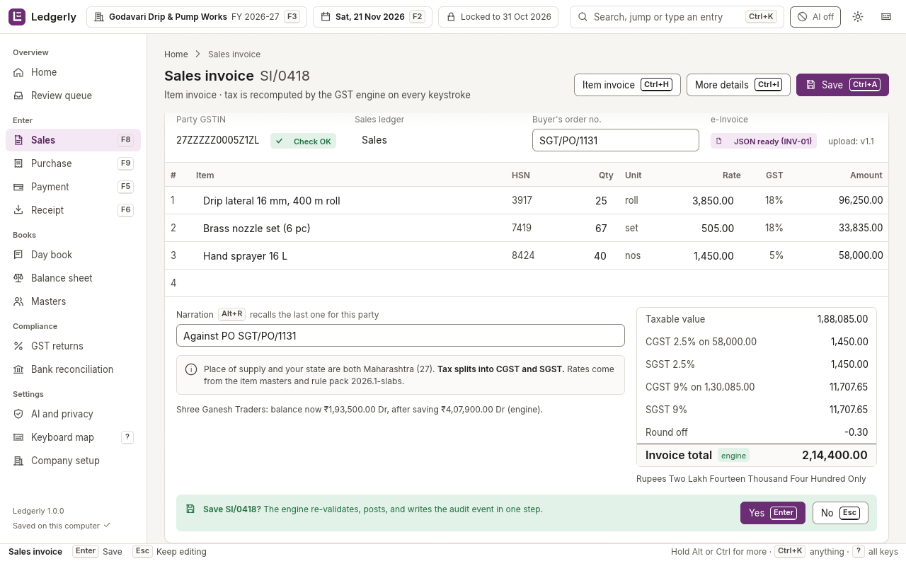</td>
</tr>
</table>

## hc / gst.gstr1-correction

SSIM 0.6034

<table>
<tr><th>Mock</th><th>App</th></tr>
<tr>
<td></td>
<td></td>
</tr>
</table>

## hc / gst.gstr1

SSIM 0.6034

<table>
<tr><th>Mock</th><th>App</th></tr>
<tr>
<td></td>
<td>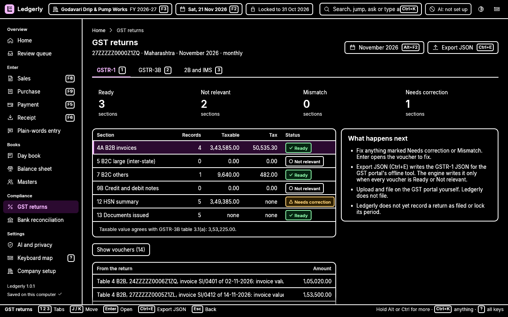</td>
</tr>
</table>

## dark / audit.default

SSIM 0.6034

<table>
<tr><th>Mock</th><th>App</th></tr>
<tr>
<td></td>
<td></td>
</tr>
</table>

## light / palette.voucher

SSIM 0.6038

<table>
<tr><th>Mock</th><th>App</th></tr>
<tr>
<td></td>
<td></td>
</tr>
</table>

## dark / review.default

SSIM 0.6039

<table>
<tr><th>Mock</th><th>App</th></tr>
<tr>
<td></td>
<td></td>
</tr>
</table>

## light / palette.no-results

SSIM 0.6048

<table>
<tr><th>Mock</th><th>App</th></tr>
<tr>
<td></td>
<td></td>
</tr>
</table>

## light / bank.default

SSIM 0.6060

<table>
<tr><th>Mock</th><th>App</th></tr>
<tr>
<td></td>
<td></td>
</tr>
</table>

## hc / masters.items

SSIM 0.6068

<table>
<tr><th>Mock</th><th>App</th></tr>
<tr>
<td></td>
<td></td>
</tr>
</table>

## hc / keys.classic

SSIM 0.6070

<table>
<tr><th>Mock</th><th>App</th></tr>
<tr>
<td></td>
<td></td>
</tr>
</table>

## dark / bank.offline-ai

SSIM 0.6071

<table>
<tr><th>Mock</th><th>App</th></tr>
<tr>
<td></td>
<td></td>
</tr>
</table>

## hc / profit-and-loss.print-busy

SSIM 0.6083

<table>
<tr><th>Mock</th><th>App</th></tr>
<tr>
<td></td>
<td></td>
</tr>
</table>

## hc / balance-sheet.default

SSIM 0.6087

<table>
<tr><th>Mock</th><th>App</th></tr>
<tr>
<td></td>
<td></td>
</tr>
</table>

## hc / profit-and-loss.print-saved

SSIM 0.6117

<table>
<tr><th>Mock</th><th>App</th></tr>
<tr>
<td></td>
<td></td>
</tr>
</table>

## light / balance-sheet.provisional

SSIM 0.6130

<table>
<tr><th>Mock</th><th>App</th></tr>
<tr>
<td>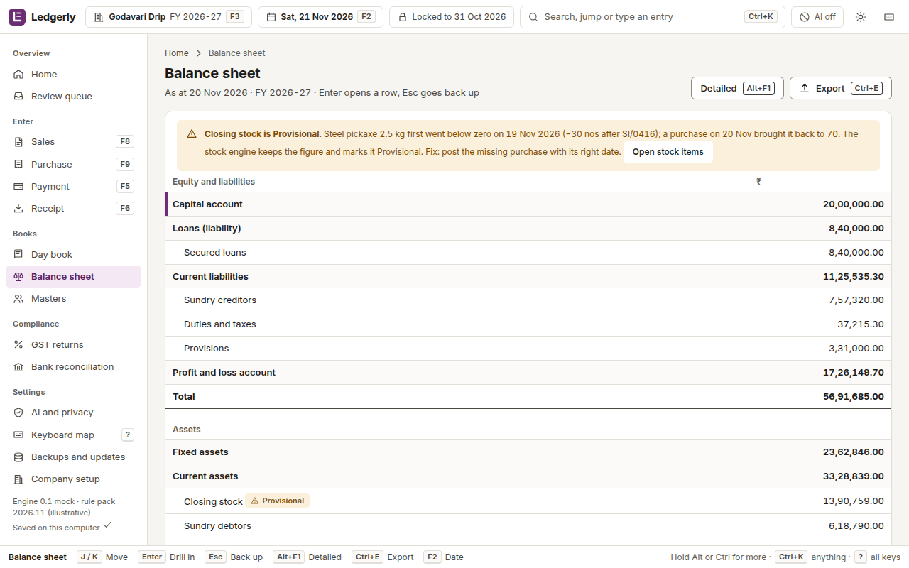</td>
<td></td>
</tr>
</table>

## hc / masters.no-match

SSIM 0.6139

<table>
<tr><th>Mock</th><th>App</th></tr>
<tr>
<td></td>
<td></td>
</tr>
</table>

## hc / sales-invoice.gst-inter-state

SSIM 0.6139

<table>
<tr><th>Mock</th><th>App</th></tr>
<tr>
<td>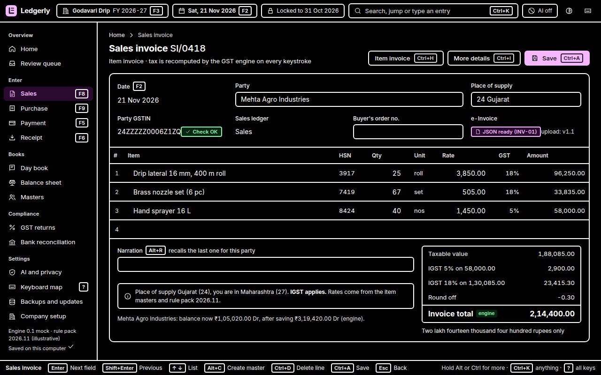</td>
<td></td>
</tr>
</table>

## light / ai-settings.cloud

SSIM 0.6141

<table>
<tr><th>Mock</th><th>App</th></tr>
<tr>
<td></td>
<td></td>
</tr>
</table>

## light / hi.masters.ledgers

SSIM 0.6142

<table>
<tr><th>Mock</th><th>App</th></tr>
<tr>
<td></td>
<td></td>
</tr>
</table>

## light / sales-invoice.einvoice-not-ready

SSIM 0.6157

<table>
<tr><th>Mock</th><th>App</th></tr>
<tr>
<td>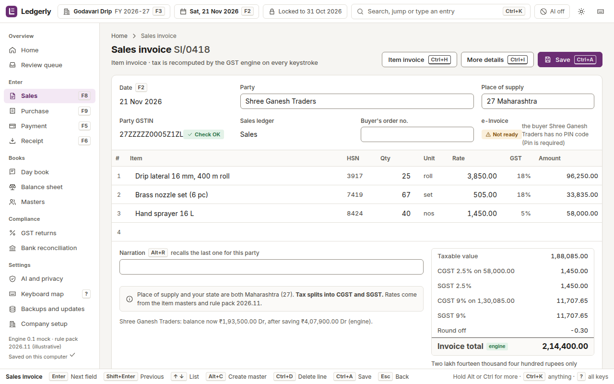</td>
<td></td>
</tr>
</table>

## hc / palette.default

SSIM 0.6162

<table>
<tr><th>Mock</th><th>App</th></tr>
<tr>
<td></td>
<td></td>
</tr>
</table>

## light / day-book.month

SSIM 0.6163

<table>
<tr><th>Mock</th><th>App</th></tr>
<tr>
<td></td>
<td></td>
</tr>
</table>

## light / trial-balance.default

SSIM 0.6168

<table>
<tr><th>Mock</th><th>App</th></tr>
<tr>
<td></td>
<td></td>
</tr>
</table>

## dark / sales-invoice.save-confirm

SSIM 0.6169

<table>
<tr><th>Mock</th><th>App</th></tr>
<tr>
<td></td>
<td></td>
</tr>
</table>

## light / sales-invoice.period-locked

SSIM 0.6176

<table>
<tr><th>Mock</th><th>App</th></tr>
<tr>
<td></td>
<td></td>
</tr>
</table>

## hc / hi.gst.gstr1

SSIM 0.6196

<table>
<tr><th>Mock</th><th>App</th></tr>
<tr>
<td></td>
<td></td>
</tr>
</table>

## hc / sales-invoice.default

SSIM 0.6197

<table>
<tr><th>Mock</th><th>App</th></tr>
<tr>
<td></td>
<td></td>
</tr>
</table>

## hc / hi.balance-sheet.default

SSIM 0.6202

<table>
<tr><th>Mock</th><th>App</th></tr>
<tr>
<td></td>
<td>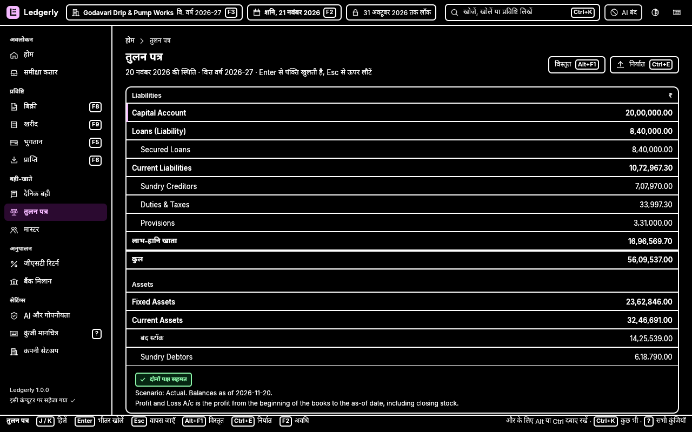</td>
</tr>
</table>

## light / profit-and-loss.detailed

SSIM 0.6242

<table>
<tr><th>Mock</th><th>App</th></tr>
<tr>
<td></td>
<td></td>
</tr>
</table>

## hc / bank.brs

SSIM 0.6246

<table>
<tr><th>Mock</th><th>App</th></tr>
<tr>
<td></td>
<td></td>
</tr>
</table>

## dark / palette.entry

SSIM 0.6247

<table>
<tr><th>Mock</th><th>App</th></tr>
<tr>
<td></td>
<td></td>
</tr>
</table>

## dark / ai-settings.cloud

SSIM 0.6252

<table>
<tr><th>Mock</th><th>App</th></tr>
<tr>
<td></td>
<td></td>
</tr>
</table>

## light / sales-invoice.validation-error

SSIM 0.6263

<table>
<tr><th>Mock</th><th>App</th></tr>
<tr>
<td>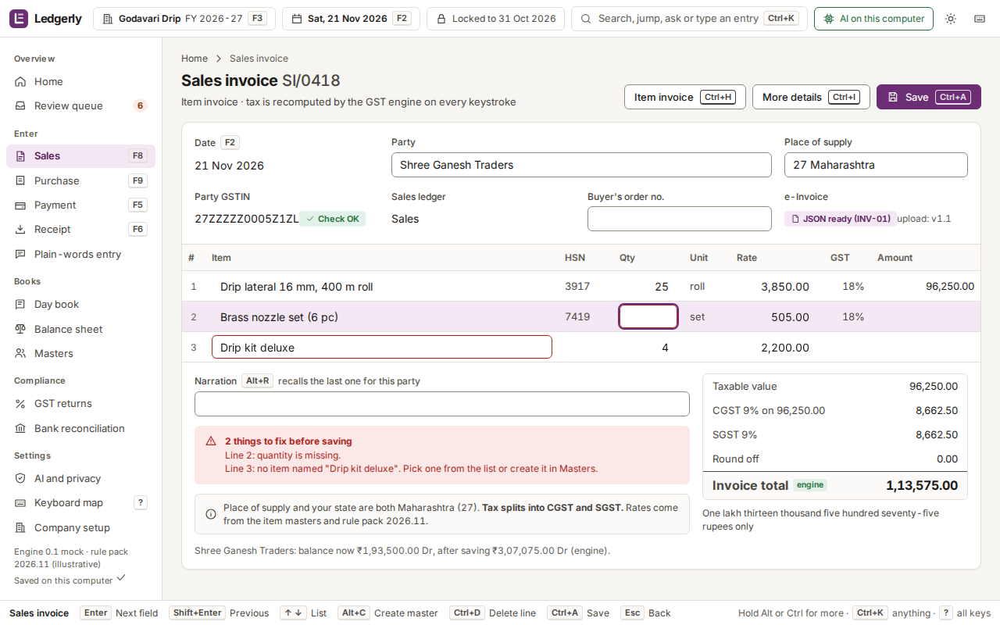</td>
<td></td>
</tr>
</table>

## hc / sales-invoice.print-preview

SSIM 0.6266

<table>
<tr><th>Mock</th><th>App</th></tr>
<tr>
<td>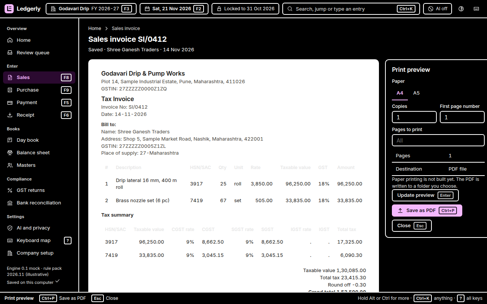</td>
<td>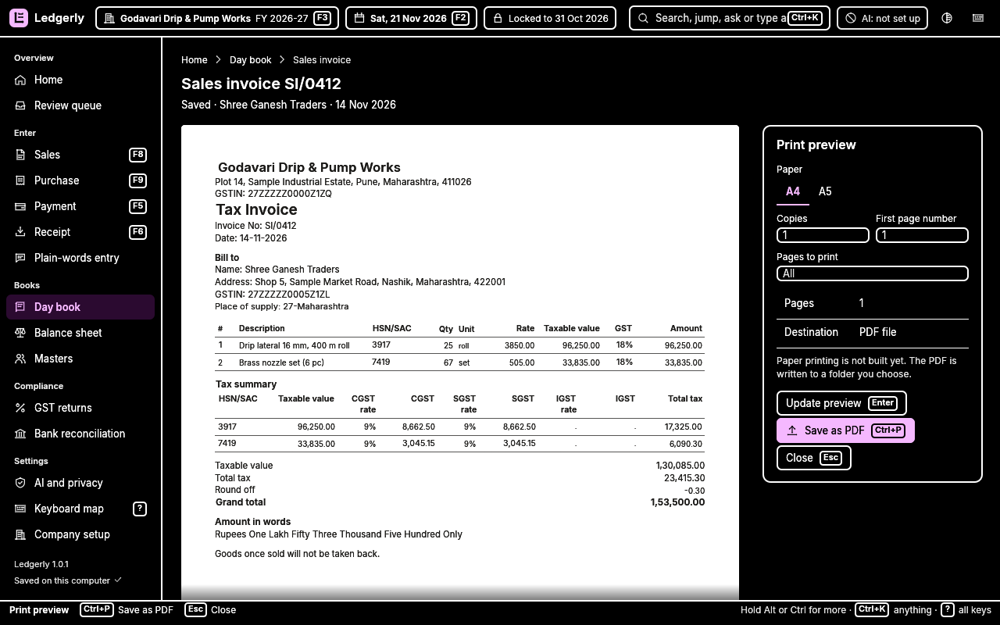</td>
</tr>
</table>

## dark / day-book.month

SSIM 0.6274

<table>
<tr><th>Mock</th><th>App</th></tr>
<tr>
<td></td>
<td></td>
</tr>
</table>

## light / bank.offline-ai

SSIM 0.6274

<table>
<tr><th>Mock</th><th>App</th></tr>
<tr>
<td></td>
<td></td>
</tr>
</table>

## dark / palette.ask

SSIM 0.6274

<table>
<tr><th>Mock</th><th>App</th></tr>
<tr>
<td></td>
<td></td>
</tr>
</table>

## hc / hi.sales-invoice.default

SSIM 0.6282

<table>
<tr><th>Mock</th><th>App</th></tr>
<tr>
<td>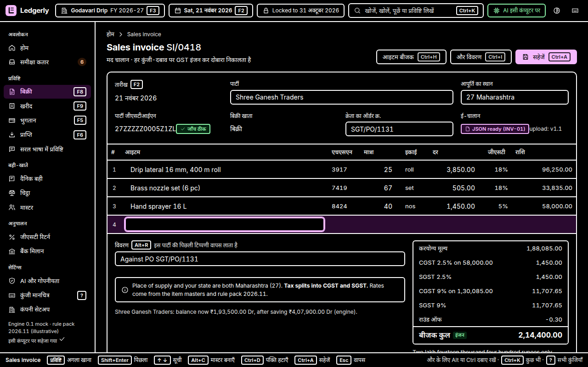</td>
<td></td>
</tr>
</table>

## light / sales-invoice.default

SSIM 0.6284

<table>
<tr><th>Mock</th><th>App</th></tr>
<tr>
<td></td>
<td></td>
</tr>
</table>

## light / sales-invoice.as-voucher

SSIM 0.6292

<table>
<tr><th>Mock</th><th>App</th></tr>
<tr>
<td></td>
<td></td>
</tr>
</table>

## light / sales-invoice.item-list

SSIM 0.6294

<table>
<tr><th>Mock</th><th>App</th></tr>
<tr>
<td></td>
<td>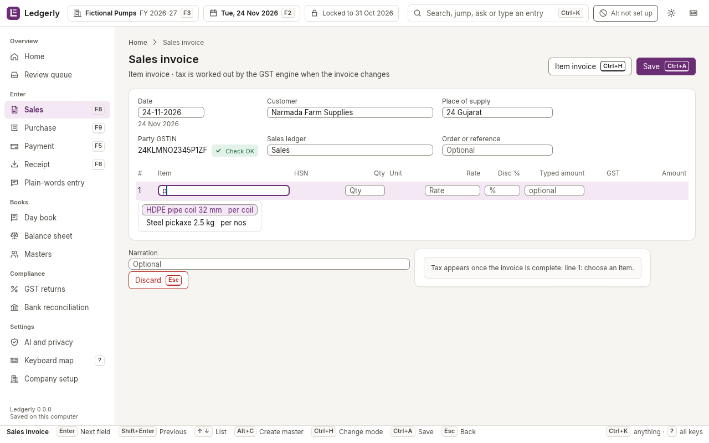</td>
</tr>
</table>

## light / hi.bank.default

SSIM 0.6295

<table>
<tr><th>Mock</th><th>App</th></tr>
<tr>
<td></td>
<td>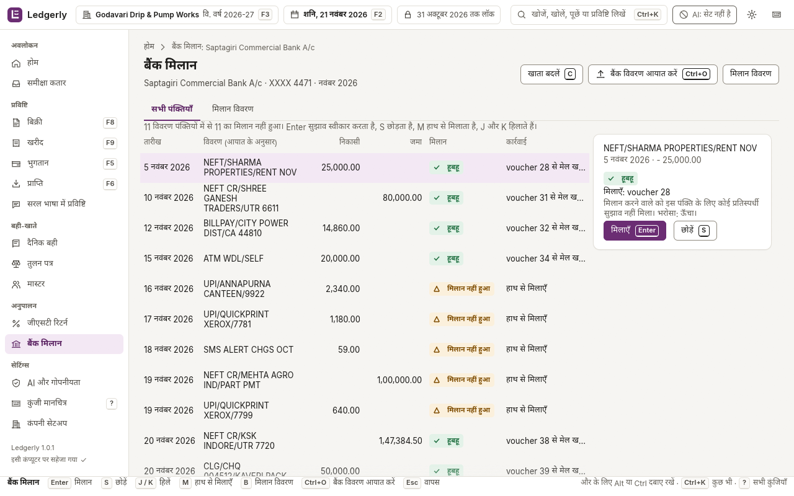</td>
</tr>
</table>

## hc / import.running

SSIM 0.6306

<table>
<tr><th>Mock</th><th>App</th></tr>
<tr>
<td></td>
<td></td>
</tr>
</table>

## light / gst.gstr3b

SSIM 0.6309

<table>
<tr><th>Mock</th><th>App</th></tr>
<tr>
<td></td>
<td></td>
</tr>
</table>

## dark / palette.no-results

SSIM 0.6320

<table>
<tr><th>Mock</th><th>App</th></tr>
<tr>
<td></td>
<td></td>
</tr>
</table>

## dark / sales-invoice.print-preview

SSIM 0.6321

<table>
<tr><th>Mock</th><th>App</th></tr>
<tr>
<td></td>
<td></td>
</tr>
</table>

## hc / day-book.print-preview

SSIM 0.6322

<table>
<tr><th>Mock</th><th>App</th></tr>
<tr>
<td></td>
<td></td>
</tr>
</table>

## light / sales-invoice.gst-inter-state

SSIM 0.6326

<table>
<tr><th>Mock</th><th>App</th></tr>
<tr>
<td></td>
<td></td>
</tr>
</table>

## dark / gst.gstr3b

SSIM 0.6331

<table>
<tr><th>Mock</th><th>App</th></tr>
<tr>
<td></td>
<td>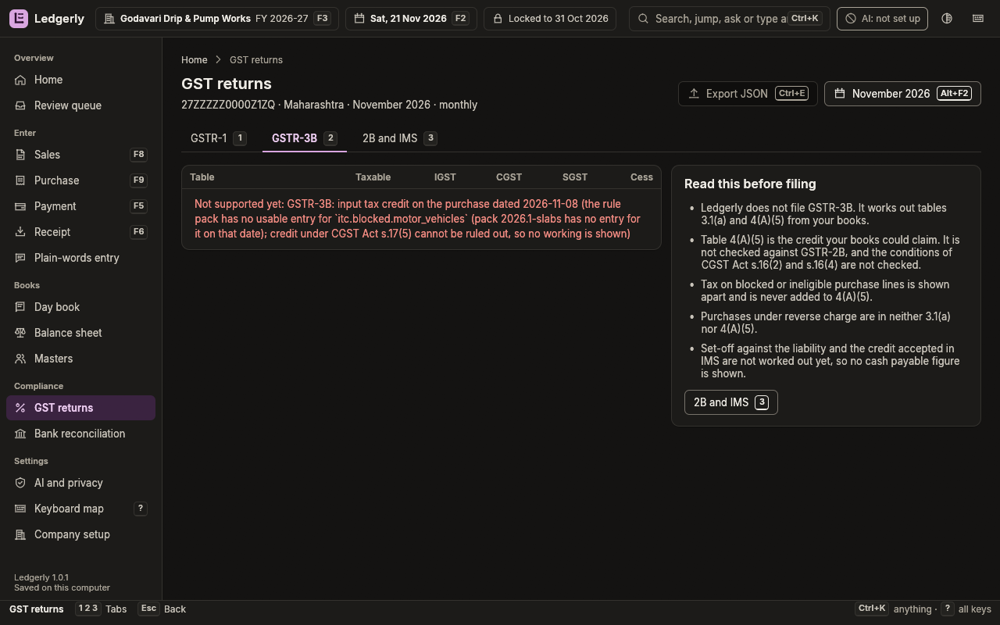</td>
</tr>
</table>

## dark / masters.ledgers

SSIM 0.6331

<table>
<tr><th>Mock</th><th>App</th></tr>
<tr>
<td></td>
<td></td>
</tr>
</table>

## dark / sales-invoice.einvoice-not-ready

SSIM 0.6337

<table>
<tr><th>Mock</th><th>App</th></tr>
<tr>
<td></td>
<td></td>
</tr>
</table>

## dark / day-book.print-preview

SSIM 0.6347

<table>
<tr><th>Mock</th><th>App</th></tr>
<tr>
<td></td>
<td></td>
</tr>
</table>

## light / palette.search

SSIM 0.6361

<table>
<tr><th>Mock</th><th>App</th></tr>
<tr>
<td></td>
<td></td>
</tr>
</table>

## dark / palette.voucher

SSIM 0.6366

<table>
<tr><th>Mock</th><th>App</th></tr>
<tr>
<td>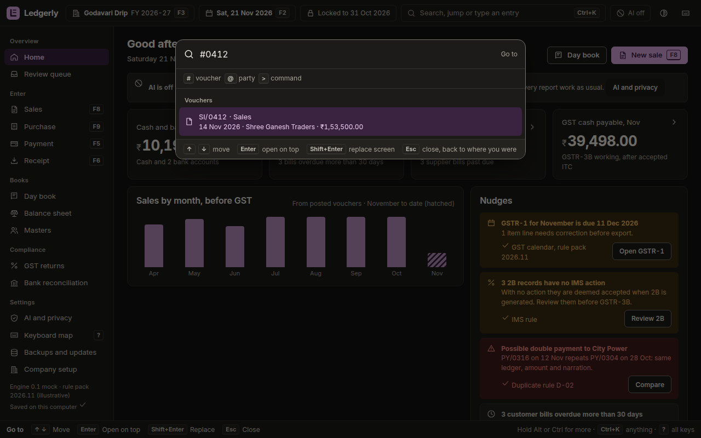</td>
<td></td>
</tr>
</table>

## hc / ai-settings.off

SSIM 0.6367

<table>
<tr><th>Mock</th><th>App</th></tr>
<tr>
<td></td>
<td></td>
</tr>
</table>

## dark / sales-invoice.period-locked

SSIM 0.6370

<table>
<tr><th>Mock</th><th>App</th></tr>
<tr>
<td></td>
<td></td>
</tr>
</table>

## dark / sales-invoice.validation-error

SSIM 0.6371

<table>
<tr><th>Mock</th><th>App</th></tr>
<tr>
<td></td>
<td>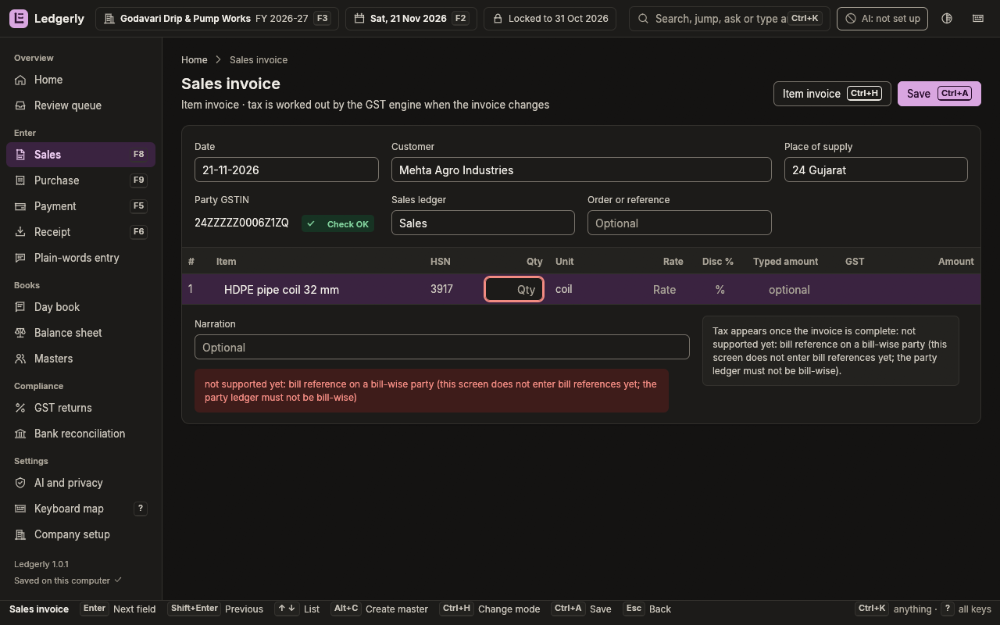</td>
</tr>
</table>

## hc / hi.sales-invoice.print-preview

SSIM 0.6373

<table>
<tr><th>Mock</th><th>App</th></tr>
<tr>
<td></td>
<td></td>
</tr>
</table>

## hc / credit-note.validation-error

SSIM 0.6375

<table>
<tr><th>Mock</th><th>App</th></tr>
<tr>
<td></td>
<td></td>
</tr>
</table>

## dark / sales-invoice.item-list

SSIM 0.6375

<table>
<tr><th>Mock</th><th>App</th></tr>
<tr>
<td></td>
<td>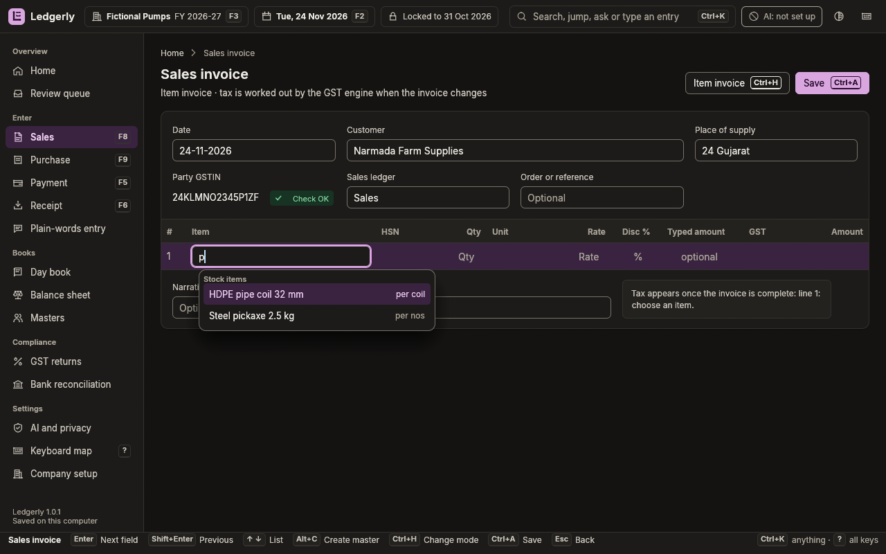</td>
</tr>
</table>

## light / hi.sales-invoice.default

SSIM 0.6398

<table>
<tr><th>Mock</th><th>App</th></tr>
<tr>
<td>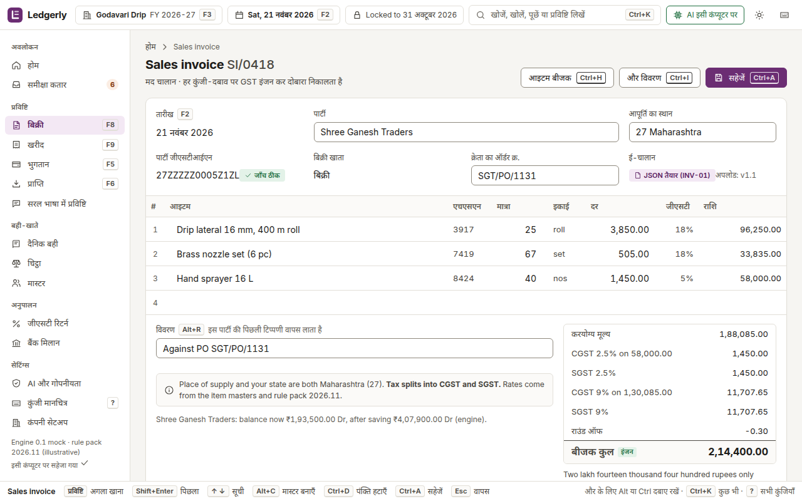</td>
<td>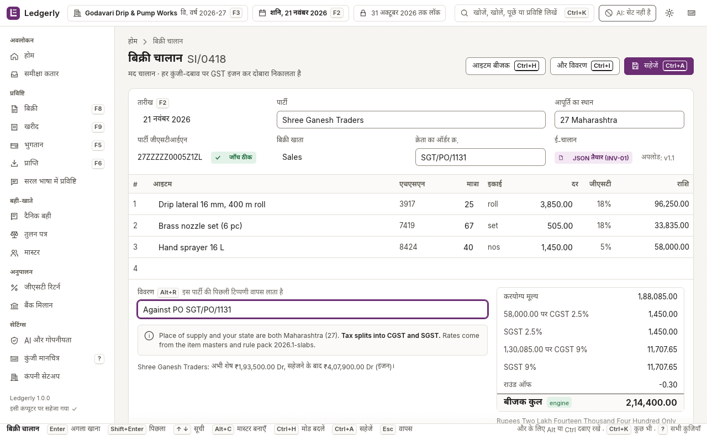</td>
</tr>
</table>

## hc / debit-note.validation-error

SSIM 0.6408

<table>
<tr><th>Mock</th><th>App</th></tr>
<tr>
<td></td>
<td></td>
</tr>
</table>

## light / sales-invoice.mode-list

SSIM 0.6416

<table>
<tr><th>Mock</th><th>App</th></tr>
<tr>
<td></td>
<td></td>
</tr>
</table>

## dark / sales-invoice.as-voucher

SSIM 0.6423

<table>
<tr><th>Mock</th><th>App</th></tr>
<tr>
<td></td>
<td></td>
</tr>
</table>

## light / profit-and-loss.provisional

SSIM 0.6433

<table>
<tr><th>Mock</th><th>App</th></tr>
<tr>
<td></td>
<td></td>
</tr>
</table>

## hc / purchase.default

SSIM 0.6436

<table>
<tr><th>Mock</th><th>App</th></tr>
<tr>
<td></td>
<td></td>
</tr>
</table>

## dark / hi.sales-invoice.print-preview

SSIM 0.6441

<table>
<tr><th>Mock</th><th>App</th></tr>
<tr>
<td></td>
<td></td>
</tr>
</table>

## dark / sales-invoice.mode-list

SSIM 0.6446

<table>
<tr><th>Mock</th><th>App</th></tr>
<tr>
<td></td>
<td></td>
</tr>
</table>

## dark / hi.masters.ledgers

SSIM 0.6448

<table>
<tr><th>Mock</th><th>App</th></tr>
<tr>
<td></td>
<td></td>
</tr>
</table>

## hc / sales-invoice.b2c

SSIM 0.6468

<table>
<tr><th>Mock</th><th>App</th></tr>
<tr>
<td></td>
<td></td>
</tr>
</table>

## dark / bank.brs-exported

SSIM 0.6469

<table>
<tr><th>Mock</th><th>App</th></tr>
<tr>
<td></td>
<td></td>
</tr>
</table>

## dark / balance-sheet.provisional

SSIM 0.6471

<table>
<tr><th>Mock</th><th>App</th></tr>
<tr>
<td></td>
<td></td>
</tr>
</table>

## hc / import.default

SSIM 0.6475

<table>
<tr><th>Mock</th><th>App</th></tr>
<tr>
<td></td>
<td></td>
</tr>
</table>

## dark / profit-and-loss.detailed

SSIM 0.6486

<table>
<tr><th>Mock</th><th>App</th></tr>
<tr>
<td></td>
<td></td>
</tr>
</table>

## dark / sales-invoice.default

SSIM 0.6487

<table>
<tr><th>Mock</th><th>App</th></tr>
<tr>
<td></td>
<td></td>
</tr>
</table>

## light / bank.brs-exported

SSIM 0.6493

<table>
<tr><th>Mock</th><th>App</th></tr>
<tr>
<td></td>
<td></td>
</tr>
</table>

## dark / trial-balance.default

SSIM 0.6510

<table>
<tr><th>Mock</th><th>App</th></tr>
<tr>
<td></td>
<td></td>
</tr>
</table>

## light / profit-and-loss.print-busy

SSIM 0.6517

<table>
<tr><th>Mock</th><th>App</th></tr>
<tr>
<td></td>
<td></td>
</tr>
</table>

## dark / profit-and-loss.provisional

SSIM 0.6519

<table>
<tr><th>Mock</th><th>App</th></tr>
<tr>
<td></td>
<td></td>
</tr>
</table>

## hc / palette.commands

SSIM 0.6529

<table>
<tr><th>Mock</th><th>App</th></tr>
<tr>
<td></td>
<td></td>
</tr>
</table>

## dark / purchase-bill.offline-ai

SSIM 0.6533

<table>
<tr><th>Mock</th><th>App</th></tr>
<tr>
<td></td>
<td></td>
</tr>
</table>

## dark / sales-invoice.gst-inter-state

SSIM 0.6543

<table>
<tr><th>Mock</th><th>App</th></tr>
<tr>
<td></td>
<td></td>
</tr>
</table>

## light / keys.standard

SSIM 0.6547

<table>
<tr><th>Mock</th><th>App</th></tr>
<tr>
<td></td>
<td></td>
</tr>
</table>

## light / balance-sheet.detailed

SSIM 0.6556

<table>
<tr><th>Mock</th><th>App</th></tr>
<tr>
<td></td>
<td></td>
</tr>
</table>

## dark / keys.standard

SSIM 0.6557

<table>
<tr><th>Mock</th><th>App</th></tr>
<tr>
<td></td>
<td></td>
</tr>
</table>

## light / profit-and-loss.print-failed

SSIM 0.6571

<table>
<tr><th>Mock</th><th>App</th></tr>
<tr>
<td></td>
<td></td>
</tr>
</table>

## dark / profit-and-loss.print-failed

SSIM 0.6580

<table>
<tr><th>Mock</th><th>App</th></tr>
<tr>
<td></td>
<td></td>
</tr>
</table>

## dark / stock-summary.provisional

SSIM 0.6590

<table>
<tr><th>Mock</th><th>App</th></tr>
<tr>
<td></td>
<td></td>
</tr>
</table>

## light / stock-summary.provisional

SSIM 0.6591

<table>
<tr><th>Mock</th><th>App</th></tr>
<tr>
<td></td>
<td></td>
</tr>
</table>

## dark / hi.sales-invoice.default

SSIM 0.6593

<table>
<tr><th>Mock</th><th>App</th></tr>
<tr>
<td></td>
<td></td>
</tr>
</table>

## dark / palette.search

SSIM 0.6598

<table>
<tr><th>Mock</th><th>App</th></tr>
<tr>
<td></td>
<td></td>
</tr>
</table>

## hc / sales-invoice.saved

SSIM 0.6602

<table>
<tr><th>Mock</th><th>App</th></tr>
<tr>
<td></td>
<td></td>
</tr>
</table>

## light / ai-settings.local

SSIM 0.6612

<table>
<tr><th>Mock</th><th>App</th></tr>
<tr>
<td></td>
<td></td>
</tr>
</table>

## light / profit-and-loss.print-range-error

SSIM 0.6612

<table>
<tr><th>Mock</th><th>App</th></tr>
<tr>
<td></td>
<td></td>
</tr>
</table>

## light / sales-invoice.b2c

SSIM 0.6613

<table>
<tr><th>Mock</th><th>App</th></tr>
<tr>
<td></td>
<td></td>
</tr>
</table>

## hc / journal.print-preview

SSIM 0.6615

<table>
<tr><th>Mock</th><th>App</th></tr>
<tr>
<td></td>
<td></td>
</tr>
</table>

## light / palette.default

SSIM 0.6624

<table>
<tr><th>Mock</th><th>App</th></tr>
<tr>
<td></td>
<td></td>
</tr>
</table>

## hc / profit-and-loss.default

SSIM 0.6626

<table>
<tr><th>Mock</th><th>App</th></tr>
<tr>
<td></td>
<td></td>
</tr>
</table>

## light / balance-sheet.default

SSIM 0.6633

<table>
<tr><th>Mock</th><th>App</th></tr>
<tr>
<td></td>
<td></td>
</tr>
</table>

## dark / home.ai-off

SSIM 0.6634

<table>
<tr><th>Mock</th><th>App</th></tr>
<tr>
<td></td>
<td></td>
</tr>
</table>

## light / sales-invoice.print-preview

SSIM 0.6636

<table>
<tr><th>Mock</th><th>App</th></tr>
<tr>
<td></td>
<td></td>
</tr>
</table>

## hc / balance-sheet.voucher

SSIM 0.6647

<table>
<tr><th>Mock</th><th>App</th></tr>
<tr>
<td></td>
<td></td>
</tr>
</table>

## light / keys.classic

SSIM 0.6648

<table>
<tr><th>Mock</th><th>App</th></tr>
<tr>
<td></td>
<td></td>
</tr>
</table>

## dark / keys.classic

SSIM 0.6651

<table>
<tr><th>Mock</th><th>App</th></tr>
<tr>
<td></td>
<td></td>
</tr>
</table>

## hc / balance-sheet.ledger

SSIM 0.6653

<table>
<tr><th>Mock</th><th>App</th></tr>
<tr>
<td></td>
<td></td>
</tr>
</table>

## dark / ai-settings.local

SSIM 0.6668

<table>
<tr><th>Mock</th><th>App</th></tr>
<tr>
<td></td>
<td></td>
</tr>
</table>

## dark / profit-and-loss.print-busy

SSIM 0.6672

<table>
<tr><th>Mock</th><th>App</th></tr>
<tr>
<td></td>
<td></td>
</tr>
</table>

## light / home.ai-off

SSIM 0.6676

<table>
<tr><th>Mock</th><th>App</th></tr>
<tr>
<td></td>
<td></td>
</tr>
</table>

## light / hi.sales-invoice.print-preview

SSIM 0.6690

<table>
<tr><th>Mock</th><th>App</th></tr>
<tr>
<td></td>
<td></td>
</tr>
</table>

## hc / payment.overdraft

SSIM 0.6698

<table>
<tr><th>Mock</th><th>App</th></tr>
<tr>
<td></td>
<td></td>
</tr>
</table>

## light / bank.brs

SSIM 0.6704

<table>
<tr><th>Mock</th><th>App</th></tr>
<tr>
<td></td>
<td></td>
</tr>
</table>

## light / profit-and-loss.print-config

SSIM 0.6704

<table>
<tr><th>Mock</th><th>App</th></tr>
<tr>
<td></td>
<td></td>
</tr>
</table>

## light / profit-and-loss.print-preview

SSIM 0.6718

<table>
<tr><th>Mock</th><th>App</th></tr>
<tr>
<td></td>
<td></td>
</tr>
</table>

## dark / import.no-company

SSIM 0.6737

<table>
<tr><th>Mock</th><th>App</th></tr>
<tr>
<td></td>
<td></td>
</tr>
</table>

## light / gst.gstr1

SSIM 0.6738

<table>
<tr><th>Mock</th><th>App</th></tr>
<tr>
<td></td>
<td></td>
</tr>
</table>

## light / hi.balance-sheet.default

SSIM 0.6738

<table>
<tr><th>Mock</th><th>App</th></tr>
<tr>
<td></td>
<td></td>
</tr>
</table>

## dark / bank.brs

SSIM 0.6746

<table>
<tr><th>Mock</th><th>App</th></tr>
<tr>
<td></td>
<td></td>
</tr>
</table>

## dark / gst.gstr1

SSIM 0.6781

<table>
<tr><th>Mock</th><th>App</th></tr>
<tr>
<td></td>
<td></td>
</tr>
</table>

## dark / journal.print-preview

SSIM 0.6787

<table>
<tr><th>Mock</th><th>App</th></tr>
<tr>
<td></td>
<td></td>
</tr>
</table>

## light / import.no-company

SSIM 0.6804

<table>
<tr><th>Mock</th><th>App</th></tr>
<tr>
<td></td>
<td></td>
</tr>
</table>

## dark / import.refused

SSIM 0.6807

<table>
<tr><th>Mock</th><th>App</th></tr>
<tr>
<td></td>
<td></td>
</tr>
</table>

## light / sales-invoice.saved

SSIM 0.6814

<table>
<tr><th>Mock</th><th>App</th></tr>
<tr>
<td></td>
<td></td>
</tr>
</table>

## dark / sales-invoice.b2c

SSIM 0.6815

<table>
<tr><th>Mock</th><th>App</th></tr>
<tr>
<td></td>
<td></td>
</tr>
</table>

## light / import.refused

SSIM 0.6821

<table>
<tr><th>Mock</th><th>App</th></tr>
<tr>
<td></td>
<td></td>
</tr>
</table>

## dark / palette.default

SSIM 0.6821

<table>
<tr><th>Mock</th><th>App</th></tr>
<tr>
<td></td>
<td></td>
</tr>
</table>

## dark / import.failed

SSIM 0.6823

<table>
<tr><th>Mock</th><th>App</th></tr>
<tr>
<td></td>
<td></td>
</tr>
</table>

## hc / outstanding.receivables

SSIM 0.6826

<table>
<tr><th>Mock</th><th>App</th></tr>
<tr>
<td></td>
<td></td>
</tr>
</table>

## dark / import.imported

SSIM 0.6828

<table>
<tr><th>Mock</th><th>App</th></tr>
<tr>
<td></td>
<td></td>
</tr>
</table>

## light / palette.commands

SSIM 0.6831

<table>
<tr><th>Mock</th><th>App</th></tr>
<tr>
<td></td>
<td></td>
</tr>
</table>

## hc / journal.validation-error

SSIM 0.6831

<table>
<tr><th>Mock</th><th>App</th></tr>
<tr>
<td></td>
<td></td>
</tr>
</table>

## light / import.failed

SSIM 0.6833

<table>
<tr><th>Mock</th><th>App</th></tr>
<tr>
<td></td>
<td></td>
</tr>
</table>

## light / gst.gstr1-correction

SSIM 0.6847

<table>
<tr><th>Mock</th><th>App</th></tr>
<tr>
<td></td>
<td></td>
</tr>
</table>

## dark / import.port-error

SSIM 0.6857

<table>
<tr><th>Mock</th><th>App</th></tr>
<tr>
<td></td>
<td></td>
</tr>
</table>

## light / ai-settings.off

SSIM 0.6872

<table>
<tr><th>Mock</th><th>App</th></tr>
<tr>
<td></td>
<td></td>
</tr>
</table>

## light / import.imported

SSIM 0.6873

<table>
<tr><th>Mock</th><th>App</th></tr>
<tr>
<td></td>
<td></td>
</tr>
</table>

## dark / import.validation-error

SSIM 0.6873

<table>
<tr><th>Mock</th><th>App</th></tr>
<tr>
<td></td>
<td></td>
</tr>
</table>

## light / hi.gst.gstr1

SSIM 0.6888

<table>
<tr><th>Mock</th><th>App</th></tr>
<tr>
<td></td>
<td></td>
</tr>
</table>

## dark / gst.gstr1-correction

SSIM 0.6893

<table>
<tr><th>Mock</th><th>App</th></tr>
<tr>
<td></td>
<td></td>
</tr>
</table>

## hc / receipt.default

SSIM 0.6897

<table>
<tr><th>Mock</th><th>App</th></tr>
<tr>
<td></td>
<td></td>
</tr>
</table>

## light / purchase.validation-error

SSIM 0.6898

<table>
<tr><th>Mock</th><th>App</th></tr>
<tr>
<td></td>
<td></td>
</tr>
</table>

## dark / ai-settings.off

SSIM 0.6917

<table>
<tr><th>Mock</th><th>App</th></tr>
<tr>
<td></td>
<td></td>
</tr>
</table>

## light / import.port-error

SSIM 0.6918

<table>
<tr><th>Mock</th><th>App</th></tr>
<tr>
<td></td>
<td></td>
</tr>
</table>

## dark / masters.no-match

SSIM 0.6925

<table>
<tr><th>Mock</th><th>App</th></tr>
<tr>
<td></td>
<td></td>
</tr>
</table>

## hc / payment.bill-wise

SSIM 0.6925

<table>
<tr><th>Mock</th><th>App</th></tr>
<tr>
<td></td>
<td></td>
</tr>
</table>

## hc / credit-note.default

SSIM 0.6928

<table>
<tr><th>Mock</th><th>App</th></tr>
<tr>
<td></td>
<td></td>
</tr>
</table>

## light / import.validation-error

SSIM 0.6932

<table>
<tr><th>Mock</th><th>App</th></tr>
<tr>
<td></td>
<td></td>
</tr>
</table>

## light / outstanding.receivables

SSIM 0.6936

<table>
<tr><th>Mock</th><th>App</th></tr>
<tr>
<td></td>
<td></td>
</tr>
</table>

## dark / hi.gst.gstr1

SSIM 0.6940

<table>
<tr><th>Mock</th><th>App</th></tr>
<tr>
<td></td>
<td></td>
</tr>
</table>

## dark / purchase.validation-error

SSIM 0.6942

<table>
<tr><th>Mock</th><th>App</th></tr>
<tr>
<td></td>
<td></td>
</tr>
</table>

## dark / balance-sheet.detailed

SSIM 0.6956

<table>
<tr><th>Mock</th><th>App</th></tr>
<tr>
<td></td>
<td></td>
</tr>
</table>

## dark / sales-invoice.saved

SSIM 0.6965

<table>
<tr><th>Mock</th><th>App</th></tr>
<tr>
<td></td>
<td></td>
</tr>
</table>

## dark / import.running

SSIM 0.6974

<table>
<tr><th>Mock</th><th>App</th></tr>
<tr>
<td></td>
<td></td>
</tr>
</table>

## light / purchase.default

SSIM 0.6977

<table>
<tr><th>Mock</th><th>App</th></tr>
<tr>
<td></td>
<td></td>
</tr>
</table>

## dark / import.default

SSIM 0.6977

<table>
<tr><th>Mock</th><th>App</th></tr>
<tr>
<td></td>
<td></td>
</tr>
</table>

## light / masters.no-match

SSIM 0.6987

<table>
<tr><th>Mock</th><th>App</th></tr>
<tr>
<td></td>
<td></td>
</tr>
</table>

## hc / debit-note.default

SSIM 0.7006

<table>
<tr><th>Mock</th><th>App</th></tr>
<tr>
<td></td>
<td></td>
</tr>
</table>

## dark / balance-sheet.default

SSIM 0.7009

<table>
<tr><th>Mock</th><th>App</th></tr>
<tr>
<td></td>
<td></td>
</tr>
</table>

## light / import.running

SSIM 0.7014

<table>
<tr><th>Mock</th><th>App</th></tr>
<tr>
<td></td>
<td></td>
</tr>
</table>

## light / profit-and-loss.default

SSIM 0.7020

<table>
<tr><th>Mock</th><th>App</th></tr>
<tr>
<td></td>
<td></td>
</tr>
</table>

## light / profit-and-loss.print-saved

SSIM 0.7049

<table>
<tr><th>Mock</th><th>App</th></tr>
<tr>
<td></td>
<td></td>
</tr>
</table>

## light / import.default

SSIM 0.7051

<table>
<tr><th>Mock</th><th>App</th></tr>
<tr>
<td></td>
<td></td>
</tr>
</table>

## dark / palette.commands

SSIM 0.7057

<table>
<tr><th>Mock</th><th>App</th></tr>
<tr>
<td></td>
<td></td>
</tr>
</table>

## dark / outstanding.receivables

SSIM 0.7060

<table>
<tr><th>Mock</th><th>App</th></tr>
<tr>
<td></td>
<td></td>
</tr>
</table>

## dark / purchase.default

SSIM 0.7070

<table>
<tr><th>Mock</th><th>App</th></tr>
<tr>
<td></td>
<td></td>
</tr>
</table>

## hc / balance-sheet.group

SSIM 0.7073

<table>
<tr><th>Mock</th><th>App</th></tr>
<tr>
<td></td>
<td></td>
</tr>
</table>

## hc / gst.recon

SSIM 0.7087

<table>
<tr><th>Mock</th><th>App</th></tr>
<tr>
<td></td>
<td></td>
</tr>
</table>

## hc / setup.features

SSIM 0.7088

<table>
<tr><th>Mock</th><th>App</th></tr>
<tr>
<td></td>
<td></td>
</tr>
</table>

## hc / contra.default

SSIM 0.7098

<table>
<tr><th>Mock</th><th>App</th></tr>
<tr>
<td></td>
<td></td>
</tr>
</table>

## hc / journal.default

SSIM 0.7105

<table>
<tr><th>Mock</th><th>App</th></tr>
<tr>
<td></td>
<td></td>
</tr>
</table>

## hc / stock-summary.default

SSIM 0.7111

<table>
<tr><th>Mock</th><th>App</th></tr>
<tr>
<td></td>
<td></td>
</tr>
</table>

## dark / hi.balance-sheet.default

SSIM 0.7114

<table>
<tr><th>Mock</th><th>App</th></tr>
<tr>
<td></td>
<td></td>
</tr>
</table>

## light / payment.overdraft

SSIM 0.7131

<table>
<tr><th>Mock</th><th>App</th></tr>
<tr>
<td></td>
<td></td>
</tr>
</table>

## dark / profit-and-loss.print-saved

SSIM 0.7150

<table>
<tr><th>Mock</th><th>App</th></tr>
<tr>
<td></td>
<td></td>
</tr>
</table>

## light / day-book.print-preview

SSIM 0.7162

<table>
<tr><th>Mock</th><th>App</th></tr>
<tr>
<td></td>
<td></td>
</tr>
</table>

## dark / masters.items

SSIM 0.7172

<table>
<tr><th>Mock</th><th>App</th></tr>
<tr>
<td></td>
<td></td>
</tr>
</table>

## light / masters.loading

SSIM 0.7179

<table>
<tr><th>Mock</th><th>App</th></tr>
<tr>
<td></td>
<td></td>
</tr>
</table>

## hc / payment.default

SSIM 0.7180

<table>
<tr><th>Mock</th><th>App</th></tr>
<tr>
<td></td>
<td></td>
</tr>
</table>

## dark / profit-and-loss.default

SSIM 0.7190

<table>
<tr><th>Mock</th><th>App</th></tr>
<tr>
<td></td>
<td></td>
</tr>
</table>

## light / masters.items

SSIM 0.7196

<table>
<tr><th>Mock</th><th>App</th></tr>
<tr>
<td></td>
<td></td>
</tr>
</table>

## dark / payment.overdraft

SSIM 0.7196

<table>
<tr><th>Mock</th><th>App</th></tr>
<tr>
<td></td>
<td></td>
</tr>
</table>

## hc / setup.new-tab

SSIM 0.7204

<table>
<tr><th>Mock</th><th>App</th></tr>
<tr>
<td></td>
<td></td>
</tr>
</table>

## light / credit-note.validation-error

SSIM 0.7209

<table>
<tr><th>Mock</th><th>App</th></tr>
<tr>
<td></td>
<td></td>
</tr>
</table>

## hc / home.loading

SSIM 0.7220

<table>
<tr><th>Mock</th><th>App</th></tr>
<tr>
<td></td>
<td></td>
</tr>
</table>

## light / debit-note.validation-error

SSIM 0.7222

<table>
<tr><th>Mock</th><th>App</th></tr>
<tr>
<td></td>
<td></td>
</tr>
</table>

## light / balance-sheet.voucher

SSIM 0.7230

<table>
<tr><th>Mock</th><th>App</th></tr>
<tr>
<td></td>
<td></td>
</tr>
</table>

## dark / masters.loading

SSIM 0.7258

<table>
<tr><th>Mock</th><th>App</th></tr>
<tr>
<td></td>
<td></td>
</tr>
</table>

## light / receipt.default

SSIM 0.7259

<table>
<tr><th>Mock</th><th>App</th></tr>
<tr>
<td></td>
<td></td>
</tr>
</table>

## light / stock-summary.default

SSIM 0.7277

<table>
<tr><th>Mock</th><th>App</th></tr>
<tr>
<td></td>
<td></td>
</tr>
</table>

## dark / credit-note.validation-error

SSIM 0.7278

<table>
<tr><th>Mock</th><th>App</th></tr>
<tr>
<td></td>
<td></td>
</tr>
</table>

## light / payment.bill-wise

SSIM 0.7283

<table>
<tr><th>Mock</th><th>App</th></tr>
<tr>
<td></td>
<td></td>
</tr>
</table>

## light / balance-sheet.group

SSIM 0.7285

<table>
<tr><th>Mock</th><th>App</th></tr>
<tr>
<td></td>
<td></td>
</tr>
</table>

## dark / debit-note.validation-error

SSIM 0.7294

<table>
<tr><th>Mock</th><th>App</th></tr>
<tr>
<td></td>
<td></td>
</tr>
</table>

## hc / masters.ledger-detail

SSIM 0.7316

<table>
<tr><th>Mock</th><th>App</th></tr>
<tr>
<td></td>
<td></td>
</tr>
</table>

## light / gst.recon

SSIM 0.7322

<table>
<tr><th>Mock</th><th>App</th></tr>
<tr>
<td></td>
<td></td>
</tr>
</table>

## dark / balance-sheet.voucher

SSIM 0.7326

<table>
<tr><th>Mock</th><th>App</th></tr>
<tr>
<td></td>
<td></td>
</tr>
</table>

## hc / contra.validation-error

SSIM 0.7329

<table>
<tr><th>Mock</th><th>App</th></tr>
<tr>
<td></td>
<td></td>
</tr>
</table>

## dark / receipt.default

SSIM 0.7351

<table>
<tr><th>Mock</th><th>App</th></tr>
<tr>
<td></td>
<td></td>
</tr>
</table>

## dark / balance-sheet.ledger

SSIM 0.7363

<table>
<tr><th>Mock</th><th>App</th></tr>
<tr>
<td></td>
<td></td>
</tr>
</table>

## hc / day-book.default

SSIM 0.7368

<table>
<tr><th>Mock</th><th>App</th></tr>
<tr>
<td></td>
<td></td>
</tr>
</table>

## light / balance-sheet.ledger

SSIM 0.7371

<table>
<tr><th>Mock</th><th>App</th></tr>
<tr>
<td></td>
<td></td>
</tr>
</table>

## dark / balance-sheet.group

SSIM 0.7375

<table>
<tr><th>Mock</th><th>App</th></tr>
<tr>
<td></td>
<td></td>
</tr>
</table>

## dark / payment.bill-wise

SSIM 0.7379

<table>
<tr><th>Mock</th><th>App</th></tr>
<tr>
<td></td>
<td></td>
</tr>
</table>

## dark / gst.recon

SSIM 0.7384

<table>
<tr><th>Mock</th><th>App</th></tr>
<tr>
<td></td>
<td></td>
</tr>
</table>

## light / outstanding.payables

SSIM 0.7391

<table>
<tr><th>Mock</th><th>App</th></tr>
<tr>
<td></td>
<td></td>
</tr>
</table>

## dark / stock-summary.default

SSIM 0.7402

<table>
<tr><th>Mock</th><th>App</th></tr>
<tr>
<td></td>
<td></td>
</tr>
</table>

## hc / outstanding.payables

SSIM 0.7414

<table>
<tr><th>Mock</th><th>App</th></tr>
<tr>
<td></td>
<td></td>
</tr>
</table>

## light / purchase-bill.offline-ai

SSIM 0.7439

<table>
<tr><th>Mock</th><th>App</th></tr>
<tr>
<td></td>
<td></td>
</tr>
</table>

## dark / outstanding.payables

SSIM 0.7474

<table>
<tr><th>Mock</th><th>App</th></tr>
<tr>
<td></td>
<td></td>
</tr>
</table>

## light / payment.default

SSIM 0.7476

<table>
<tr><th>Mock</th><th>App</th></tr>
<tr>
<td></td>
<td></td>
</tr>
</table>

## hc / bank.import-error

SSIM 0.7478

<table>
<tr><th>Mock</th><th>App</th></tr>
<tr>
<td></td>
<td></td>
</tr>
</table>

## hc / profit-and-loss.loading

SSIM 0.7502

<table>
<tr><th>Mock</th><th>App</th></tr>
<tr>
<td></td>
<td></td>
</tr>
</table>

## hc / masters.create-ledger

SSIM 0.7514

<table>
<tr><th>Mock</th><th>App</th></tr>
<tr>
<td></td>
<td></td>
</tr>
</table>

## light / credit-note.default

SSIM 0.7532

<table>
<tr><th>Mock</th><th>App</th></tr>
<tr>
<td></td>
<td></td>
</tr>
</table>

## dark / payment.default

SSIM 0.7550

<table>
<tr><th>Mock</th><th>App</th></tr>
<tr>
<td></td>
<td></td>
</tr>
</table>

## light / day-book.default

SSIM 0.7562

<table>
<tr><th>Mock</th><th>App</th></tr>
<tr>
<td></td>
<td></td>
</tr>
</table>

## light / debit-note.default

SSIM 0.7574

<table>
<tr><th>Mock</th><th>App</th></tr>
<tr>
<td></td>
<td></td>
</tr>
</table>

## dark / credit-note.default

SSIM 0.7590

<table>
<tr><th>Mock</th><th>App</th></tr>
<tr>
<td></td>
<td></td>
</tr>
</table>

## hc / home.empty

SSIM 0.7591

<table>
<tr><th>Mock</th><th>App</th></tr>
<tr>
<td></td>
<td></td>
</tr>
</table>

## light / setup.features

SSIM 0.7592

<table>
<tr><th>Mock</th><th>App</th></tr>
<tr>
<td></td>
<td></td>
</tr>
</table>

## hc / audit.integrity

SSIM 0.7598

<table>
<tr><th>Mock</th><th>App</th></tr>
<tr>
<td></td>
<td></td>
</tr>
</table>

## hc / balance-sheet.loading

SSIM 0.7602

<table>
<tr><th>Mock</th><th>App</th></tr>
<tr>
<td></td>
<td></td>
</tr>
</table>

## hc / masters.gstin-error

SSIM 0.7611

<table>
<tr><th>Mock</th><th>App</th></tr>
<tr>
<td></td>
<td></td>
</tr>
</table>

## hc / setup.ai

SSIM 0.7634

<table>
<tr><th>Mock</th><th>App</th></tr>
<tr>
<td></td>
<td></td>
</tr>
</table>

## dark / debit-note.default

SSIM 0.7640

<table>
<tr><th>Mock</th><th>App</th></tr>
<tr>
<td></td>
<td></td>
</tr>
</table>

## light / journal.validation-error

SSIM 0.7642

<table>
<tr><th>Mock</th><th>App</th></tr>
<tr>
<td></td>
<td></td>
</tr>
</table>

## light / contra.default

SSIM 0.7646

<table>
<tr><th>Mock</th><th>App</th></tr>
<tr>
<td></td>
<td></td>
</tr>
</table>

## light / setup.new-tab

SSIM 0.7649

<table>
<tr><th>Mock</th><th>App</th></tr>
<tr>
<td></td>
<td></td>
</tr>
</table>

## dark / masters.ledger-detail

SSIM 0.7649

<table>
<tr><th>Mock</th><th>App</th></tr>
<tr>
<td></td>
<td></td>
</tr>
</table>

## hc / ask.offline-ai

SSIM 0.7653

<table>
<tr><th>Mock</th><th>App</th></tr>
<tr>
<td></td>
<td></td>
</tr>
</table>

## dark / day-book.default

SSIM 0.7656

<table>
<tr><th>Mock</th><th>App</th></tr>
<tr>
<td></td>
<td></td>
</tr>
</table>

## hc / stock-summary.loading

SSIM 0.7666

<table>
<tr><th>Mock</th><th>App</th></tr>
<tr>
<td></td>
<td></td>
</tr>
</table>

## hc / audit.loading

SSIM 0.7673

<table>
<tr><th>Mock</th><th>App</th></tr>
<tr>
<td></td>
<td></td>
</tr>
</table>

## hc / outstanding.loading

SSIM 0.7674

<table>
<tr><th>Mock</th><th>App</th></tr>
<tr>
<td></td>
<td></td>
</tr>
</table>

## dark / journal.validation-error

SSIM 0.7678

<table>
<tr><th>Mock</th><th>App</th></tr>
<tr>
<td></td>
<td></td>
</tr>
</table>

## hc / trial-balance.loading

SSIM 0.7681

<table>
<tr><th>Mock</th><th>App</th></tr>
<tr>
<td></td>
<td></td>
</tr>
</table>

## dark / setup.features

SSIM 0.7683

<table>
<tr><th>Mock</th><th>App</th></tr>
<tr>
<td></td>
<td></td>
</tr>
</table>

## dark / setup.new-tab

SSIM 0.7701

<table>
<tr><th>Mock</th><th>App</th></tr>
<tr>
<td></td>
<td></td>
</tr>
</table>

## dark / contra.default

SSIM 0.7704

<table>
<tr><th>Mock</th><th>App</th></tr>
<tr>
<td></td>
<td></td>
</tr>
</table>

## light / masters.ledger-detail

SSIM 0.7727

<table>
<tr><th>Mock</th><th>App</th></tr>
<tr>
<td></td>
<td></td>
</tr>
</table>

## light / journal.print-preview

SSIM 0.7754

<table>
<tr><th>Mock</th><th>App</th></tr>
<tr>
<td></td>
<td></td>
</tr>
</table>

## hc / setup.company

SSIM 0.7764

<table>
<tr><th>Mock</th><th>App</th></tr>
<tr>
<td></td>
<td></td>
</tr>
</table>

## light / journal.default

SSIM 0.7782

<table>
<tr><th>Mock</th><th>App</th></tr>
<tr>
<td></td>
<td></td>
</tr>
</table>

## light / contra.validation-error

SSIM 0.7815

<table>
<tr><th>Mock</th><th>App</th></tr>
<tr>
<td></td>
<td></td>
</tr>
</table>

## dark / journal.default

SSIM 0.7824

<table>
<tr><th>Mock</th><th>App</th></tr>
<tr>
<td></td>
<td></td>
</tr>
</table>

## hc / bank.empty

SSIM 0.7837

<table>
<tr><th>Mock</th><th>App</th></tr>
<tr>
<td></td>
<td></td>
</tr>
</table>

## hc / masters.create-item

SSIM 0.7837

<table>
<tr><th>Mock</th><th>App</th></tr>
<tr>
<td></td>
<td></td>
</tr>
</table>

## dark / contra.validation-error

SSIM 0.7882

<table>
<tr><th>Mock</th><th>App</th></tr>
<tr>
<td></td>
<td></td>
</tr>
</table>

## hc / gst.recon-locked

SSIM 0.7901

<table>
<tr><th>Mock</th><th>App</th></tr>
<tr>
<td></td>
<td></td>
</tr>
</table>

## hc / masters.items-empty

SSIM 0.7925

<table>
<tr><th>Mock</th><th>App</th></tr>
<tr>
<td></td>
<td></td>
</tr>
</table>

## hc / masters.empty

SSIM 0.7936

<table>
<tr><th>Mock</th><th>App</th></tr>
<tr>
<td></td>
<td></td>
</tr>
</table>

## dark / setup.company

SSIM 0.7954

<table>
<tr><th>Mock</th><th>App</th></tr>
<tr>
<td></td>
<td></td>
</tr>
</table>

## light / masters.gstin-error

SSIM 0.7956

<table>
<tr><th>Mock</th><th>App</th></tr>
<tr>
<td></td>
<td></td>
</tr>
</table>

## dark / masters.gstin-error

SSIM 0.7964

<table>
<tr><th>Mock</th><th>App</th></tr>
<tr>
<td></td>
<td></td>
</tr>
</table>

## light / masters.create-ledger

SSIM 0.7965

<table>
<tr><th>Mock</th><th>App</th></tr>
<tr>
<td></td>
<td></td>
</tr>
</table>

## light / setup.company

SSIM 0.7971

<table>
<tr><th>Mock</th><th>App</th></tr>
<tr>
<td></td>
<td></td>
</tr>
</table>

## dark / masters.create-ledger

SSIM 0.7974

<table>
<tr><th>Mock</th><th>App</th></tr>
<tr>
<td></td>
<td></td>
</tr>
</table>

## hc / audit.unsupported

SSIM 0.7980

<table>
<tr><th>Mock</th><th>App</th></tr>
<tr>
<td></td>
<td></td>
</tr>
</table>

## dark / bank.import-error

SSIM 0.7989

<table>
<tr><th>Mock</th><th>App</th></tr>
<tr>
<td></td>
<td></td>
</tr>
</table>

## hc / setup.gstin-error

SSIM 0.7996

<table>
<tr><th>Mock</th><th>App</th></tr>
<tr>
<td></td>
<td></td>
</tr>
</table>

## dark / home.empty

SSIM 0.8001

<table>
<tr><th>Mock</th><th>App</th></tr>
<tr>
<td></td>
<td></td>
</tr>
</table>

## light / home.loading

SSIM 0.8022

<table>
<tr><th>Mock</th><th>App</th></tr>
<tr>
<td></td>
<td></td>
</tr>
</table>

## light / audit.loading

SSIM 0.8025

<table>
<tr><th>Mock</th><th>App</th></tr>
<tr>
<td></td>
<td></td>
</tr>
</table>

## hc / gst.recon-empty

SSIM 0.8038

<table>
<tr><th>Mock</th><th>App</th></tr>
<tr>
<td></td>
<td></td>
</tr>
</table>

## light / home.empty

SSIM 0.8046

<table>
<tr><th>Mock</th><th>App</th></tr>
<tr>
<td></td>
<td></td>
</tr>
</table>

## light / bank.import-error

SSIM 0.8052

<table>
<tr><th>Mock</th><th>App</th></tr>
<tr>
<td></td>
<td></td>
</tr>
</table>

## hc / setup.backup

SSIM 0.8053

<table>
<tr><th>Mock</th><th>App</th></tr>
<tr>
<td></td>
<td></td>
</tr>
</table>

## light / profit-and-loss.loading

SSIM 0.8060

<table>
<tr><th>Mock</th><th>App</th></tr>
<tr>
<td></td>
<td></td>
</tr>
</table>

## hc / day-book.empty

SSIM 0.8067

<table>
<tr><th>Mock</th><th>App</th></tr>
<tr>
<td></td>
<td></td>
</tr>
</table>

## light / ask.offline-ai

SSIM 0.8106

<table>
<tr><th>Mock</th><th>App</th></tr>
<tr>
<td></td>
<td></td>
</tr>
</table>

## dark / bank.empty

SSIM 0.8108

<table>
<tr><th>Mock</th><th>App</th></tr>
<tr>
<td></td>
<td></td>
</tr>
</table>

## light / bank.empty

SSIM 0.8112

<table>
<tr><th>Mock</th><th>App</th></tr>
<tr>
<td></td>
<td></td>
</tr>
</table>

## hc / bank-chooser.default

SSIM 0.8112

<table>
<tr><th>Mock</th><th>App</th></tr>
<tr>
<td></td>
<td></td>
</tr>
</table>

## hc / review.empty

SSIM 0.8123

<table>
<tr><th>Mock</th><th>App</th></tr>
<tr>
<td></td>
<td></td>
</tr>
</table>

## dark / gst.recon-locked

SSIM 0.8128

<table>
<tr><th>Mock</th><th>App</th></tr>
<tr>
<td></td>
<td></td>
</tr>
</table>

## light / gst.recon-locked

SSIM 0.8136

<table>
<tr><th>Mock</th><th>App</th></tr>
<tr>
<td></td>
<td></td>
</tr>
</table>

## hc / setup.welcome

SSIM 0.8147

<table>
<tr><th>Mock</th><th>App</th></tr>
<tr>
<td></td>
<td></td>
</tr>
</table>

## light / balance-sheet.loading

SSIM 0.8160

<table>
<tr><th>Mock</th><th>App</th></tr>
<tr>
<td></td>
<td></td>
</tr>
</table>

## dark / ask.offline-ai

SSIM 0.8162

<table>
<tr><th>Mock</th><th>App</th></tr>
<tr>
<td></td>
<td></td>
</tr>
</table>

## dark / setup.gstin-error

SSIM 0.8162

<table>
<tr><th>Mock</th><th>App</th></tr>
<tr>
<td></td>
<td></td>
</tr>
</table>

## light / setup.gstin-error

SSIM 0.8173

<table>
<tr><th>Mock</th><th>App</th></tr>
<tr>
<td></td>
<td></td>
</tr>
</table>

## hc / gst.recon-error

SSIM 0.8173

<table>
<tr><th>Mock</th><th>App</th></tr>
<tr>
<td></td>
<td></td>
</tr>
</table>

## light / audit.integrity

SSIM 0.8181

<table>
<tr><th>Mock</th><th>App</th></tr>
<tr>
<td></td>
<td></td>
</tr>
</table>

## light / stock-summary.loading

SSIM 0.8203

<table>
<tr><th>Mock</th><th>App</th></tr>
<tr>
<td></td>
<td></td>
</tr>
</table>

## light / masters.create-item

SSIM 0.8205

<table>
<tr><th>Mock</th><th>App</th></tr>
<tr>
<td></td>
<td></td>
</tr>
</table>

## hc / setup.keyboard

SSIM 0.8207

<table>
<tr><th>Mock</th><th>App</th></tr>
<tr>
<td></td>
<td></td>
</tr>
</table>

## light / outstanding.loading

SSIM 0.8213

<table>
<tr><th>Mock</th><th>App</th></tr>
<tr>
<td></td>
<td></td>
</tr>
</table>

## light / trial-balance.loading

SSIM 0.8220

<table>
<tr><th>Mock</th><th>App</th></tr>
<tr>
<td></td>
<td></td>
</tr>
</table>

## dark / profit-and-loss.loading

SSIM 0.8223

<table>
<tr><th>Mock</th><th>App</th></tr>
<tr>
<td></td>
<td></td>
</tr>
</table>

## dark / masters.create-item

SSIM 0.8241

<table>
<tr><th>Mock</th><th>App</th></tr>
<tr>
<td></td>
<td></td>
</tr>
</table>

## dark / audit.integrity

SSIM 0.8251

<table>
<tr><th>Mock</th><th>App</th></tr>
<tr>
<td></td>
<td></td>
</tr>
</table>

## dark / home.loading

SSIM 0.8257

<table>
<tr><th>Mock</th><th>App</th></tr>
<tr>
<td></td>
<td></td>
</tr>
</table>

## light / audit.unsupported

SSIM 0.8267

<table>
<tr><th>Mock</th><th>App</th></tr>
<tr>
<td></td>
<td></td>
</tr>
</table>

## dark / audit.unsupported

SSIM 0.8270

<table>
<tr><th>Mock</th><th>App</th></tr>
<tr>
<td></td>
<td></td>
</tr>
</table>

## dark / masters.items-empty

SSIM 0.8273

<table>
<tr><th>Mock</th><th>App</th></tr>
<tr>
<td></td>
<td></td>
</tr>
</table>

## hc / hi.setup.welcome

SSIM 0.8281

<table>
<tr><th>Mock</th><th>App</th></tr>
<tr>
<td></td>
<td></td>
</tr>
</table>

## dark / masters.empty

SSIM 0.8286

<table>
<tr><th>Mock</th><th>App</th></tr>
<tr>
<td></td>
<td></td>
</tr>
</table>

## light / gst.recon-empty

SSIM 0.8296

<table>
<tr><th>Mock</th><th>App</th></tr>
<tr>
<td></td>
<td></td>
</tr>
</table>

## dark / gst.recon-empty

SSIM 0.8302

<table>
<tr><th>Mock</th><th>App</th></tr>
<tr>
<td></td>
<td></td>
</tr>
</table>

## light / masters.items-empty

SSIM 0.8309

<table>
<tr><th>Mock</th><th>App</th></tr>
<tr>
<td></td>
<td></td>
</tr>
</table>

## dark / balance-sheet.loading

SSIM 0.8311

<table>
<tr><th>Mock</th><th>App</th></tr>
<tr>
<td></td>
<td></td>
</tr>
</table>

## dark / review.empty

SSIM 0.8317

<table>
<tr><th>Mock</th><th>App</th></tr>
<tr>
<td></td>
<td></td>
</tr>
</table>

## light / masters.empty

SSIM 0.8319

<table>
<tr><th>Mock</th><th>App</th></tr>
<tr>
<td></td>
<td></td>
</tr>
</table>

## light / review.empty

SSIM 0.8335

<table>
<tr><th>Mock</th><th>App</th></tr>
<tr>
<td></td>
<td></td>
</tr>
</table>

## dark / audit.loading

SSIM 0.8338

<table>
<tr><th>Mock</th><th>App</th></tr>
<tr>
<td></td>
<td></td>
</tr>
</table>

## light / setup.backup

SSIM 0.8350

<table>
<tr><th>Mock</th><th>App</th></tr>
<tr>
<td></td>
<td></td>
</tr>
</table>

## dark / setup.ai

SSIM 0.8350

<table>
<tr><th>Mock</th><th>App</th></tr>
<tr>
<td></td>
<td></td>
</tr>
</table>

## light / day-book.empty

SSIM 0.8361

<table>
<tr><th>Mock</th><th>App</th></tr>
<tr>
<td></td>
<td></td>
</tr>
</table>

## dark / stock-summary.loading

SSIM 0.8363

<table>
<tr><th>Mock</th><th>App</th></tr>
<tr>
<td></td>
<td></td>
</tr>
</table>

## dark / day-book.empty

SSIM 0.8368

<table>
<tr><th>Mock</th><th>App</th></tr>
<tr>
<td></td>
<td></td>
</tr>
</table>

## dark / outstanding.loading

SSIM 0.8373

<table>
<tr><th>Mock</th><th>App</th></tr>
<tr>
<td></td>
<td></td>
</tr>
</table>

## dark / setup.backup

SSIM 0.8375

<table>
<tr><th>Mock</th><th>App</th></tr>
<tr>
<td></td>
<td></td>
</tr>
</table>

## dark / trial-balance.loading

SSIM 0.8380

<table>
<tr><th>Mock</th><th>App</th></tr>
<tr>
<td></td>
<td></td>
</tr>
</table>

## light / setup.ai

SSIM 0.8412

<table>
<tr><th>Mock</th><th>App</th></tr>
<tr>
<td></td>
<td></td>
</tr>
</table>

## light / setup.welcome

SSIM 0.8417

<table>
<tr><th>Mock</th><th>App</th></tr>
<tr>
<td></td>
<td></td>
</tr>
</table>

## hc / gst.gstr3b-unsupported

SSIM 0.8426

<table>
<tr><th>Mock</th><th>App</th></tr>
<tr>
<td></td>
<td></td>
</tr>
</table>

## dark / gst.recon-error

SSIM 0.8429

<table>
<tr><th>Mock</th><th>App</th></tr>
<tr>
<td></td>
<td></td>
</tr>
</table>

## light / setup.keyboard

SSIM 0.8440

<table>
<tr><th>Mock</th><th>App</th></tr>
<tr>
<td></td>
<td></td>
</tr>
</table>

## dark / setup.keyboard

SSIM 0.8444

<table>
<tr><th>Mock</th><th>App</th></tr>
<tr>
<td></td>
<td></td>
</tr>
</table>

## hc / setup.rail

SSIM 0.8450

<table>
<tr><th>Mock</th><th>App</th></tr>
<tr>
<td></td>
<td></td>
</tr>
</table>

## hc / start.recent

SSIM 0.8450

<table>
<tr><th>Mock</th><th>App</th></tr>
<tr>
<td></td>
<td></td>
</tr>
</table>

## light / bank-chooser.default

SSIM 0.8460

<table>
<tr><th>Mock</th><th>App</th></tr>
<tr>
<td></td>
<td></td>
</tr>
</table>

## dark / bank-chooser.default

SSIM 0.8470

<table>
<tr><th>Mock</th><th>App</th></tr>
<tr>
<td></td>
<td></td>
</tr>
</table>

## dark / setup.welcome

SSIM 0.8473

<table>
<tr><th>Mock</th><th>App</th></tr>
<tr>
<td></td>
<td></td>
</tr>
</table>

## light / gst.recon-error

SSIM 0.8477

<table>
<tr><th>Mock</th><th>App</th></tr>
<tr>
<td></td>
<td></td>
</tr>
</table>

## hc / gst.gstr1-not-loaded

SSIM 0.8492

<table>
<tr><th>Mock</th><th>App</th></tr>
<tr>
<td></td>
<td></td>
</tr>
</table>

## hc / gst.gstr3b-not-loaded

SSIM 0.8511

<table>
<tr><th>Mock</th><th>App</th></tr>
<tr>
<td></td>
<td></td>
</tr>
</table>

## light / hi.setup.welcome

SSIM 0.8520

<table>
<tr><th>Mock</th><th>App</th></tr>
<tr>
<td></td>
<td></td>
</tr>
</table>

## dark / gst.gstr3b-unsupported

SSIM 0.8559

<table>
<tr><th>Mock</th><th>App</th></tr>
<tr>
<td></td>
<td></td>
</tr>
</table>

## dark / hi.setup.welcome

SSIM 0.8577

<table>
<tr><th>Mock</th><th>App</th></tr>
<tr>
<td></td>
<td></td>
</tr>
</table>

## light / gst.gstr3b-unsupported

SSIM 0.8593

<table>
<tr><th>Mock</th><th>App</th></tr>
<tr>
<td></td>
<td></td>
</tr>
</table>

## light / gst.gstr1-not-loaded

SSIM 0.8618

<table>
<tr><th>Mock</th><th>App</th></tr>
<tr>
<td></td>
<td></td>
</tr>
</table>

## light / gst.gstr3b-not-loaded

SSIM 0.8622

<table>
<tr><th>Mock</th><th>App</th></tr>
<tr>
<td></td>
<td></td>
</tr>
</table>

## dark / gst.gstr1-not-loaded

SSIM 0.8632

<table>
<tr><th>Mock</th><th>App</th></tr>
<tr>
<td></td>
<td></td>
</tr>
</table>

## dark / gst.gstr3b-not-loaded

SSIM 0.8637

<table>
<tr><th>Mock</th><th>App</th></tr>
<tr>
<td></td>
<td></td>
</tr>
</table>

## light / setup.rail

SSIM 0.8661

<table>
<tr><th>Mock</th><th>App</th></tr>
<tr>
<td></td>
<td></td>
</tr>
</table>

## hc / setup.done

SSIM 0.8662

<table>
<tr><th>Mock</th><th>App</th></tr>
<tr>
<td></td>
<td></td>
</tr>
</table>

## dark / start.recent

SSIM 0.8665

<table>
<tr><th>Mock</th><th>App</th></tr>
<tr>
<td></td>
<td></td>
</tr>
</table>

## light / start.recent

SSIM 0.8669

<table>
<tr><th>Mock</th><th>App</th></tr>
<tr>
<td></td>
<td></td>
</tr>
</table>

## dark / setup.rail

SSIM 0.8719

<table>
<tr><th>Mock</th><th>App</th></tr>
<tr>
<td></td>
<td></td>
</tr>
</table>

## light / setup.done

SSIM 0.8913

<table>
<tr><th>Mock</th><th>App</th></tr>
<tr>
<td></td>
<td></td>
</tr>
</table>

## dark / setup.done

SSIM 0.8937

<table>
<tr><th>Mock</th><th>App</th></tr>
<tr>
<td></td>
<td></td>
</tr>
</table>

## Mock states with no app capture yet

### light (26)

- `ask.result`
- `ask.loading`
- `ask.low-confidence`
- `ask.unsupported`
- `purchase-bill.reading`
- `purchase-bill.proposal`
- `purchase-bill.low-confidence`
- `purchase-bill.mismatch`
- `purchase-bill.duplicate`
- `purchase-bill.cloud-consent`
- `purchase-bill.error`
- `purchase-bill.accepted`
- `quick-entry.proposal`
- `quick-entry.hinglish`
- `quick-entry.unknown-ledger`
- `quick-entry.loading`
- `quick-entry.rejected`
- `balance-sheet.voucher-einvoice-exported`
- `gst.recon-explain`
- `bank.ai-suggestions`
- `bank.suggested-ledger`
- `masters.suggested-ledger`
- `profit-and-loss.print-error`
- `gst.gstr1-failed`
- `audit.failed`
- `gst.gstr1-unsupported`

### dark (26)

- `ask.result`
- `ask.loading`
- `ask.low-confidence`
- `ask.unsupported`
- `purchase-bill.reading`
- `purchase-bill.proposal`
- `purchase-bill.low-confidence`
- `purchase-bill.mismatch`
- `purchase-bill.duplicate`
- `purchase-bill.cloud-consent`
- `purchase-bill.error`
- `purchase-bill.accepted`
- `quick-entry.proposal`
- `quick-entry.hinglish`
- `quick-entry.unknown-ledger`
- `quick-entry.loading`
- `quick-entry.rejected`
- `balance-sheet.voucher-einvoice-exported`
- `gst.recon-explain`
- `bank.ai-suggestions`
- `bank.suggested-ledger`
- `masters.suggested-ledger`
- `profit-and-loss.print-error`
- `gst.gstr1-failed`
- `audit.failed`
- `gst.gstr1-unsupported`

### hc (26)

- `ask.result`
- `ask.loading`
- `ask.low-confidence`
- `ask.unsupported`
- `purchase-bill.reading`
- `purchase-bill.proposal`
- `purchase-bill.low-confidence`
- `purchase-bill.mismatch`
- `purchase-bill.duplicate`
- `purchase-bill.cloud-consent`
- `purchase-bill.error`
- `purchase-bill.accepted`
- `quick-entry.proposal`
- `quick-entry.hinglish`
- `quick-entry.unknown-ledger`
- `quick-entry.loading`
- `quick-entry.rejected`
- `balance-sheet.voucher-einvoice-exported`
- `gst.recon-explain`
- `bank.ai-suggestions`
- `bank.suggested-ledger`
- `masters.suggested-ledger`
- `profit-and-loss.print-error`
- `gst.gstr1-failed`
- `audit.failed`
- `gst.gstr1-unsupported`

## App captures with no mock capture

- `light/quick-entry.offline-ai`

