# App against mock

33 app captures are paired with a mock capture of the same theme and state id. SSIM is 1 for identical images; lower is a bigger difference, and the list runs worst first.

| Theme | State | SSIM |
| --- | --- | --- |
| hc | home.ai-off | 0.4269 |
| hc | home.nudge-open | 0.4334 |
| hc | home.default | 0.4571 |
| dark | home.ai-off | 0.4849 |
| hc | palette.entry | 0.4981 |
| hc | palette.ask | 0.5008 |
| hc | palette.voucher | 0.5096 |
| hc | palette.no-results | 0.5227 |
| light | home.nudge-open | 0.5305 |
| light | home.default | 0.5345 |
| dark | home.default | 0.5366 |
| dark | home.nudge-open | 0.5520 |
| hc | palette.search | 0.5608 |
| light | home.ai-off | 0.5646 |
| hc | palette.default | 0.5840 |
| light | palette.entry | 0.5850 |
| light | palette.ask | 0.5881 |
| light | palette.no-results | 0.5917 |
| light | palette.voucher | 0.5972 |
| dark | palette.entry | 0.6122 |
| dark | palette.no-results | 0.6145 |
| dark | palette.ask | 0.6150 |
| hc | palette.commands | 0.6153 |
| light | palette.search | 0.6191 |
| dark | palette.voucher | 0.6241 |
| dark | palette.search | 0.6407 |
| light | palette.default | 0.6429 |
| dark | palette.default | 0.6614 |
| light | palette.commands | 0.6641 |
| dark | palette.commands | 0.6827 |
| hc | home.empty | 0.7564 |
| dark | home.empty | 0.7980 |
| light | home.empty | 0.8024 |

## hc / home.ai-off

SSIM 0.4269

<table>
<tr><th>Mock</th><th>App</th></tr>
<tr>
<td></td>
<td></td>
</tr>
</table>

## hc / home.nudge-open

SSIM 0.4334

<table>
<tr><th>Mock</th><th>App</th></tr>
<tr>
<td></td>
<td>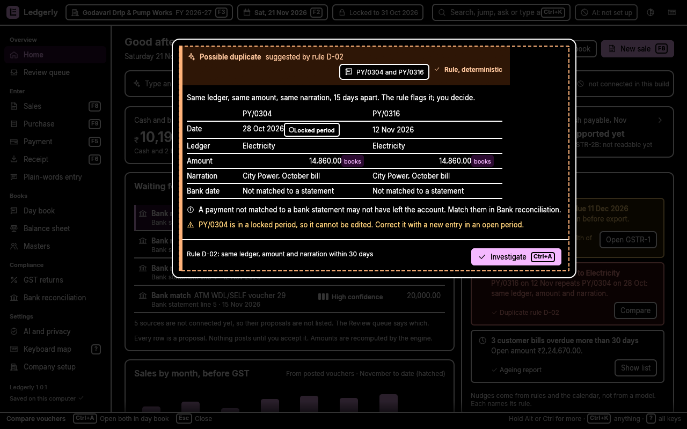</td>
</tr>
</table>

## hc / home.default

SSIM 0.4571

<table>
<tr><th>Mock</th><th>App</th></tr>
<tr>
<td></td>
<td></td>
</tr>
</table>

## dark / home.ai-off

SSIM 0.4849

<table>
<tr><th>Mock</th><th>App</th></tr>
<tr>
<td>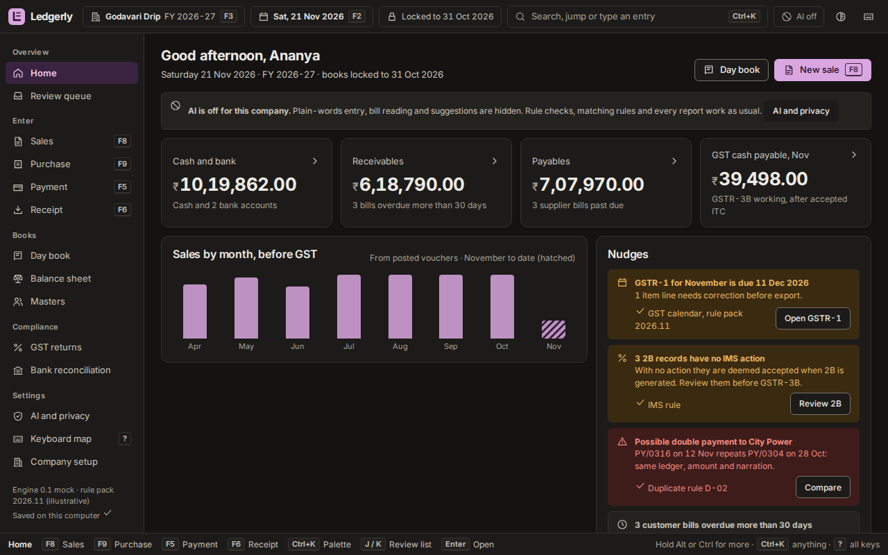</td>
<td>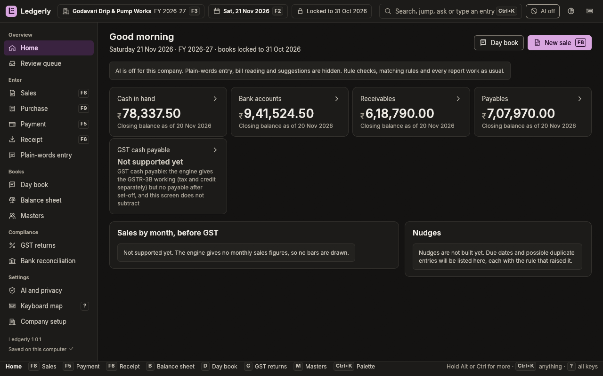</td>
</tr>
</table>

## hc / palette.entry

SSIM 0.4981

<table>
<tr><th>Mock</th><th>App</th></tr>
<tr>
<td></td>
<td>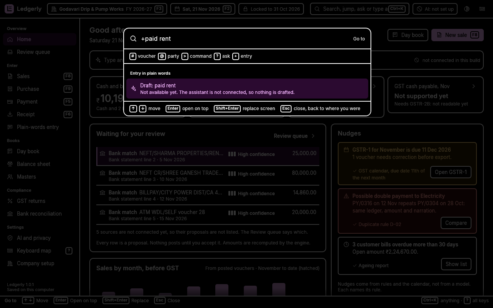</td>
</tr>
</table>

## hc / palette.ask

SSIM 0.5008

<table>
<tr><th>Mock</th><th>App</th></tr>
<tr>
<td></td>
<td></td>
</tr>
</table>

## hc / palette.voucher

SSIM 0.5096

<table>
<tr><th>Mock</th><th>App</th></tr>
<tr>
<td></td>
<td></td>
</tr>
</table>

## hc / palette.no-results

SSIM 0.5227

<table>
<tr><th>Mock</th><th>App</th></tr>
<tr>
<td></td>
<td></td>
</tr>
</table>

## light / home.nudge-open

SSIM 0.5305

<table>
<tr><th>Mock</th><th>App</th></tr>
<tr>
<td></td>
<td>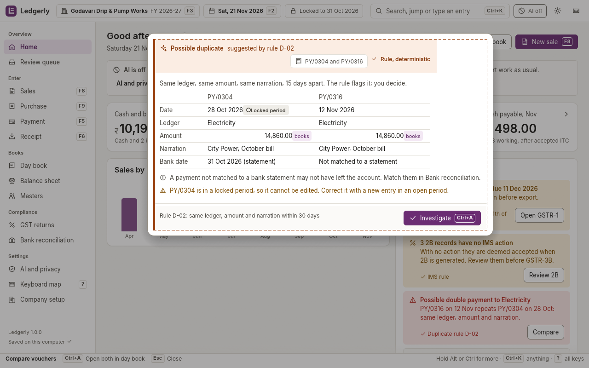</td>
</tr>
</table>

## light / home.default

SSIM 0.5345

<table>
<tr><th>Mock</th><th>App</th></tr>
<tr>
<td></td>
<td></td>
</tr>
</table>

## dark / home.default

SSIM 0.5366

<table>
<tr><th>Mock</th><th>App</th></tr>
<tr>
<td></td>
<td></td>
</tr>
</table>

## dark / home.nudge-open

SSIM 0.5520

<table>
<tr><th>Mock</th><th>App</th></tr>
<tr>
<td></td>
<td></td>
</tr>
</table>

## hc / palette.search

SSIM 0.5608

<table>
<tr><th>Mock</th><th>App</th></tr>
<tr>
<td></td>
<td></td>
</tr>
</table>

## light / home.ai-off

SSIM 0.5646

<table>
<tr><th>Mock</th><th>App</th></tr>
<tr>
<td></td>
<td></td>
</tr>
</table>

## hc / palette.default

SSIM 0.5840

<table>
<tr><th>Mock</th><th>App</th></tr>
<tr>
<td></td>
<td></td>
</tr>
</table>

## light / palette.entry

SSIM 0.5850

<table>
<tr><th>Mock</th><th>App</th></tr>
<tr>
<td>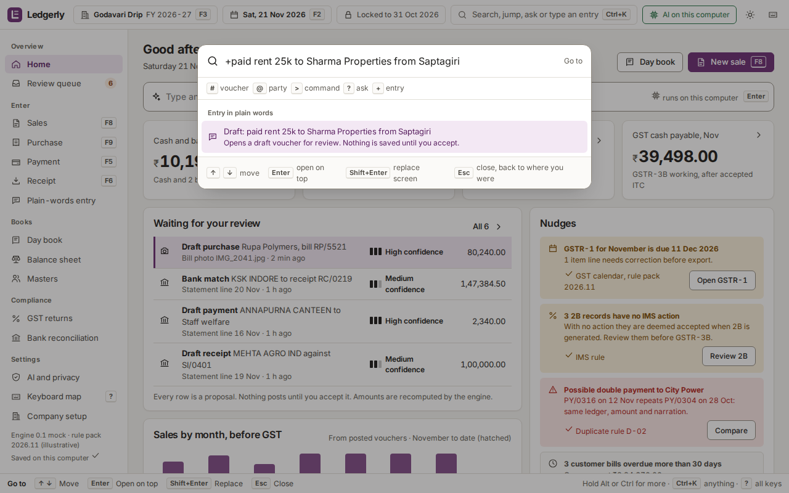</td>
<td></td>
</tr>
</table>

## light / palette.ask

SSIM 0.5881

<table>
<tr><th>Mock</th><th>App</th></tr>
<tr>
<td></td>
<td></td>
</tr>
</table>

## light / palette.no-results

SSIM 0.5917

<table>
<tr><th>Mock</th><th>App</th></tr>
<tr>
<td></td>
<td>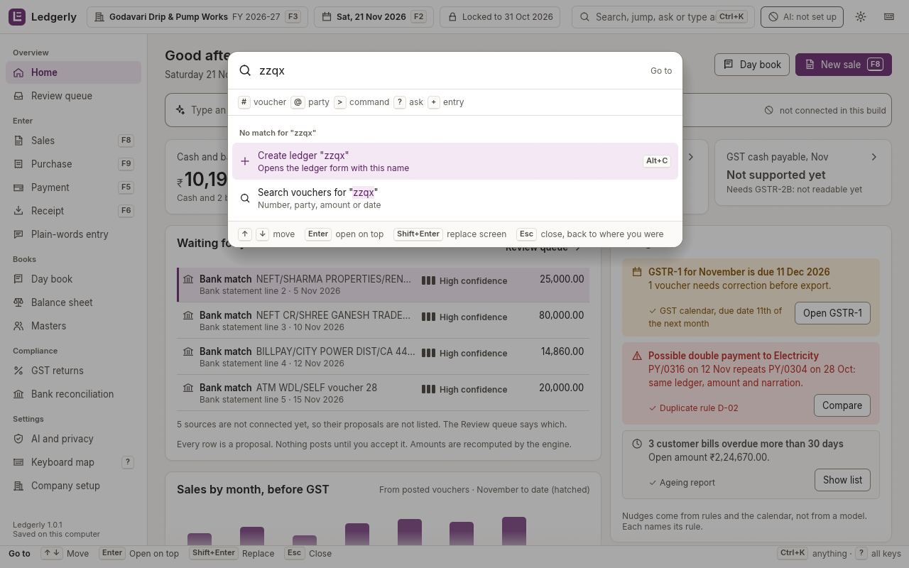</td>
</tr>
</table>

## light / palette.voucher

SSIM 0.5972

<table>
<tr><th>Mock</th><th>App</th></tr>
<tr>
<td></td>
<td></td>
</tr>
</table>

## dark / palette.entry

SSIM 0.6122

<table>
<tr><th>Mock</th><th>App</th></tr>
<tr>
<td></td>
<td></td>
</tr>
</table>

## dark / palette.no-results

SSIM 0.6145

<table>
<tr><th>Mock</th><th>App</th></tr>
<tr>
<td></td>
<td></td>
</tr>
</table>

## dark / palette.ask

SSIM 0.6150

<table>
<tr><th>Mock</th><th>App</th></tr>
<tr>
<td></td>
<td></td>
</tr>
</table>

## hc / palette.commands

SSIM 0.6153

<table>
<tr><th>Mock</th><th>App</th></tr>
<tr>
<td></td>
<td></td>
</tr>
</table>

## light / palette.search

SSIM 0.6191

<table>
<tr><th>Mock</th><th>App</th></tr>
<tr>
<td></td>
<td></td>
</tr>
</table>

## dark / palette.voucher

SSIM 0.6241

<table>
<tr><th>Mock</th><th>App</th></tr>
<tr>
<td></td>
<td></td>
</tr>
</table>

## dark / palette.search

SSIM 0.6407

<table>
<tr><th>Mock</th><th>App</th></tr>
<tr>
<td></td>
<td>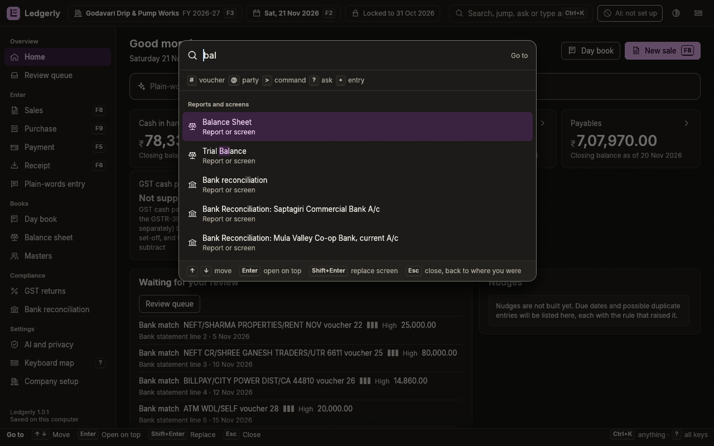</td>
</tr>
</table>

## light / palette.default

SSIM 0.6429

<table>
<tr><th>Mock</th><th>App</th></tr>
<tr>
<td>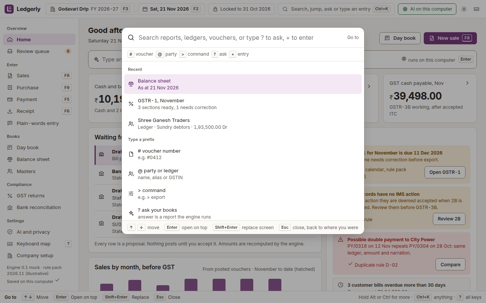</td>
<td></td>
</tr>
</table>

## dark / palette.default

SSIM 0.6614

<table>
<tr><th>Mock</th><th>App</th></tr>
<tr>
<td></td>
<td></td>
</tr>
</table>

## light / palette.commands

SSIM 0.6641

<table>
<tr><th>Mock</th><th>App</th></tr>
<tr>
<td>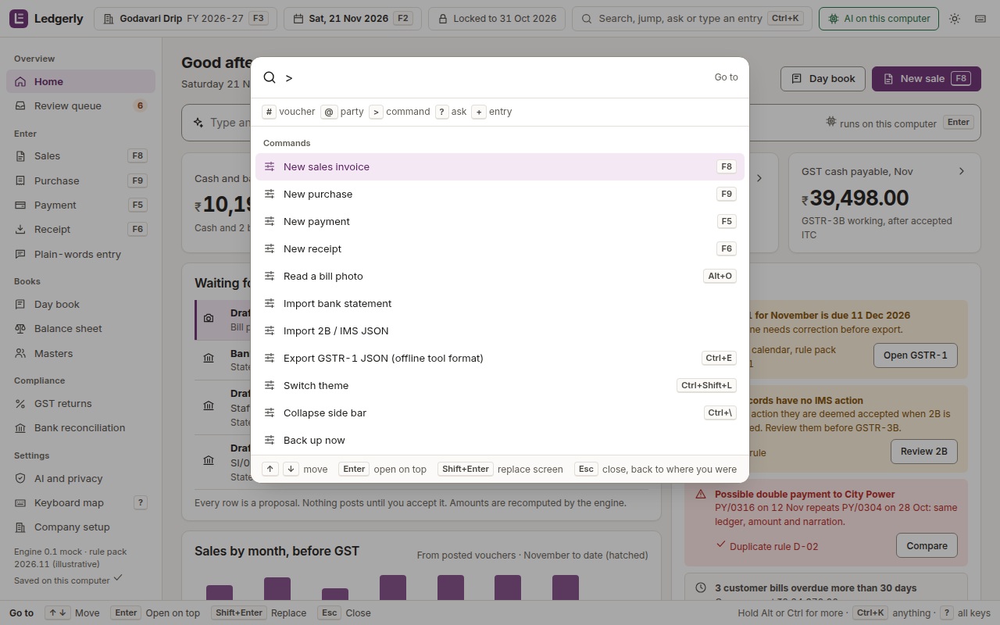</td>
<td></td>
</tr>
</table>

## dark / palette.commands

SSIM 0.6827

<table>
<tr><th>Mock</th><th>App</th></tr>
<tr>
<td></td>
<td></td>
</tr>
</table>

## hc / home.empty

SSIM 0.7564

<table>
<tr><th>Mock</th><th>App</th></tr>
<tr>
<td></td>
<td></td>
</tr>
</table>

## dark / home.empty

SSIM 0.7980

<table>
<tr><th>Mock</th><th>App</th></tr>
<tr>
<td>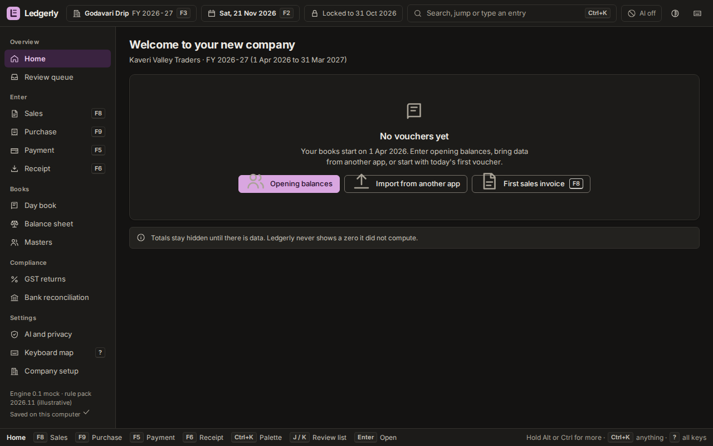</td>
<td></td>
</tr>
</table>

## light / home.empty

SSIM 0.8024

<table>
<tr><th>Mock</th><th>App</th></tr>
<tr>
<td></td>
<td></td>
</tr>
</table>

## Mock states with no app capture yet

### light (78)

- `home.loading`
- `ask.result`
- `ask.loading`
- `ask.low-confidence`
- `ask.unsupported`
- `ask.offline-ai`
- `sales-invoice.default`
- `sales-invoice.gst-inter-state`
- `sales-invoice.b2c`
- `sales-invoice.item-list`
- `sales-invoice.validation-error`
- `sales-invoice.period-locked`
- `sales-invoice.save-confirm`
- `sales-invoice.saved`
- `purchase-bill.reading`
- `purchase-bill.proposal`
- `purchase-bill.low-confidence`
- `purchase-bill.mismatch`
- `purchase-bill.duplicate`
- `purchase-bill.offline-ai`
- `purchase-bill.cloud-consent`
- `purchase-bill.error`
- `purchase-bill.accepted`
- `quick-entry.proposal`
- `quick-entry.hinglish`
- `quick-entry.unknown-ledger`
- `quick-entry.loading`
- `quick-entry.rejected`
- `payment.default`
- `payment.bill-wise`
- `payment.overdraft`
- `receipt.default`
- `balance-sheet.default`
- `balance-sheet.detailed`
- `balance-sheet.group`
- `balance-sheet.ledger`
- `balance-sheet.voucher`
- `balance-sheet.loading`
- `balance-sheet.provisional`
- `day-book.default`
- `day-book.month`
- `day-book.empty`
- `gst.gstr1`
- `gst.gstr1-correction`
- `gst.gstr3b`
- `gst.recon`
- `gst.recon-explain`
- `gst.recon-empty`
- `gst.recon-error`
- `gst.recon-locked`
- `bank.default`
- `bank.ai-suggestions`
- `bank.suggested-ledger`
- `bank.empty`
- `bank.import-error`
- `bank.offline-ai`
- `bank.brs`
- `masters.ledgers`
- `masters.ledger-detail`
- `masters.items`
- `masters.create-ledger`
- `masters.gstin-error`
- `masters.suggested-ledger`
- `review.default`
- `review.empty`
- `keys.classic`
- `keys.standard`
- `setup.welcome`
- `setup.company`
- `setup.gstin-error`
- `setup.features`
- `setup.keyboard`
- `setup.ai`
- `setup.backup`
- `setup.done`
- `ai-settings.local`
- `ai-settings.cloud`
- `ai-settings.off`

### dark (78)

- `home.loading`
- `ask.result`
- `ask.loading`
- `ask.low-confidence`
- `ask.unsupported`
- `ask.offline-ai`
- `sales-invoice.default`
- `sales-invoice.gst-inter-state`
- `sales-invoice.b2c`
- `sales-invoice.item-list`
- `sales-invoice.validation-error`
- `sales-invoice.period-locked`
- `sales-invoice.save-confirm`
- `sales-invoice.saved`
- `purchase-bill.reading`
- `purchase-bill.proposal`
- `purchase-bill.low-confidence`
- `purchase-bill.mismatch`
- `purchase-bill.duplicate`
- `purchase-bill.offline-ai`
- `purchase-bill.cloud-consent`
- `purchase-bill.error`
- `purchase-bill.accepted`
- `quick-entry.proposal`
- `quick-entry.hinglish`
- `quick-entry.unknown-ledger`
- `quick-entry.loading`
- `quick-entry.rejected`
- `payment.default`
- `payment.bill-wise`
- `payment.overdraft`
- `receipt.default`
- `balance-sheet.default`
- `balance-sheet.detailed`
- `balance-sheet.group`
- `balance-sheet.ledger`
- `balance-sheet.voucher`
- `balance-sheet.loading`
- `balance-sheet.provisional`
- `day-book.default`
- `day-book.month`
- `day-book.empty`
- `gst.gstr1`
- `gst.gstr1-correction`
- `gst.gstr3b`
- `gst.recon`
- `gst.recon-explain`
- `gst.recon-empty`
- `gst.recon-error`
- `gst.recon-locked`
- `bank.default`
- `bank.ai-suggestions`
- `bank.suggested-ledger`
- `bank.empty`
- `bank.import-error`
- `bank.offline-ai`
- `bank.brs`
- `masters.ledgers`
- `masters.ledger-detail`
- `masters.items`
- `masters.create-ledger`
- `masters.gstin-error`
- `masters.suggested-ledger`
- `review.default`
- `review.empty`
- `keys.classic`
- `keys.standard`
- `setup.welcome`
- `setup.company`
- `setup.gstin-error`
- `setup.features`
- `setup.keyboard`
- `setup.ai`
- `setup.backup`
- `setup.done`
- `ai-settings.local`
- `ai-settings.cloud`
- `ai-settings.off`

### hc (78)

- `home.loading`
- `ask.result`
- `ask.loading`
- `ask.low-confidence`
- `ask.unsupported`
- `ask.offline-ai`
- `sales-invoice.default`
- `sales-invoice.gst-inter-state`
- `sales-invoice.b2c`
- `sales-invoice.item-list`
- `sales-invoice.validation-error`
- `sales-invoice.period-locked`
- `sales-invoice.save-confirm`
- `sales-invoice.saved`
- `purchase-bill.reading`
- `purchase-bill.proposal`
- `purchase-bill.low-confidence`
- `purchase-bill.mismatch`
- `purchase-bill.duplicate`
- `purchase-bill.offline-ai`
- `purchase-bill.cloud-consent`
- `purchase-bill.error`
- `purchase-bill.accepted`
- `quick-entry.proposal`
- `quick-entry.hinglish`
- `quick-entry.unknown-ledger`
- `quick-entry.loading`
- `quick-entry.rejected`
- `payment.default`
- `payment.bill-wise`
- `payment.overdraft`
- `receipt.default`
- `balance-sheet.default`
- `balance-sheet.detailed`
- `balance-sheet.group`
- `balance-sheet.ledger`
- `balance-sheet.voucher`
- `balance-sheet.loading`
- `balance-sheet.provisional`
- `day-book.default`
- `day-book.month`
- `day-book.empty`
- `gst.gstr1`
- `gst.gstr1-correction`
- `gst.gstr3b`
- `gst.recon`
- `gst.recon-explain`
- `gst.recon-empty`
- `gst.recon-error`
- `gst.recon-locked`
- `bank.default`
- `bank.ai-suggestions`
- `bank.suggested-ledger`
- `bank.empty`
- `bank.import-error`
- `bank.offline-ai`
- `bank.brs`
- `masters.ledgers`
- `masters.ledger-detail`
- `masters.items`
- `masters.create-ledger`
- `masters.gstin-error`
- `masters.suggested-ledger`
- `review.default`
- `review.empty`
- `keys.classic`
- `keys.standard`
- `setup.welcome`
- `setup.company`
- `setup.gstin-error`
- `setup.features`
- `setup.keyboard`
- `setup.ai`
- `setup.backup`
- `setup.done`
- `ai-settings.local`
- `ai-settings.cloud`
- `ai-settings.off`

