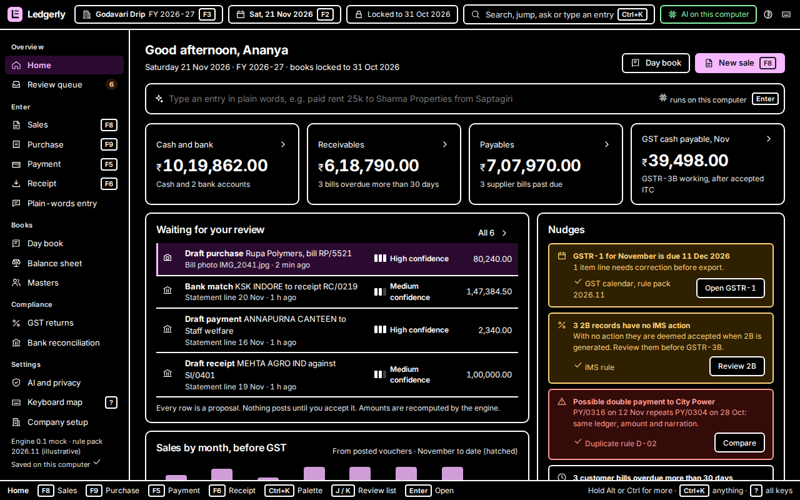
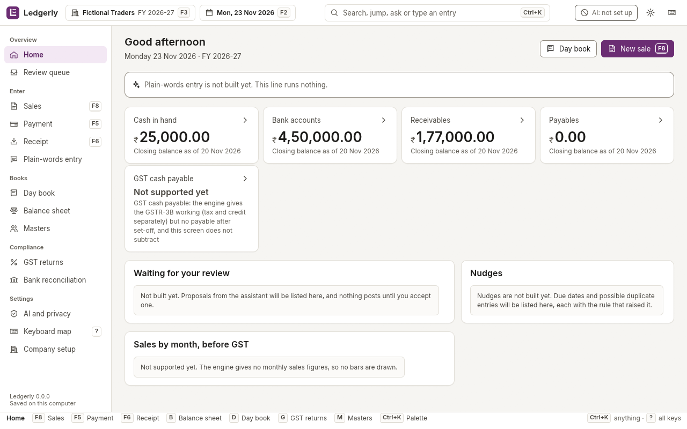
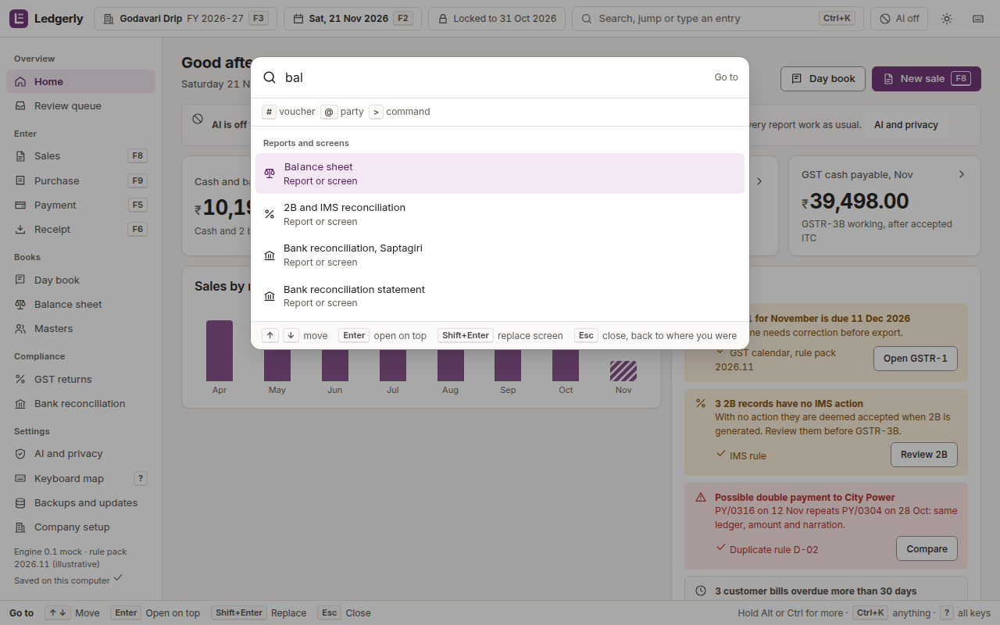
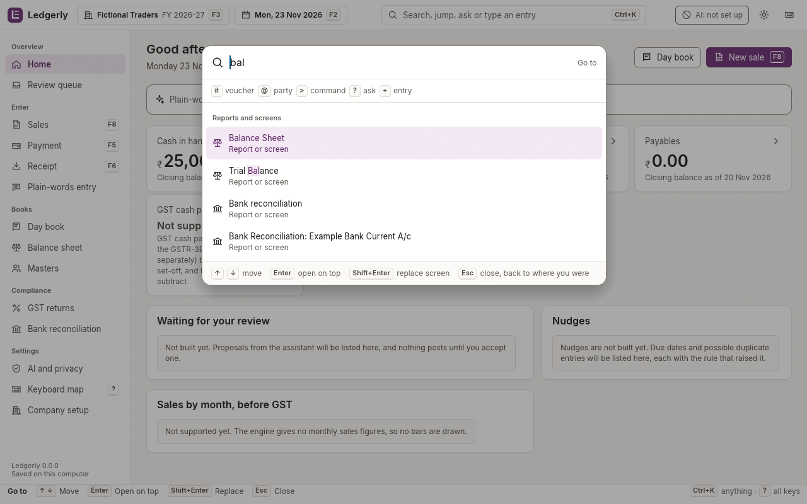
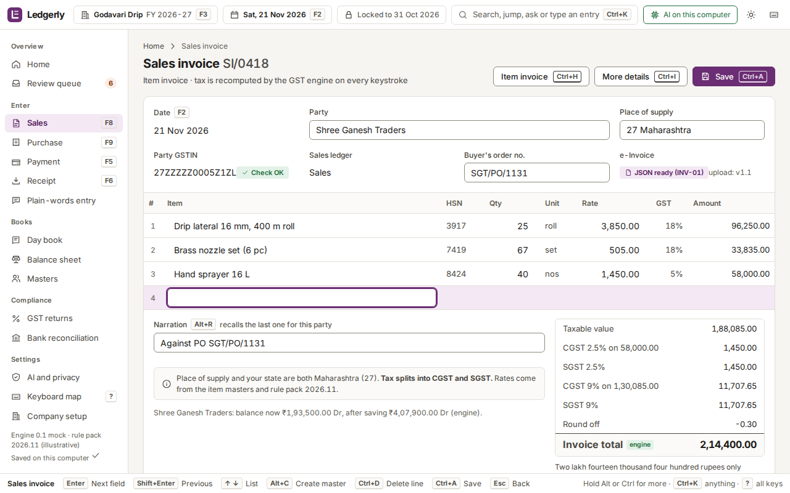
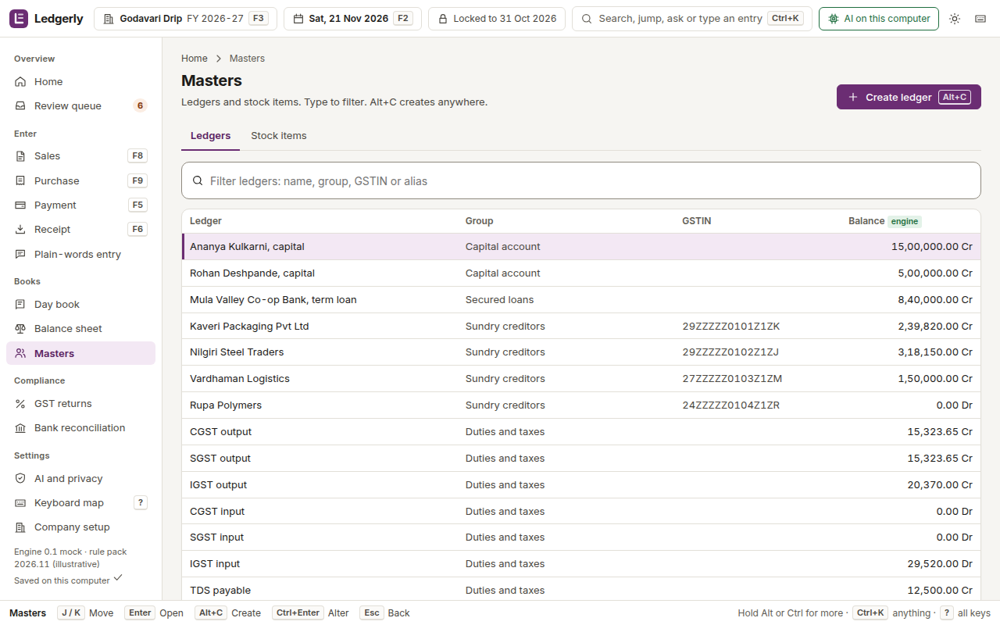
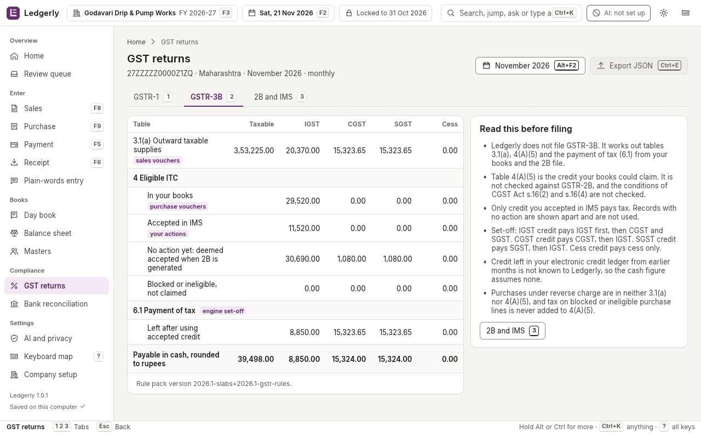

# App against mock

14 app captures are paired with a mock capture of the same theme and state id. SSIM is 1 for identical images; lower is a bigger difference, and the list runs worst first.

| Theme | State | SSIM |
| --- | --- | --- |
| hc | home.default | 0.4109 |
| dark | home.default | 0.5362 |
| light | home.default | 0.5648 |
| light | palette.search | 0.5675 |
| light | palette.default | 0.5923 |
| light | sales-invoice.default | 0.5947 |
| light | masters.ledgers | 0.6461 |
| light | gst.gstr3b | 0.6715 |
| light | bank.default | 0.6857 |
| light | balance-sheet.default | 0.6944 |
| light | gst.gstr1 | 0.7163 |
| light | receipt.default | 0.7175 |
| light | day-book.default | 0.7329 |
| light | payment.default | 0.7346 |

## hc / home.default

SSIM 0.4109

<table>
<tr><th>Mock</th><th>App</th></tr>
<tr>
<td></td>
<td></td>
</tr>
</table>

## dark / home.default

SSIM 0.5362

<table>
<tr><th>Mock</th><th>App</th></tr>
<tr>
<td></td>
<td></td>
</tr>
</table>

## light / home.default

SSIM 0.5648

<table>
<tr><th>Mock</th><th>App</th></tr>
<tr>
<td></td>
<td></td>
</tr>
</table>

## light / palette.search

SSIM 0.5675

<table>
<tr><th>Mock</th><th>App</th></tr>
<tr>
<td></td>
<td></td>
</tr>
</table>

## light / palette.default

SSIM 0.5923

<table>
<tr><th>Mock</th><th>App</th></tr>
<tr>
<td></td>
<td></td>
</tr>
</table>

## light / sales-invoice.default

SSIM 0.5947

<table>
<tr><th>Mock</th><th>App</th></tr>
<tr>
<td></td>
<td></td>
</tr>
</table>

## light / masters.ledgers

SSIM 0.6461

<table>
<tr><th>Mock</th><th>App</th></tr>
<tr>
<td></td>
<td></td>
</tr>
</table>

## light / gst.gstr3b

SSIM 0.6715

<table>
<tr><th>Mock</th><th>App</th></tr>
<tr>
<td></td>
<td></td>
</tr>
</table>

## light / bank.default

SSIM 0.6857

<table>
<tr><th>Mock</th><th>App</th></tr>
<tr>
<td></td>
<td></td>
</tr>
</table>

## light / balance-sheet.default

SSIM 0.6944

<table>
<tr><th>Mock</th><th>App</th></tr>
<tr>
<td></td>
<td></td>
</tr>
</table>

## light / gst.gstr1

SSIM 0.7163

<table>
<tr><th>Mock</th><th>App</th></tr>
<tr>
<td></td>
<td></td>
</tr>
</table>

## light / receipt.default

SSIM 0.7175

<table>
<tr><th>Mock</th><th>App</th></tr>
<tr>
<td></td>
<td></td>
</tr>
</table>

## light / day-book.default

SSIM 0.7329

<table>
<tr><th>Mock</th><th>App</th></tr>
<tr>
<td></td>
<td></td>
</tr>
</table>

## light / payment.default

SSIM 0.7346

<table>
<tr><th>Mock</th><th>App</th></tr>
<tr>
<td></td>
<td></td>
</tr>
</table>

## Mock states with no app capture yet

### light (77)

- `home.loading`
- `home.empty`
- `home.ai-off`
- `home.nudge-open`
- `palette.voucher`
- `palette.ask`
- `palette.entry`
- `palette.commands`
- `palette.no-results`
- `ask.result`
- `ask.loading`
- `ask.low-confidence`
- `ask.unsupported`
- `ask.offline-ai`
- `sales-invoice.gst-inter-state`
- `sales-invoice.b2c`
- `sales-invoice.item-list`
- `sales-invoice.validation-error`
- `sales-invoice.period-locked`
- `sales-invoice.save-confirm`
- `sales-invoice.saved`
- `purchase-bill.reading`
- `purchase-bill.proposal`
- `purchase-bill.low-confidence`
- `purchase-bill.mismatch`
- `purchase-bill.duplicate`
- `purchase-bill.offline-ai`
- `purchase-bill.cloud-consent`
- `purchase-bill.error`
- `purchase-bill.accepted`
- `quick-entry.proposal`
- `quick-entry.hinglish`
- `quick-entry.unknown-ledger`
- `quick-entry.loading`
- `quick-entry.rejected`
- `payment.bill-wise`
- `payment.overdraft`
- `balance-sheet.detailed`
- `balance-sheet.group`
- `balance-sheet.ledger`
- `balance-sheet.voucher`
- `balance-sheet.loading`
- `balance-sheet.provisional`
- `day-book.month`
- `day-book.empty`
- `gst.gstr1-correction`
- `gst.recon`
- `gst.recon-explain`
- `gst.recon-empty`
- `gst.recon-error`
- `gst.recon-locked`
- `bank.ai-suggestions`
- `bank.suggested-ledger`
- `bank.empty`
- `bank.import-error`
- `bank.offline-ai`
- `bank.brs`
- `masters.ledger-detail`
- `masters.items`
- `masters.create-ledger`
- `masters.gstin-error`
- `masters.suggested-ledger`
- `review.default`
- `review.empty`
- `keys.classic`
- `keys.standard`
- `setup.welcome`
- `setup.company`
- `setup.gstin-error`
- `setup.features`
- `setup.keyboard`
- `setup.ai`
- `setup.backup`
- `setup.done`
- `ai-settings.local`
- `ai-settings.cloud`
- `ai-settings.off`

### dark (88)

- `home.loading`
- `home.empty`
- `home.ai-off`
- `home.nudge-open`
- `palette.default`
- `palette.search`
- `palette.voucher`
- `palette.ask`
- `palette.entry`
- `palette.commands`
- `palette.no-results`
- `ask.result`
- `ask.loading`
- `ask.low-confidence`
- `ask.unsupported`
- `ask.offline-ai`
- `sales-invoice.default`
- `sales-invoice.gst-inter-state`
- `sales-invoice.b2c`
- `sales-invoice.item-list`
- `sales-invoice.validation-error`
- `sales-invoice.period-locked`
- `sales-invoice.save-confirm`
- `sales-invoice.saved`
- `purchase-bill.reading`
- `purchase-bill.proposal`
- `purchase-bill.low-confidence`
- `purchase-bill.mismatch`
- `purchase-bill.duplicate`
- `purchase-bill.offline-ai`
- `purchase-bill.cloud-consent`
- `purchase-bill.error`
- `purchase-bill.accepted`
- `quick-entry.proposal`
- `quick-entry.hinglish`
- `quick-entry.unknown-ledger`
- `quick-entry.loading`
- `quick-entry.rejected`
- `payment.default`
- `payment.bill-wise`
- `payment.overdraft`
- `receipt.default`
- `balance-sheet.default`
- `balance-sheet.detailed`
- `balance-sheet.group`
- `balance-sheet.ledger`
- `balance-sheet.voucher`
- `balance-sheet.loading`
- `balance-sheet.provisional`
- `day-book.default`
- `day-book.month`
- `day-book.empty`
- `gst.gstr1`
- `gst.gstr1-correction`
- `gst.gstr3b`
- `gst.recon`
- `gst.recon-explain`
- `gst.recon-empty`
- `gst.recon-error`
- `gst.recon-locked`
- `bank.default`
- `bank.ai-suggestions`
- `bank.suggested-ledger`
- `bank.empty`
- `bank.import-error`
- `bank.offline-ai`
- `bank.brs`
- `masters.ledgers`
- `masters.ledger-detail`
- `masters.items`
- `masters.create-ledger`
- `masters.gstin-error`
- `masters.suggested-ledger`
- `review.default`
- `review.empty`
- `keys.classic`
- `keys.standard`
- `setup.welcome`
- `setup.company`
- `setup.gstin-error`
- `setup.features`
- `setup.keyboard`
- `setup.ai`
- `setup.backup`
- `setup.done`
- `ai-settings.local`
- `ai-settings.cloud`
- `ai-settings.off`

### hc (88)

- `home.loading`
- `home.empty`
- `home.ai-off`
- `home.nudge-open`
- `palette.default`
- `palette.search`
- `palette.voucher`
- `palette.ask`
- `palette.entry`
- `palette.commands`
- `palette.no-results`
- `ask.result`
- `ask.loading`
- `ask.low-confidence`
- `ask.unsupported`
- `ask.offline-ai`
- `sales-invoice.default`
- `sales-invoice.gst-inter-state`
- `sales-invoice.b2c`
- `sales-invoice.item-list`
- `sales-invoice.validation-error`
- `sales-invoice.period-locked`
- `sales-invoice.save-confirm`
- `sales-invoice.saved`
- `purchase-bill.reading`
- `purchase-bill.proposal`
- `purchase-bill.low-confidence`
- `purchase-bill.mismatch`
- `purchase-bill.duplicate`
- `purchase-bill.offline-ai`
- `purchase-bill.cloud-consent`
- `purchase-bill.error`
- `purchase-bill.accepted`
- `quick-entry.proposal`
- `quick-entry.hinglish`
- `quick-entry.unknown-ledger`
- `quick-entry.loading`
- `quick-entry.rejected`
- `payment.default`
- `payment.bill-wise`
- `payment.overdraft`
- `receipt.default`
- `balance-sheet.default`
- `balance-sheet.detailed`
- `balance-sheet.group`
- `balance-sheet.ledger`
- `balance-sheet.voucher`
- `balance-sheet.loading`
- `balance-sheet.provisional`
- `day-book.default`
- `day-book.month`
- `day-book.empty`
- `gst.gstr1`
- `gst.gstr1-correction`
- `gst.gstr3b`
- `gst.recon`
- `gst.recon-explain`
- `gst.recon-empty`
- `gst.recon-error`
- `gst.recon-locked`
- `bank.default`
- `bank.ai-suggestions`
- `bank.suggested-ledger`
- `bank.empty`
- `bank.import-error`
- `bank.offline-ai`
- `bank.brs`
- `masters.ledgers`
- `masters.ledger-detail`
- `masters.items`
- `masters.create-ledger`
- `masters.gstin-error`
- `masters.suggested-ledger`
- `review.default`
- `review.empty`
- `keys.classic`
- `keys.standard`
- `setup.welcome`
- `setup.company`
- `setup.gstin-error`
- `setup.features`
- `setup.keyboard`
- `setup.ai`
- `setup.backup`
- `setup.done`
- `ai-settings.local`
- `ai-settings.cloud`
- `ai-settings.off`

